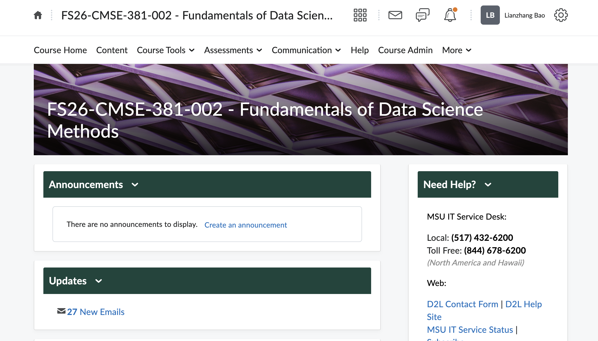
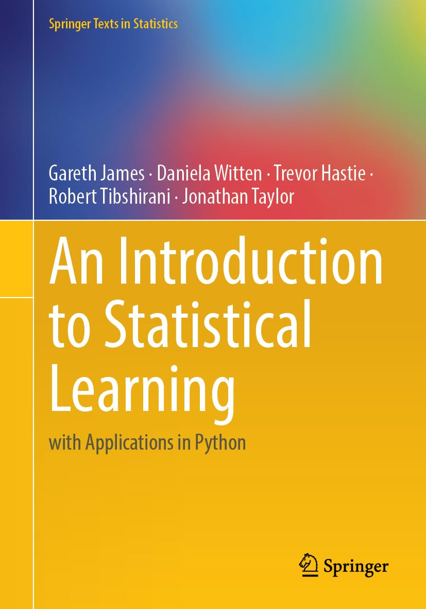
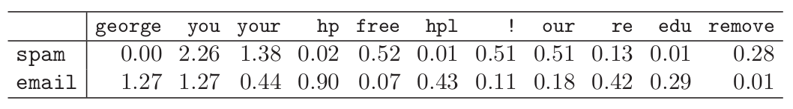
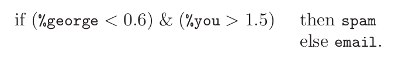
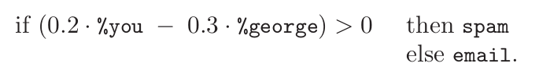

## People in this lecture

:::::: {.columns}

::::: {.column width="45%"}

{fig-alt="Photo of Lianzhang Bao" width="40%"}

**Dr. Bao** (he/him)

Assistant Professor, CMSE, MSU

:::::

::::: {.column width="45%"}

{fig-alt="Photo of Christy Lu" width="55%"}

**Christy Lu** (she/her)

Graduate Student, CMSE, MSU

:::::

::::::

## What is this course about?

Topics:

- Fundamental concepts of data science
- Regression
- Classification
- Dimension reduction
- Resampling methods
- Tree-based methods
- Machine learning and statistical learning, etc.

## D2L and where to find grades

<https://d2l.msu.edu/d2l/home/2387930>

{fig-alt="Screenshot of the course page on D2L" width="70%"}

## Office hours

:::::: {.columns}

::::: {.column width="45%"}

*Dr. Bao*

- Tue 9:00 am - 10:00 am, Wed 10:00 am - 11:00 am (starting 9/08)
- In person, EB 2507L

:::::

::::: {.column width="45%"}

*Christy Lu*

- Time: TBD

:::::

::::::

## Textbook

:::::: {.columns}

::::: {.column width="55%"}

**Free download:** [statlearning.com](https://www.statlearning.com/)

:::::

::::: {.column width="35%"}

{fig-alt="Screenshot of the course textbook" width="100%"}

:::::

::::::

## Class Structure

- Class is a combination of lecture time and group work/coding time.
  - Bring your computer every day
  - Jupyter notebooks
  - Python
- Once a week, there will be a short check-in quiz. This will be basic content related to lectures since the last class. Possible questions include checking on definitions, or basic understanding of major ideas.
  - 10 points per quiz
  - Drop the two lowest grades

## Class Structure Pt 2

- Six homeworks
  - 20 points per homework
  - Drop the lowest grade
  - Sliding scale for late work:
    - 24 hours late: 5% penalty
    - 48 hours late: 15% penalty
    - More than 48 hours late: no late work accepted
- Three midterms
  - See the schedule for dates
  - 100 points each
  - Not cumulative
- One project
  - Analyze a dataset using tools from class, submit a written report
  - 100 points
  - Due at the end of the semester

## Basic Expectations

- Attend each class for the full 70 minute duration
- Take detailed notes on, or beside, the skeleton slides provided
- Complete the Jupyter notebook in class
- Read the assigned textbook chapters listed in the course schedule (on the course website)
- Actively participate in group work and interactive Q&A sessions
- Complete all homework assignments, quizzes, exams, and a semester project

## Grade distribution

| Component | Estimated points |
|---|---|
| Homeworks | (6 homeworks - the lowest grade) × 20 points = 100 |
| Quizzes | (10 quizzes - 2 lowest grades) × 10 points = 80 |
| Midterms | 3 midterms × 100 points = 300 |
| Final project | 100 |
| **Total** | **580 (subject to change!)** |

# Intro to class

## What is Statistical Learning?

:::::: {.columns}

::::: {.column width="45%"}

**Statistical Learning**

- Subfield of statistics
- Emphasizes models and their interpretability, precision, and uncertainty

:::::

::::: {.column width="45%"}

**Machine Learning**

- Machine learning has a greater emphasis on large scale applications and prediction accuracy.

:::::

::::::

## Why should you care?

Data is everywhere, getting more complicated and useful. Learning how to analyze data is critical.

- Web data, e-commerce (Amazon, JD, Alibaba)
- Car sales (Tesla, Ford, and GM)
- Sports teams (MSU, Lions, etc.)
- Politics and government
- Images, videos, text
- Even fancier data in biomedicine

## Learning Tools as Black Boxes? Or Math Apocalypse?

- Need to understand the machinery enough to
  - know what tool to use
  - know how to interpret the output of the tool
- Don't need to rebuild the entire box from scratch

## Example: Email spam

{fig-alt="Table of the distribution of words and characters in samples of spam versus non-spam emails" width="100%"}

:::::: {.columns}

::::: {.column width="45%"}

{fig-alt="Example if statement to determine whether an email is spam or not (first rule)" width="100%"}

:::::

::::: {.column width="45%"}

{fig-alt="Example if statement to determine whether an email is spam or not (second rule)" width="100%"}

:::::

::::::

## Supervised learning

- Outcome measurement $Y$ (also called dependent variable, response, target, label).
- Vector of $p$ predictor measurements $X$ (also called inputs, regressors, covariates, features, independent variables).
- In the **regression** problem, $Y$ is quantitative (e.g., price, blood pressure).
- In the **classification** problem, $Y$ takes values in a set of distinct categories (survived/died, cancer class of tissue sample, types of language).

## Unsupervised learning

- No outcome variable, just a set of predictors (features) measured on a set of samples.
- Objective is fuzzier: often explore the intrinsic relation between samples (e.g., clustering) or features (e.g., dimensionality reduction).
- Difficult to know how well you are doing.
- Different from supervised learning but can be useful as a pre-processing step for supervised learning.

## Generative AI discussion {background-color="#FDDDA0"}

:::::: {.columns}

::::: {.column width="48%"}

Definition via [Wikipedia](https://en.wikipedia.org/wiki/Generative_artificial_intelligence):

> Generative artificial intelligence (AI) is artificial intelligence capable of generating text, images, or other media, using generative models. Generative AI models learn the patterns and structure of their input training data and then generate new data that has similar characteristics.

Examples:

- ChatGPT
- Claude
- Grok
- Deepseek

:::::

::::: {.column width="48%"}

- Get in a group of about 4.
- Open this Google doc: [tinyurl.com/CMSE381-F26-genAI](https://tinyurl.com/CMSE381-F26-genAI)
- In your group, brainstorm cases where someone might use generative AI in the context of our class.
- Once you have added a few, start adding arguments for or against whether we should allow the use of that context in class.

:::::

::::::

# Python Review Lab: Pt 1

## Plan for the lab {background-color="#FDDDA0"}

- Find a group of 4 or so.
- Go to D2L and download the Jupyter notebook for the Python Review Lab.
- Get started!

## Next time

- Weds: What is statistical learning? (Reading 2.1)
- No class coming Monday (9/7)
- Quiz sometime **this** week
- Office hours:
  - Starting next week
