## Announcements

:::::: {.columns}

::::: {.column width="45%"}

**Last time:**

- Discussed where to find everything
  - D2L
- Check out the syllabus!

:::::

::::: {.column width="45%"}

**Announcements:**

- First homework due Sun Sep 13
- First office hours next week

:::::

::::::

## Covered in this class

:::::: {.columns}

::::: {.column width="45%"}

- Input/output variables
- Prediction vs inference
- Reducible vs irreducible error
- Overfitting
- Classification vs regression
- Supervised vs unsupervised learning

:::::

::::: {.column width="45%"}

- Please note: no Jupyter notebook for today's class, slides only

:::::

::::::

## An example data set: `Advertising`

:::::: {.columns}

::::: {.column width="28%"}

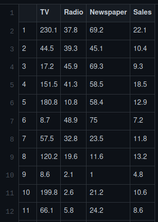{fig-alt="Screenshot of the Advertising data set, a table with columns TV, radio, newspaper, and sales" width="100%"}

:::::

::::: {.column width="62%"}

- Sales of a product in 200 markets, along with amount spent on three different types of advertising
- Goal: Predict Sales based on amount spent in each type of advertising
- Input variables: TV, Radio, Newspaper
- Output variable: Sales

:::::

::::::

Data are available at [CMSE381-DataSets (Advertising.csv)](https://github.com/lianzhangbao/CMSE381-DataSets/blob/main/Advertising.csv).

## Notation and Big Assumption

:::::: {.columns}

::::: {.column width="45%"}

Input variables: $X_1, X_2, \cdots, X_p$

Output variable: $Y$

:::::

::::: {.column width="50%"}

$$
Y = f(X) + \epsilon
$$

- $f$ is the systematic information that $X$ provides about $Y$.
- It is the ground truth that we want but can't access.
- So our goal is to come up with an estimated model $\hat f$.
- $\epsilon$ is a random error term which is independent of $X$ and has mean 0.

:::::

::::::

## `Advertising` Example

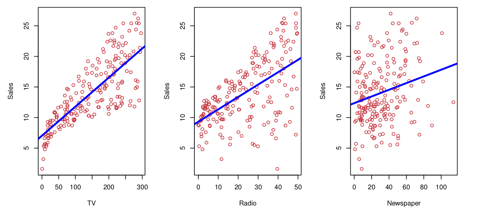{fig-alt="Three scatter plots of Sales versus TV, radio, and newspaper advertising spending, all in units of 1000, each with a fitted line" width="100%"}

## More examples

:::::: {.columns}

::::: {.column width="55%"}

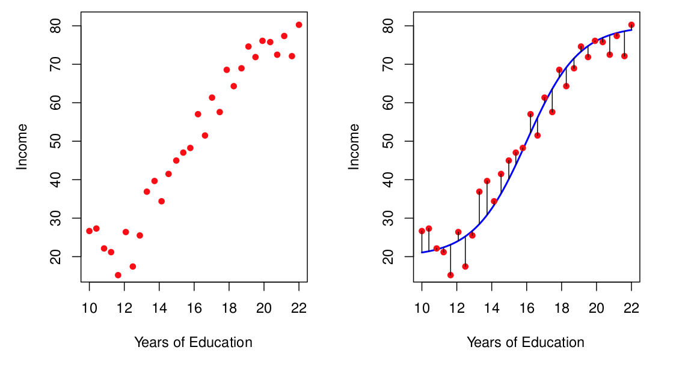{fig-alt="Data points for income in units of 1000 versus years of education, with a nonlinear curve fit to the data" width="100%"}

:::::

::::: {.column width="40%"}

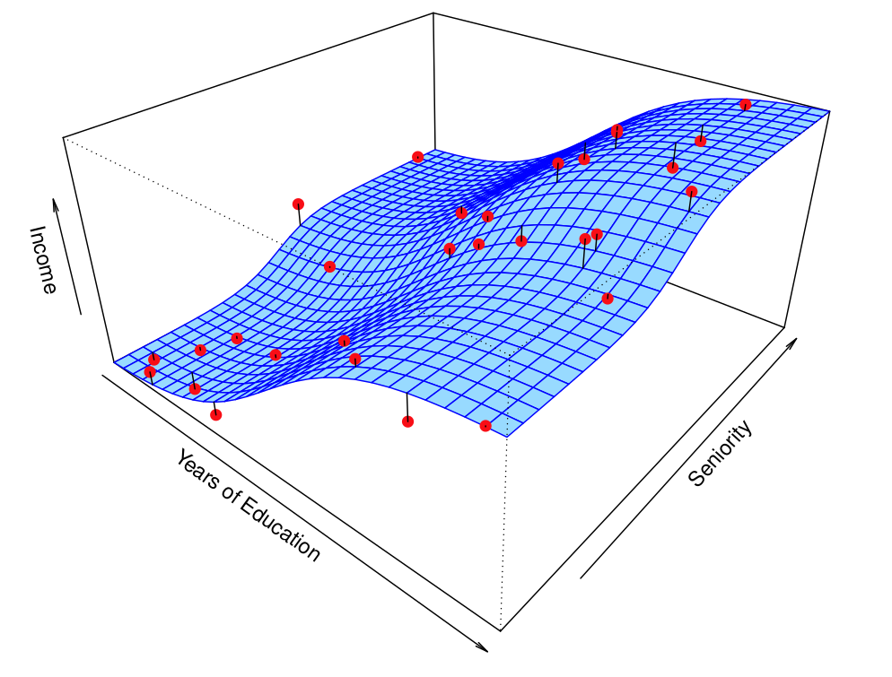{fig-alt="Data points for income in units of 1000 versus years of education and seniority, with a surface fit to the data" width="100%"}

:::::

::::::

# Prediction vs Inference

## Prediction

:::::: {.columns}

::::: {.column width="45%"}

Given a value $X$, try to provide an estimate for $f(X)$.

Build a model:

$$
\hat Y = \hat f(X)
$$

- Want to get a good guess for $f$, which is unknown (the solid blue line)
- The model $\hat f$ is the dashed green line

:::::

::::: {.column width="45%"}

Example: If we spend \$250 on TV advertising, what do we predict we will make in sales?

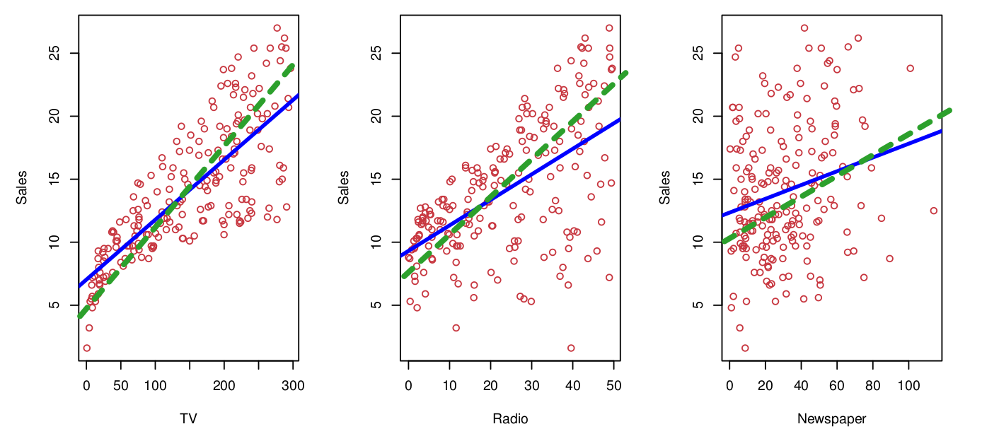{fig-alt="Sales versus TV advertising spending in units of 1000, with the true function f as a solid line and two different linear fits as dashed lines" width="100%"}

:::::

::::::

## Group question {background-color="#FDDDA0"}

:::::: {.columns}

::::: {.column width="30%"}

{fig-alt="Screenshot of the first rows of the Advertising data set" width="100%"}

{fig-alt="Sales versus TV advertising spending in units of 1000, with the true function f as a solid line and two different linear fits as dashed lines" width="100%"}

:::::

::::: {.column width="60%"}

The solid blue line is $f$. The dashed green line is $\hat f$.

- What is the predicted sales for the first three data points using the dashed green line $\hat f$ shown in the graph?
  - Note: all values approximate
  - $\hat f(230.1) = 19$
  - $\hat f(44.5) = 7$
  - $\hat f(17.2) = 5$
- Using the dashed green line as the predicted model $\hat f$, what is the error in each of the three predictions?

:::::

::::::

## Reducible vs irreducible error

*All models are wrong, some are useful.*

$$
Y - \hat Y
$$

:::::: {.columns}

::::: {.column width="45%"}

**Reducible error**

- $\hat f$ will not be a perfect estimate for $f$.
- We can potentially improve the accuracy of $\hat f$ by using the most appropriate statistical learning technique.

:::::

::::: {.column width="45%"}

**Irreducible error**

- The model was $Y = f(X) + \epsilon$.
- The variability of $\epsilon$ also affects predictions.
- No matter how well we estimate $f$, we can't get rid of this error.
- We would expect this in real life, though.

:::::

::::::

## More on error

- Given estimate $\hat f$ (fixed)
- Set of predictors $X$ (fixed)
- Prediction $\hat Y = \hat f(X)$

$$
E(Y-\hat Y)^2 = E[f(X) + \epsilon - \hat f(X)]^2 = [f(X) - \hat f(X)]^2 + \mathrm{Var}(\epsilon)
$$

$[f(X) - \hat f(X)]^2$ is reducible, $\mathrm{Var}(\epsilon)$ is irreducible.

## Inference

:::::: {.columns}

::::: {.column width="40%"}

Want $f$, but not for prediction

(or possibly combined with prediction)

:::::

::::: {.column width="55%"}

- Which predictors are associated with the response?
- What is the relationship between the response and each predictor?
- Can the relationship between $Y$ and each predictor be adequately summarized using a linear equation? Is it more complicated?

:::::

::::::

## Prediction or inference? {background-color="#FDDDA0"}

Determine whether each scenario is prediction, inference, or both.

| Application | Prediction | Inference |
|---|---|---|
| Predict whether an email is spam or not. | | |
| Determine which neighborhood features drive up house prices. | | |
| Recognize handwritten digits from a scanned image. | | |
| Understand how study habits affect exam performance. | | |
| Predict a patient's risk of heart disease based on symptoms. | | |

# How to estimate $f$?

## Input: Training data

:::::: {.columns}

::::: {.column width="55%"}

- $n$ data points observed
- $x_{ij}$ is the $j$th predictor for observation $i$
- $y_i$ is the response variable for the $i$th observation
- Training data:
  - $\{(x_1,y_1), (x_2,y_2), \cdots, (x_n,y_n)\}$
  - $x_i = (x_{i1}, x_{i2}, \cdots, x_{ip})^T$

:::::

::::: {.column width="35%"}

{fig-alt="Screenshot of the Advertising data set, a table with columns TV, radio, newspaper, and sales" width="100%"}

:::::

::::::

## Parametric methods

:::::: {.columns}

::::: {.column width="50%"}

**Step 1:** Select a model

Example:
$$
f(X) = \beta_0 + \beta_1X_1 + \beta_2 X_2 + \cdots + \beta_pX_p
$$

**Step 2:** Train the model

Example: find the $\beta_i$'s so that
$$
Y \approx \beta_0 + \beta_1X_1 + \beta_2 X_2 + \cdots + \beta_pX_p
$$

:::::

::::: {.column width="45%"}

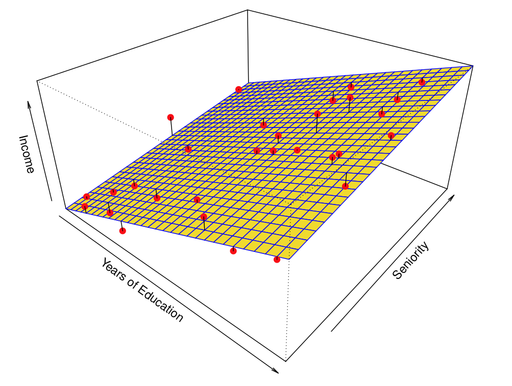{fig-alt="Data points for income in units of 1000 versus years of education and seniority, with a planar surface fit to the data" width="100%"}

:::::

::::::

## How do you decide on the coefficients?

:::::: {.columns}

::::: {.column width="45%"}

$$
Y \approx \beta_0 + \beta_1X_1
$$

:::::

::::: {.column width="50%"}

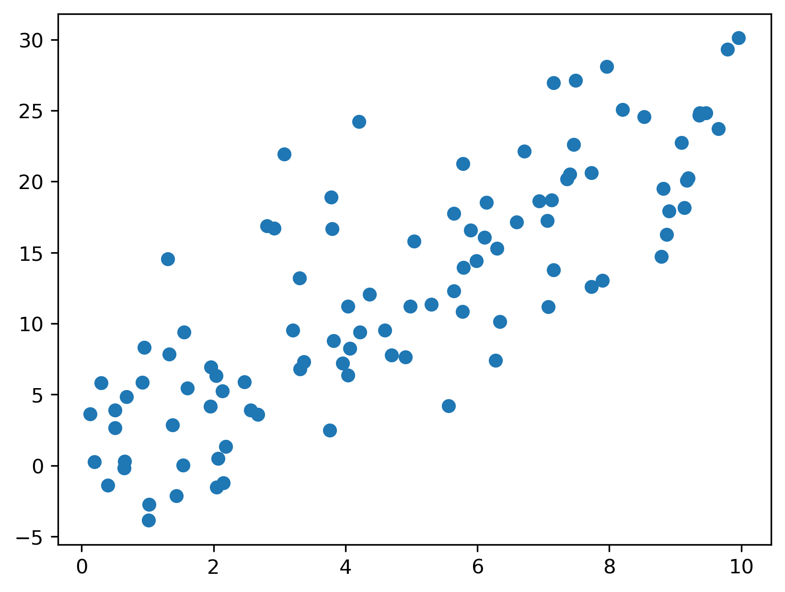{fig-alt="A two-dimensional scatter plot of data points" width="100%"}

:::::

::::::

Interactive example: [Desmos toy for choosing a line](https://www.desmos.com/calculator/skvt8c73l7)

## Example non-parametric method: Nearest Neighbors

:::::: {.columns}

::::: {.column width="45%"}

$$
N_k(x) = \text{set of } k \text{ nearest neighbors of } x
$$

$$
\hat f(x) = \frac{1}{k} \sum_{x_i \in N_k(x)} y_i
$$

:::::

::::: {.column width="45%"}

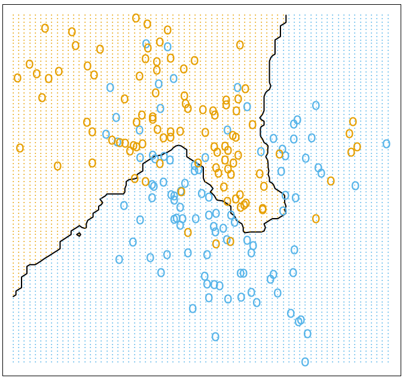{fig-alt="Data with two classes separated by a non-linear boundary obtained using nearest neighbors with k equal to 15" width="100%"}

$k = 15$

:::::

::::::

## Parametric methods: Pros and Cons

:::::: {.columns}

::::: {.column width="45%"}

**Pros**

- Easier to estimate parameters than to figure out a completely arbitrary function

:::::

::::: {.column width="45%"}

**Cons**

- You might have chosen the wrong function type

:::::

::::::

## Overfitting

- Possible fix: find more **flexible** models, which means a broader functional form
- Problem: needs more variables, could lead to overfitting
- Overfitting: following the noise too closely

:::::: {.columns}

::::: {.column width="45%"}

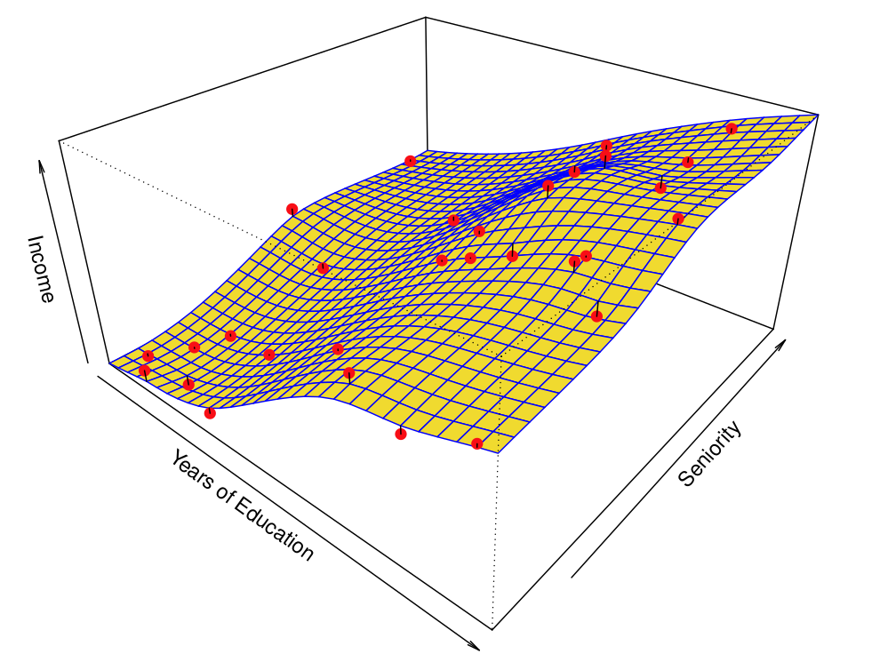{fig-alt="Data points for income in units of 1000 versus years of education and seniority, with a non-planar surface fit to the data" width="100%"}

:::::

::::: {.column width="45%"}

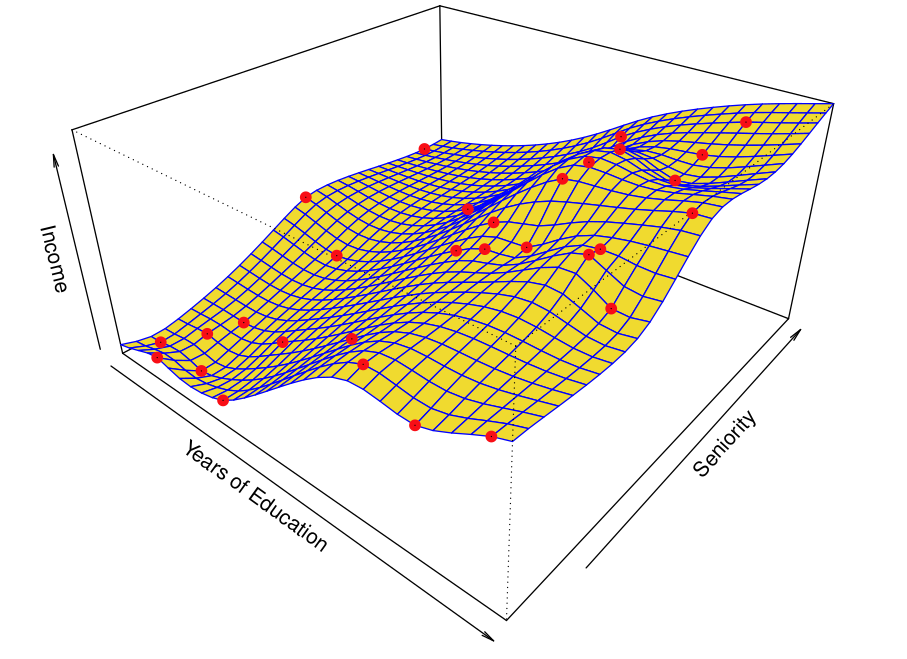{fig-alt="Data points for income in units of 1000 versus years of education and seniority, with a more flexible non-planar surface fit to the data" width="100%"}

:::::

::::::

## Prediction accuracy vs model interpretability

:::::: {.columns}

::::: {.column width="65%"}

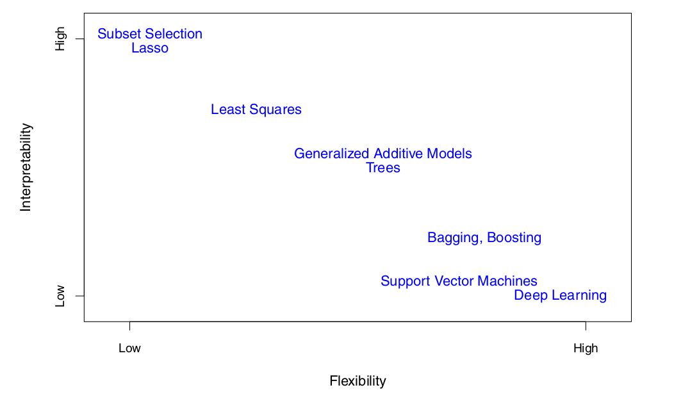{fig-alt="A figure that plots common machine learning methods, with low to high interpretability on the vertical axis versus low to high flexibility on the horizontal axis" width="100%"}

:::::

::::: {.column width="30%"}

- More flexible allows for greater accuracy, but with potential for overfitting
- More restrictive makes it easier to understand and interpret the results

:::::

::::::

## Supervised vs unsupervised learning

:::::: {.columns}

::::: {.column width="45%"}

**Supervised learning:**

Training data has a response variable $y$ for every input $x$

{fig-alt="Sales versus TV, radio, and newspaper advertising spending, all in units of 1000, as an example of supervised learning" width="100%"}

:::::

::::: {.column width="45%"}

**Unsupervised learning:**

Training data does not have a response variable $y$ for every input $x$

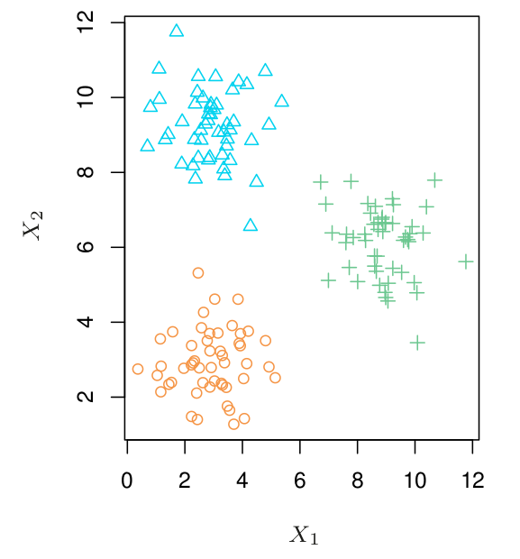{fig-alt="Plot of three different classes grouped separately, shown against two predictors X1 and X2" width="70%"}

:::::

::::::

## Regression vs Classification

**Types of variables:** emphasize that this is the *output* variable, and which type it is determines regression vs classification

- Quantitative
  - Examples: blood pressure, temperature, volume, height, income
- Qualitative / categorical
  - Examples: purchased a ticket, owns a house, job, digit in MNIST

# Group work

## Group work (a) {background-color="#FDDDA0"}

:::::: {.columns}

::::: {.column width="45%"}

We collect a set of data on the top 500 firms in the US. For each firm we record profit, number of employees, industry and the CEO salary. We are interested in understanding which factors affect CEO salary.

:::::

::::: {.column width="50%"}

- Is this classification or regression?
- Do we want inference or prediction?
- What is $n$, the number of data points?
- What is $p$, the number of variables?
  - Answer: 3

*From exercise 2.4.2.*

:::::

::::::

## Group work (b) {background-color="#FDDDA0"}

:::::: {.columns}

::::: {.column width="45%"}

We are considering launching a new product and wish to know whether it will be a success or a failure. We collect data on 20 similar products that were previously launched. For each product we have recorded whether it was a success or failure, price charged for the product, marketing budget, competition price, and ten other variables.

:::::

::::: {.column width="50%"}

- Is this classification or regression?
- Do we want inference or prediction?
- What is $n$, the number of data points?
- What is $p$, the number of variables?

:::::

::::::

## TL;DR

- Input/output variables
- Prediction vs inference
- Reducible vs irreducible error
- Overfitting
- Classification vs regression
- Supervised vs unsupervised learning

## Wrap up

:::::: {.columns}

::::: {.column width="45%"}

**Next time:**

- Friday 9/4
  - Bring your laptop!
  - First homework due Sun Sep 13
  - There will be a quiz this Friday

:::::

::::: {.column width="50%"}

**Announcements:**

- Office hours!
  - Dr. Bao: Tue 9 am - 10 am, Wed 10 am - 11 am (EB 2507L)
  - Christy Lu: Tue 11 am - noon, Wed 2 pm - 3 pm (EB 2504)

:::::

::::::

## Source and reading

- Textbook reading: Ch. 2.1 of [*An Introduction to Statistical Learning with Applications in Python*](https://www.statlearning.com/).
- Figures and datasets are from the textbook (ISLP) unless noted.
