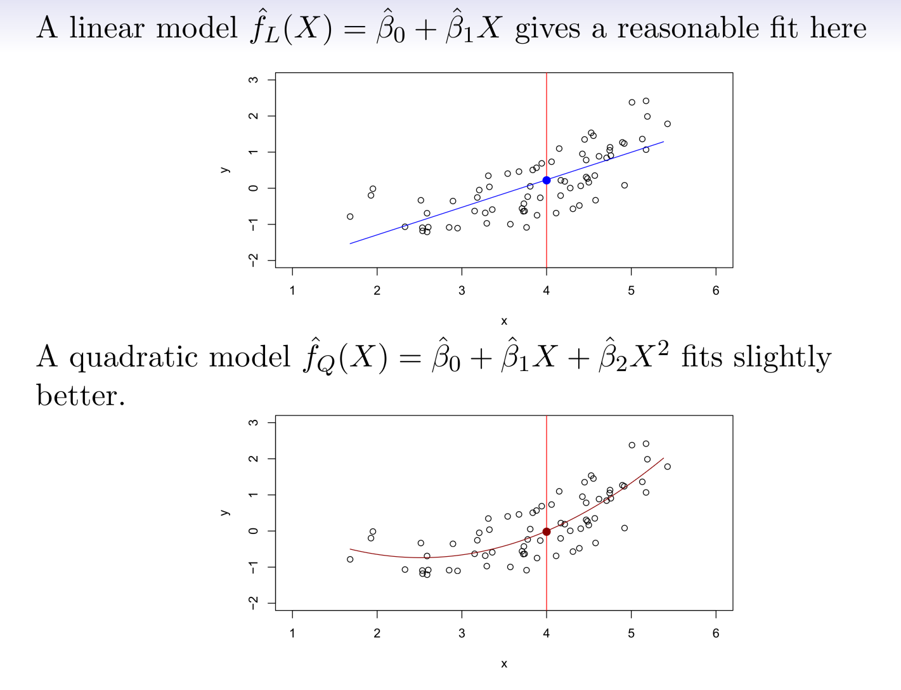
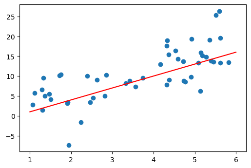
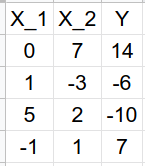
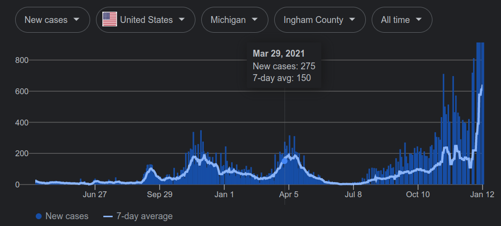
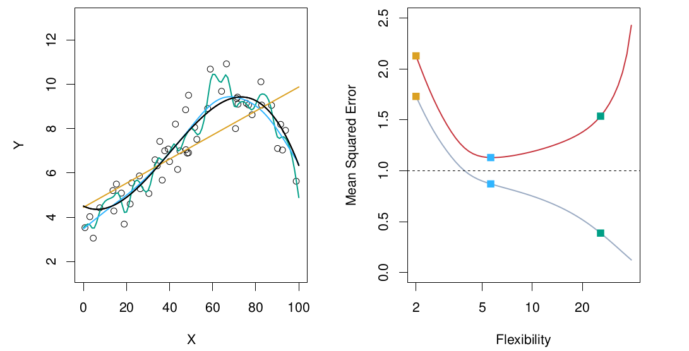
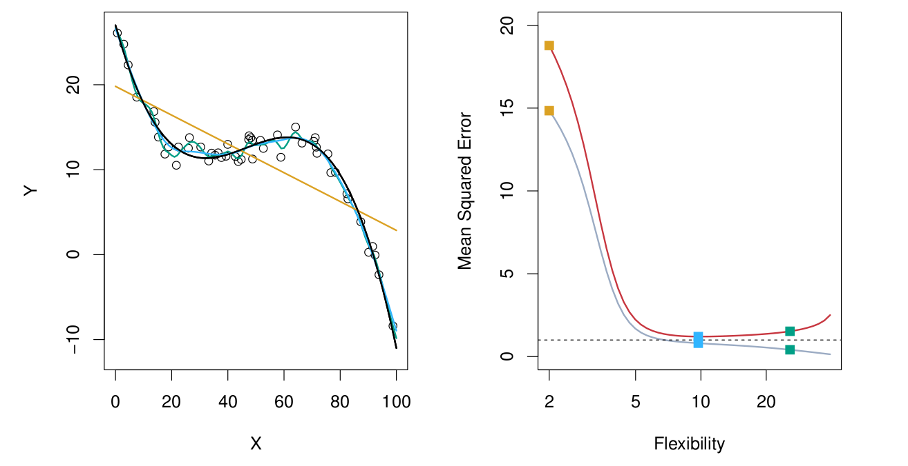
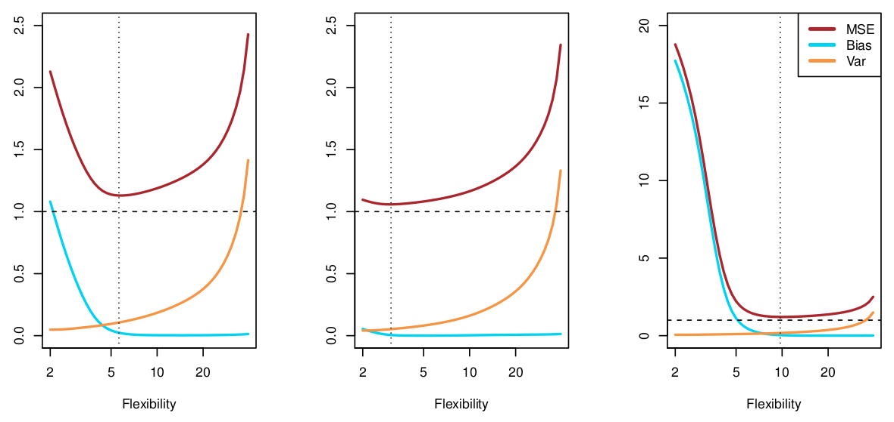

## Announcements

:::::: {.columns}

::::: {.column width="35%"}

Last time:

- Ch 2.1, vocab day!

:::::

::::: {.column width="55%"}

Announcements:

- First homework due Sunday, 9/13. It covers:
  - Mon 8/31 lecture
  - Wed 9/2 lecture
  - Today's 9/4 lecture

:::::

::::::

## Covered in this lecture

- Mean squared error (regression)
- Train vs test
- Bias-variance trade-off

## Quick review of notation

- $X = (X_1, \cdots, X_p)$: the $p$ predictor variables
- Ground truth: $Y = f(X) + \epsilon$
- Approximation: $\hat Y = \hat f(X)$
- Number of data points: $n$
- $X_{ij}$ is the $j$th predictor for observation $i$

# Mean Squared Error

## Which is better?

{fig-alt="Two vertical scatter plots of the same data: the top plot has a linear fit overlaid, and the bottom plot has a quadratic fit overlaid" width="55%"}

## No free lunch

- No best model for all data sets
- So we need to measure the quality of a model on a given data set

## Mean Squared Error

Error in the regression setting:

$$
MSE = \frac{1}{n} \sum_{i=1}^n (y_i - \hat f(x_i))^2
$$

{fig-alt="Scatter plot of 50 data points with a straight line fit to the data" width="40%"}

## Group work {background-color="#FDDDA0"}

Given the following data, you decide to use the model
$$
\hat f(X_1, X_2) = 1 - 3X_1 + 2X_2.
$$
What is the MSE?

{fig-alt="A data table with columns X1, X2, and Y" width="25%"}

## Training MSE

:::::: {.columns}

::::: {.column width="45%"}

{fig-alt="COVID-19 case data for Ingham County in 2021" width="100%"}

:::::

::::: {.column width="45%"}

We don't care about how well the model does on the data we have. We want the quality of the model on data not seen when training the model.

:::::

::::::

## Train vs test

:::::: {.columns}

::::: {.column width="45%"}

**Training set:**

The observations $\{(x_1,y_1),\cdots,(x_n,y_n)\}$ used to get the estimate $\hat f$

:::::

::::: {.column width="45%"}

**Test set:**

The observations $\{(x_1',y_1'),\cdots,(x_{n'}',y_{n'}')\}$ used to compute the average squared prediction error
$$
\frac{1}{n'} \sum_i (y_i' - \hat f(x_i'))^2
$$

:::::

::::::

## Why not just get the best model for the training data?

{fig-alt="Two panels. Left: scatter plot of simulated nonlinear data with the true function and three fits of increasing flexibility. Right: training MSE and test MSE as a function of flexibility, with the three fits marked by squares" width="70%"}

- Left: the black line is the model used to simulate the data; three estimates of $f$ are shown as orange, blue and green curves
- Right: training MSE in grey, test MSE in red; squares mark the training and test MSEs for the three fits in the left panel
- The variance of $\epsilon$ is the dashed line
- Training error goes down but test error goes up (overfitting)
- Flexibility = degrees of freedom

## A more linear example

{fig-alt="Two panels. Left: scatter plot of simulated close-to-linear data with three fits of increasing flexibility. Right: training MSE and test MSE as a function of flexibility" width="70%"}

The truth is linear, so test MSE goes down only a bit before going up.

## A more non-linear example

{fig-alt="Two panels. Left: scatter plot of simulated strongly nonlinear data with three fits of increasing flexibility. Right: training MSE and test MSE as a function of flexibility" width="70%"}

Similar structure to the previous example, but it needs more degrees of freedom before getting a good test MSE.

## A simple solution: train/test split

More on this in Ch 5.

- Split the data into a training set and a test set.
- Fit the model on the training set only.
- Measure the error on the test set.

# Bias-Variance Trade-Off

## Bias-variance

$$
E(y_0 - \hat f(x_0))^2 = \mathrm{Var}(\hat f(x_0)) + \left[\mathrm{Bias}(\hat f(x_0))\right]^2 + \mathrm{Var}(\epsilon)
$$

:::::: {.columns}

::::: {.column width="45%"}

- The proof is outside the scope of the class (see "Bias-variance tradeoff" on Wikipedia)
- $E(y_0 - \hat f(x_0))^2$ is the expected test MSE at $x_0$: the average test MSE if we repeatedly estimated $f$ with lots of training sets and tested each at $x_0$
- It is computed by averaging $E(y_0 - \hat f(x_0))^2$ over all values in the test set

:::::

::::: {.column width="45%"}

- The equation says we need an $\hat f$ with both low variance and low bias
- It also says the error is bounded below by the irreducible error $\mathrm{Var}(\epsilon)$

:::::

::::::

## Variance

:::::: {.columns}

::::: {.column width="55%"}

**Variance:** the amount by which $\hat f$ would change if we estimated it using a different training data set.

- High variance: small changes in the training data result in large changes in $\hat f$.
- Example at right: the green curve is more flexible, but small changes in the data set could also cause large changes in the computed model.

:::::

::::: {.column width="40%"}

:::::

::::::

## Bias

:::::: {.columns}

::::: {.column width="50%"}

**Bias:** the error that is introduced by approximating a (complicated) real-life problem by a much simpler model.

- Example: linear regression is likely too simple for any real-life problem.
- Left figure: the true $f$ is non-linear, so no good estimate is possible with linear regression (linear regression = high bias).
- Right figure: the true $f$ is linear, so linear regression should do a good job (linear regression = low bias).

:::::

::::: {.column width="22%"}

:::::

::::: {.column width="22%"}

:::::

::::::

## Group work {background-color="#FDDDA0"}

:::::: {.columns}

::::: {.column width="30%"}

:::::

::::: {.column width="35%"}

:::::

::::: {.column width="30%"}

- Label the line corresponding to each of the following:
  - MSE
  - Bias
  - Variance of $\hat f(x_0)$
  - Variance of $\epsilon$

:::::

::::::

$$
E(y_0 - \hat f(x_0))^2 = \mathrm{Var}(\hat f(x_0)) + \left[\mathrm{Bias}(\hat f(x_0))\right]^2 + \mathrm{Var}(\epsilon)
$$

## Another example

:::::: {.columns}

::::: {.column width="30%"}

:::::

::::: {.column width="35%"}

:::::

::::: {.column width="30%"}

- Label the line corresponding to each of the following:
  - MSE
  - Bias
  - Variance of $\hat f(x_0)$
  - Variance of $\epsilon$

:::::

::::::

$$
E(y_0 - \hat f(x_0))^2 = \mathrm{Var}(\hat f(x_0)) + \left[\mathrm{Bias}(\hat f(x_0))\right]^2 + \mathrm{Var}(\epsilon)
$$

## Yet another example

:::::: {.columns}

::::: {.column width="30%"}

:::::

::::: {.column width="35%"}

:::::

::::: {.column width="30%"}

- Label the line corresponding to each of the following:
  - MSE
  - Bias
  - Variance of $\hat f(x_0)$
  - Variance of $\epsilon$

:::::

::::::

$$
E(y_0 - \hat f(x_0))^2 = \mathrm{Var}(\hat f(x_0)) + \left[\mathrm{Bias}(\hat f(x_0))\right]^2 + \mathrm{Var}(\epsilon)
$$

## Bias-variance trade-off

:::::: {.columns}

::::: {.column width="30%"}

:::::

::::: {.column width="60%"}

- More flexible: variance up, bias down.
- The relative rate of change between bias and variance determines whether MSE goes up or down.
- Initially, bias goes down faster, so MSE declines.
- Eventually there is little effect on bias but lots of added variance, so MSE increases.

:::::

::::::

$$
E(y_0 - \hat f(x_0))^2 = \mathrm{Var}(\hat f(x_0)) + \left[\mathrm{Bias}(\hat f(x_0))\right]^2 + \mathrm{Var}(\epsilon)
$$

## Group work: coding {background-color="#FDDDA0"}

See the Jupyter notebook.

## Next time

- Wednesday:
  - 3.1 Linear Regression
- Sunday, 9/13:
  - Homework due at midnight on <https://www.msu-stt-learning.com>

## Source and reading

- Textbook reading: Ch. 2.2 of [*An Introduction to Statistical Learning with Applications in Python*](https://www.statlearning.com/).
- Figures and datasets are from the textbook (ISLP) unless noted.
