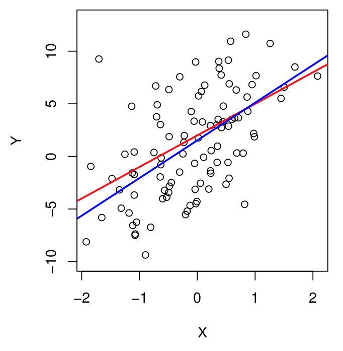
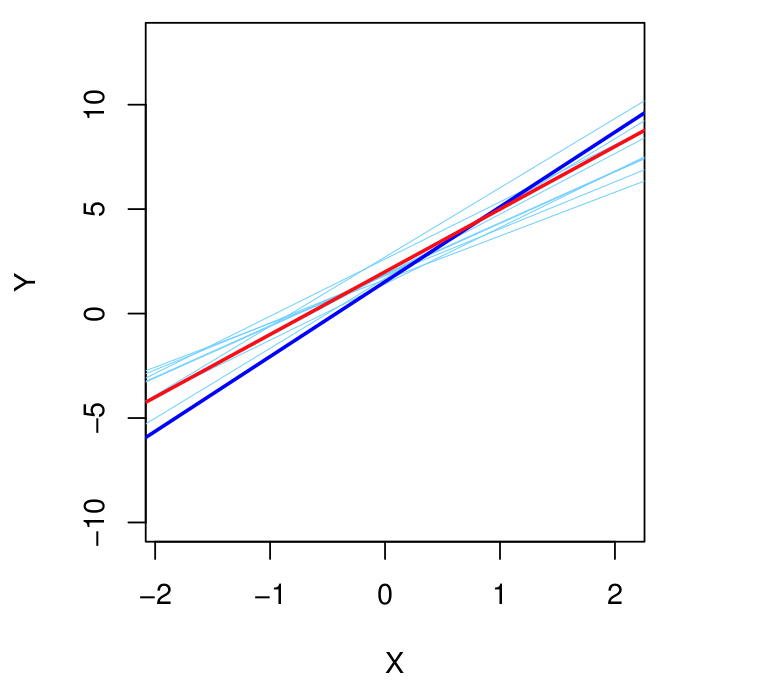
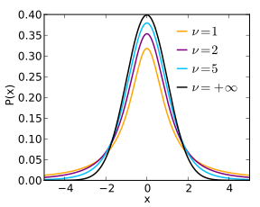
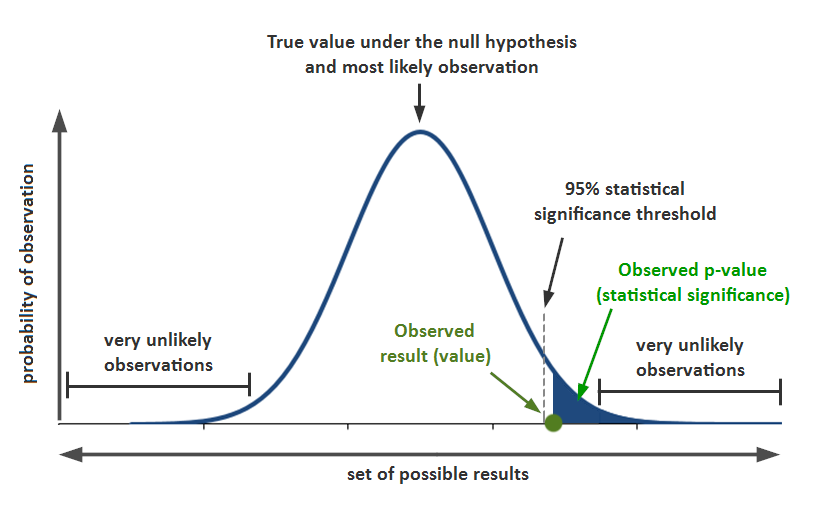

```{python}
#| include: false
# Load the data used by later code cells (the code shown on slides starts from `advertising`).
import pandas as pd
advertising = pd.read_csv(
    "https://www.statlearning.com/s/Advertising.csv", index_col=0
)
```

## Announcements

:::::: {.columns}

::::: {.column width="45%"}

**Last time:**
	- Started 3.1 - Simple linear regression (least squares)

:::::

::::: {.column width="45%"}

**Announcements:**
	- Homework #1 Due Sun, Sep 13

:::::

::::::

## Covered in this lecture

:::::: {.columns}

::::: {.column width="40%"}

- Confidence interval, hypothesis test, and p-value for coefficient estimates
- Residual standard error (RSE)
- R squared

:::::

::::: {.column width="40%"}

:::::

::::::

# Last time

## Setup

:::::: {.columns}

::::: {.column width="40%"}

- Predict $Y$ on a single predictor variable $X$ $$
Y \approx \beta_0 + \beta_1 X
$$
- "$\approx$'' .... "is approximately modeled as"

:::::

::::: {.column width="40%"}

- Given $(x_1,y_1),\cdots,(x_n,y_n)$
- Let $	\hat y_i = \hat \beta_0 + \hat \beta_1 x_i$ be prediction for $Y$ on $i$th value of $X$.
- $e_i = y_i - \hat y_i$ is the $i$th residual
{fig-alt="scatter plot with linear fit and residuals" width="70%"}

:::::

::::::

## Least squares criterion: RSS

:::::: {.columns}

::::: {.column width="60%"}

{fig-alt="TODO: describe this figure" width="70%"}

:::::

::::: {.column width="34%"}

Residual sum of squares RSS is
$$
\begin{aligned}
RSS &= e_1^2 + \cdots + e_n^2\\
	 	  &= \sum_i (y_i - \hat \beta_0 - \hat \beta_1 x_i)^2
\end{aligned}
$$

:::::

::::::

:::::: {.columns}

::::: {.column width="50%"}

::: {.callout-note appearance="simple"}

### Least squares criterion
Find $\beta_0$ and $\beta_1$ that minimize the RSS.

:::

:::::

::::: {.column width="40%"}

$$
\begin{aligned}
\hat \beta_1 &=
		\frac{\sum_{i=1}^n(x_i-\overline x) (y_i - \overline y)}
			{\sum_{i=1}^n (x_i - \overline x)^2}\\
			\hat \beta_0 & = \overline y - \hat \beta_1 \overline x
\end{aligned}
$$

:::::

::::::

# Assessing Coefficient Estimate Accuracy

## Bias in estimation

{Analogy with mean}

	
	
	

::: {.notes}

Sample vs population.

:::

:::::: {.columns}

::::: {.column width="40%"}

- Assume a true value $\mu ^*$
- An estimate from training data $\hat \mu$
- The estimate is unbiased if $E(\hat \mu) = \mu^*$

:::::

::::: {.column width="50%"}

- Sample mean is unbiased for population mean: $$
E(\hat \mu) = E\left(\frac{1}{n}\sum_i X_i \right) = \mu
$$
- Standard variance estimate is biased   ::: {.notes} (under estimation) :::   $$
E(\hat \sigma ^2) = E\left[\frac{1}{n} \sum_i(X_i - \overline X)^2\right] \neq \sigma^2
$$

:::::

::::::

## Linear regression is unbiased

:::::: {.columns}

::::: {.column width="30%"}

{fig-alt="Scatter plot of simulated data with linear relationship plus noise with overlaid true line relationship and least squares linear fit" width="70%"}

:::::

::::: {.column width="30%"}

{fig-alt="10 linear fits for the same data with 10 different noise realizations" width="70%"}

:::::

::::: {.column width="40%"}

::: {.notes}

- 100 data points drawn from $Y = 2 + 3X + \epsilon$
- $\epsilon$ drawn from normal distribution with mean 0
- Red line is true relationship, blue is least squares estimate
- Repeat this 10 times and plot all the found lines (in variations of blue)
- The resulting models are slightly different but are all around the red true relationship

:::

:::::

::::::

## Variance in estimation

{Continuing analogy with mean}

:::::: {.columns}

::::: {.column width="40%"}

- True value $\mu^*$
- Estimate from training data $\hat \mu$
- Variance of sample mean $\text{Var}(\hat \mu) = \text{SE}(\hat \mu)^2 = \frac{\sigma^2}{n}$

:::::

::::: {.column width="55%"}

::: {.notes}

- Standard error
- The more data you have, the smaller variance, the better the estimate
- the law of large numbers (LLN)

:::

:::::

::::::

## Variance of linear regression estimates

:::::: {.columns}

::::: {.column width="55%"}

- Variance of linear regression estimates: $$
\begin{aligned}
\text{SE}(\hat \beta_0)^2 &= \sigma^2 \left[ \frac{1}{n} + \frac{\overline x^2}{\sum_{i=1}^n (x_i - \overline x)^2}\right]\\ \text{SE}(\hat \beta_1)^2 &= \frac{\sigma^2}{\sum_{i=1}^n (x_i - \overline x)^2}
\end{aligned}
$$ where $\sigma^2 = \text{Var}(\epsilon)$
- Residual standard error is an estimate of $\sigma$ $$
RSE = \sqrt{RSS/ (n-2)}
$$

:::::

::::: {.column width="35%"}

::: {.notes}

if data are more spreadout the SE is smaller

:::

:::::

::::::

## Coding group work {background-color="#FDDDA0"}

:::::: {.columns}

::::: {.column width="45%"}

Run the section titled "Simulating data"

:::::

::::: {.column width="45%"}

:::::

::::::

## Confidence Interval

:::::: {.columns}

::::: {.column width="40%"}

The 95\% confidence interval for $\beta_1$ approximately takes the form
$$
\hat \beta_1 \pm 2 \cdot \text{SE}(\hat \beta_1)
$$

:::::

::::: {.column width="40%"}

**Interpretation: **

There is approximately a 95\% chance that the interval
$$
\left[ 	\hat \beta_1 - 2 \cdot \text{SE}(\hat \beta_1),
	\hat \beta_1 + 2 \cdot \text{SE}(\hat \beta_1)
\right ]
$$
will contain $\beta_1$ where we repeatedly approximate $\hat \beta_1$ using repeated samples.

:::::

::::::

::: {.notes}

Same form works for $\beta_0$

:::

## CI in Advertising data

:::::: {.columns}

::::: {.column width="55%"}

{fig-alt="scatter plot with linear fit and residuals" width="70%"}

:::::

::::: {.column width="40%"}

For the advertising data set, the 95\% CIs are:
- $\beta_1$ :: $[0.042,0.053]$   ::: {.notes}
- First line through [0,8] and [300,20.6]
- Second line through [0,7] and [300,21.9] :::
- $\beta_0$ :: $[6.130, 7.935]$

:::::

::::::

## Hypothesis testing

:::::: {.columns}

::::: {.column width="50%"}

- $H_0$: There is no relationship between $X$ and $Y$   ::: {.notes} (null hypothesis) :::
- $H_1$: There is some relationship between $X$ and $Y$   ::: {.notes} (alternative hypothesis) :::

:::::

::::: {.column width="40%"}

::: {.notes}

$$
\begin{aligned}
H_0: &\beta_1 = 0 \\
	H_A: &\beta_1 \neq 0
\end{aligned}
$$
since if $\beta_1 = 0$ then the model reduces to $Y = \beta_0+\epsilon$, and thus $X$ is not associated with $Y$

:::

:::::

::::::

## Test statistic and p-value

:::::: {.columns}

::::: {.column width="40%"}

Test statistic:
$$
t = \frac{\hat \beta_1 - 0}{\text{SE}(\hat \beta_1)}
$$
t-distribution with $n-2$ degrees of freedom
{fig-alt="student t-distribution for four different values of nu" width="70%"}

:::::

::::: {.column width="40%"}

::: {.notes}

A small p-value indicates that it is unlikely to observe such a substantial association between the predictor and the response due to chance, in the absence of any real association between the predictor and the response.

:::

::: {.notes}

Draw me:
{fig-alt="TODO: describe this figure" width="70%"}

:::

:::::

::::::

## Advertising example

```{python}
#| echo: true
import statsmodels.api as sm
from ISLP.models import ModelSpec as MS, summarize

X = MS(['TV']).fit_transform(advertising)
model = sm.OLS(advertising['sales'], X)
results = model.fit()
summarize(results)
```

::: {.notes}

`summarize()` reproduces Table 3.1 from the book directly: coefficient
estimate, standard error, t-statistic, and p-value for each term -- this
replaces the static screenshot with something students can re-run and
modify (e.g. swap `'TV'` for `'radio'` or `'newspaper'`).

:::

{fig-alt="scatter plot with linear fit and residuals" width="70%"}

## Assessing the accuracy of the model: RSE

::: {.notes}

Quantify the extent to which the model fits the data

:::

:::::: {.columns}

::::: {.column width="40%"}

**Residual standard error (RSE):**
$$
\begin{aligned}
RSE &= \sqrt{ \frac{1}{n-2} RSS}\\
	& = \sqrt{ \frac{1}{n-2} \sum_i (y_i - \hat y_i)^2}
\end{aligned}
$$

:::::

::::: {.column width="45%"}

::: {.notes}

- estimate of the standard deviation of $\epsilon$
- Avg amount that the response will deviate from the true regression line
- The  $n-2$ (rather than n) accounts for the two parameters estimated in simple linear regression ($\hat\beta_0$ and $\hat\beta_1$), i.e., adjusting for degrees of freedom.

:::

:::::

::::::

## Assessing the accuracy of the model: $R^2$

:::::: {.columns}

::::: {.column width="40%"}

**R squared:**
$$
\begin{aligned}
R^2 &= \frac{TSS-RSS}{TSS} = 1-\frac{RSS}{TSS}
\end{aligned}
$$
where total sum of squares is
$$
TSS = \sum_i (y_i - \overline y)^2
$$

:::::

::::: {.column width="45%"}

::: {.notes}

- TSS is total variance in the response $Y$, variability before regression
- RSS amount of variability after the regression
- $R^2$ is proportion of variability in $Y$ that can be explained using $X$
- Close to 1, large proportion of varaiability is explained by regression
- Close to 0, regression does not explain much of the variability in the response

:::

:::::

::::::

## RSE and $R^2$ from `results`

`statsmodels`' fitted `results` object already carries both quantities
directly -- no need to recompute RSS/TSS by hand:

```{python}
#| echo: true
import numpy as np

RSE = np.sqrt(results.mse_resid)
print(f"RSE: {RSE:.3f}")
print(f"R-squared: {results.rsquared:.3f}")
```

::: {.notes}

`results.mse_resid` is $RSS/(n-2)$, so its square root is exactly the RSE
formula on the previous slide. `results.rsquared` is $R^2$ directly.

:::

## Advertising example

{fig-alt="Sales versus TV advertising scatter plot with linear fit line" width="30%"}
{fig-alt="Sales versus radio advertising scatter plot with linear fit line" width="30%"}
{fig-alt="Sales versus newspaper advertising scatter plot with linear fit line" width="30%"}

$$
R^2 = 0.61
	\hspace{1.2in}
	R^2 = 0.33
	\hspace{1.2in}
	R^2 = 0.05
$$

:::::: {.columns}

::::: {.column width="40%"}

:::::

::::: {.column width="40%"}

:::::

::::::

## Coding group work {background-color="#FDDDA0"}

:::::: {.columns}

::::: {.column width="45%"}

Run the section titled "Assessing Coefficient Estimate Accuracy"

:::::

::::: {.column width="45%"}

:::::

::::::

## Next time

:::::: {.columns}

::::: {.column width="40%"}

Next time:
	
		- Multi-linear regression.

:::::

::::: {.column width="40%"}

**Announcements** 
	- Homework 1  
  - Due Sun, Sep 13
- Homework 2 
  - Released on Mon, Sep 14

:::::

::::::
