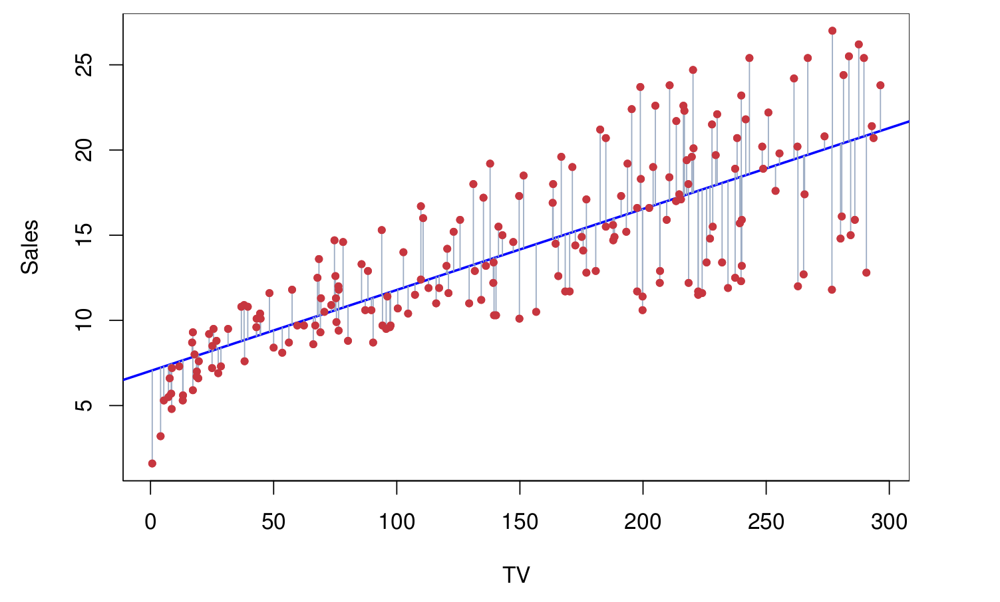
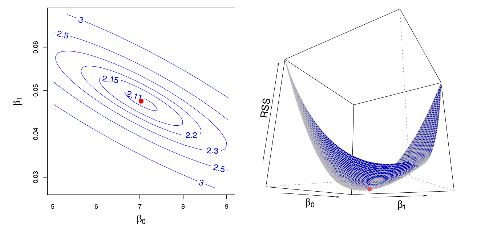
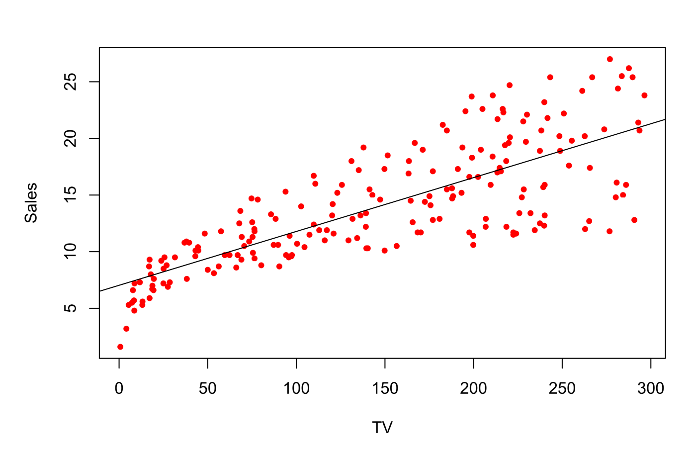
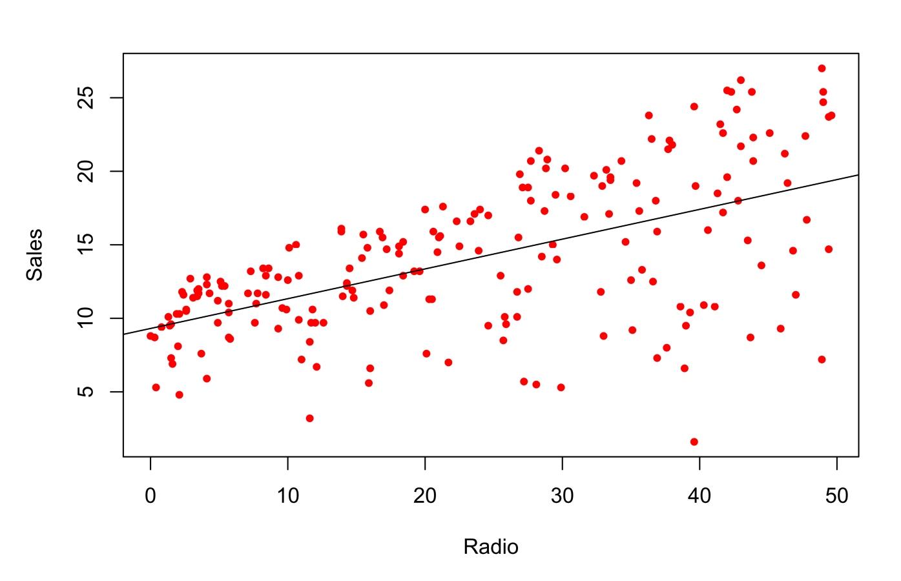
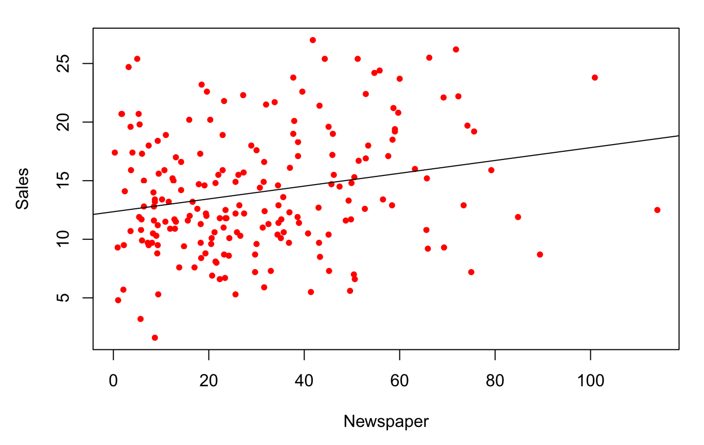
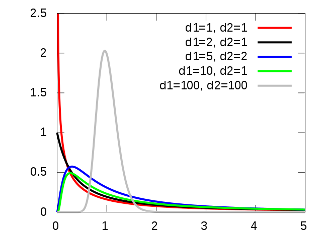

## Announcements

:::::: {.columns}

::::: {.column width="45%"}

Last time:
	- 3.1 (Simple) linear regression

:::::

::::: {.column width="45%"}

**Announcements:**
	- Homework #2 Due Monday 9/21

:::::

::::::

## Covered in this lecture

:::::: {.columns}

::::: {.column width="40%"}

- Multiple linear regression
- Hypothesis test in that case
- Forward and Backward Selection

:::::

::::: {.column width="40%"}

:::::

::::::

# Review from last time

## Linear Regression with One Variable

:::::: {.columns}

::::: {.column width="45%"}

{fig-alt="scatter plot with linear fit and residuals" width="50%"}
- Predict $Y$ on a single variable $X$ $$
Y \approx \beta_0 + \beta_1 X
$$
- Find good guesses for $\hat \beta_0$, $\hat \beta_1$.
- $	\hat y_i = \hat \beta_0 + \hat \beta_1 x_i$
- $e_i = y_i - \hat y_i$ is the $i$th residual
- residual sum of squares RSS $= \sum_i e_i^2$

:::::

::::: {.column width="40%"}

{fig-alt="TODO: describe this figure" width="70%"}
- RSS is minimized at *least squares coefficient estimates* $$
\begin{aligned}
\hat \beta_1 &= \frac{\sum_{i=1}^n(x_i-\overline x) (y_i - \overline y)} {\sum_{i=1}^n (x_i - \overline x)^2}\\ \hat \beta_0 & = \overline y - \hat \beta_1 \overline x
\end{aligned}
$$

:::::

::::::

## Evaluating the model: variance

- Linear regression is unbiased
- Variance of linear regression estimates:
$$
\begin{aligned}
\text{SE}(\hat \beta_0) &= \sigma^2 \left[ \frac{1}{n} + \frac{\overline x^2}{\sum_{i=1}^n (x_i - \overline x)^2}\right]\\ \text{SE}(\hat \beta_1)^2 &= \frac{\sigma^2}{\sum_{i=1}^n (x_i - \overline x)^2}
\end{aligned}
$$
where $\sigma^2 = \text{Var}(\epsilon)$
- Estimate $\sigma$: $\hat \sigma^2 = \frac{RSS}{n-2}$

## Evaluating the model: confidence interval and hypothesis test

- The 95\% confidence interval for $\beta_1$ approximately takes the form
$$
\hat \beta_1 \pm 2 \cdot \text{SE}(\hat \beta_1)
$$
- Hypothesis test:
  - $H_0$: $\beta_1 = 0$
  - $H_a$: $\beta_1 \neq 0$
  - Test statistic $t = \frac{\hat \beta_1 - 0}{\text{SE}(\hat \beta_1)}$

## Assessing the accuracy of the model

:::::: {.columns}

::::: {.column width="40%"}

**Residual standard error (RSE):**
$$
\begin{aligned}
RSE &= \sqrt{ \frac{1}{n-2} RSS}\\
\end{aligned}
$$

::: {.notes}

an estimate of $\sigma$.   also measure lack of fit? ($MSE=RSS/n$)

:::

:::::

::::: {.column width="45%"}

**R squared:**
$$
\begin{aligned}
R^2 &= \frac{TSS-RSS}{TSS} = 1-\frac{RSS}{TSS}
\end{aligned}
$$

$$
TSS = \sum_i (y_i - \overline y)^2
$$

::: {.notes}

- TSS = total sum of squares
- Proportion in [0,1]; variability in $Y$ that can be explained using $X$
- 0 means $Y$ not explained by linear regression on $X$

:::

:::::

::::::

\vspace{\fill}

# Multiple  Linear Regression

## Setup

$$
Y = \beta_0 + \beta_1 X_1 + \beta_2X_2 + \cdots \beta_p X_p + \epsilon
$$

:::::: {.columns}

::::: {.column width="40%"}

::: {.notes}

- $\beta_j$ is avg affect on $Y$ of one unit increase in $X_j$,  \emph{holding all other predictors fixed}.

:::

:::::

::::: {.column width="30%"}

{fig-alt="3D scatter plot of two predictor variables and a response variable, with a fitted regression plane spanning the two predictors illustrating multiple linear regression" width="70%"}

:::::

::::::

## Estimation and Prediction

:::::: {.columns}

::::: {.column width="40%"}

Given estimates $\hat \beta_0, \hat \beta_1,\hat \beta_2,\cdots,\hat\beta_p$, prediction is
$$
\hat y = \hat \beta_0 +  \hat \beta_1x_1 + \cdots + \hat \beta_p x_p
$$

:::::

::::: {.column width="45%"}

Minimize the sum of squares
$$
\begin{aligned}
RSS &= \sum_i (y_i - \hat y_i)^2\\
	&= \sum_i (y_i - \hat \beta_0 - \hat \beta_1x_{i1} - \cdots - \hat \beta_p x_{ip})^2
\end{aligned}
$$

Coefficients are closed form but UGLY

::: {.notes}

We won't write them down, your favorite code can do this for us

:::

:::::

::::::

## Advertising data set example

$$
\texttt{Sales} = \beta_0 + \beta_1 \cdot \texttt{TV} + \beta_2 \cdot  \texttt{radio} + \beta_3 \cdot  \texttt{newspaper}
$$

:::::: {.columns}

::::: {.column width="30%"}

```{python}
#| echo: true
import pandas as pd
import statsmodels.api as sm
from ISLP.models import ModelSpec as MS, summarize

advertising = pd.read_csv(
    "https://www.statlearning.com/s/Advertising.csv", index_col=0
)
X = MS(['TV', 'radio', 'newspaper']).fit_transform(advertising)
results_multi = sm.OLS(advertising['sales'], X).fit()
summarize(results_multi)
```

::: {.notes}

This reproduces Table 3.4 from the book directly, and `results_multi`
stays available in the rest of this document, so later slides just call
`summarize(results_multi)` again rather than refitting.

:::

:::::

::::: {.column width="30%"}

{fig-alt="3D scatter plot of two predictor variables and a response variable, with a fitted regression plane spanning the two predictors illustrating multiple linear regression" width="70%"}

:::::

::::::

## Interpretation of coefficients

$$
\texttt{Sales} = \beta_0 + \beta_1 \cdot \texttt{TV} + \beta_2 \cdot  \texttt{radio} + \beta_3 \cdot  \texttt{newspaper}
$$

:::::: {.columns}

::::: {.column width="40%"}

```{python}
#| echo: true
summarize(results_multi)
```

:::::

::::: {.column width="50%"}

::: {.notes}

- Fixing TV and newspaper spending; Spending \$1K more on radio results in 189 units additional sales
- What's going on with newspaper? This says no relationship between newspaper and sales

:::

:::::

::::::

## Single regression vs multi-regression

:::::: {.columns}

::::: {.column width="50%"}

{fig-alt="Sales versus TV advertising scatter plot with linear fit line" width="50%"}

```{python}
#| echo: true
summarize(sm.OLS(advertising['sales'], MS(['TV']).fit_transform(advertising)).fit())
```

{fig-alt="Sales versus radio advertising scatter plot with linear fit line" width="50%"}

```{python}
#| echo: true
summarize(sm.OLS(advertising['sales'], MS(['radio']).fit_transform(advertising)).fit())
```

{fig-alt="Sales versus newspaper advertising scatter plot with linear fit line" width="50%"}

```{python}
#| echo: true
summarize(sm.OLS(advertising['sales'], MS(['newspaper']).fit_transform(advertising)).fit())
```

:::::

::::: {.column width="40%"}

{fig-alt="3D scatter plot of two predictor variables and a response variable, with a fitted regression plane spanning the two predictors illustrating multiple linear regression" width="40%"}

```{python}
#| echo: true
summarize(results_multi)
```

Correlation matrix

```{python}
#| echo: true
advertising[['TV', 'radio', 'newspaper', 'sales']].corr().round(4)
```

\tiny

::: {.notes}

- Correlation between radio and newspaper high (0.35)
- Markets with lots of radio also have lots of newspaper ads
- In single reg, newspaper gets credit for radio

:::

:::::

::::::

## Coding group work {background-color="#FDDDA0"}

:::::: {.columns}

::::: {.column width="45%"}

Run the section titled "Multiple Linear Regression"

:::::

::::: {.column width="45%"}

:::::

::::::

# Ch 3.2.2: Questions to ask of your regression

## Untitled

:::::: {.columns}

::::: {.column width="70%"}

::: {.callout-note appearance="simple"}

### Question 1
 
Is at least one of the predictors $X_1, \cdots, X_p$   
useful in predicting the response?

:::

:::::

::::::

## Q1: Hypothesis test

:::::: {.columns}

::::: {.column width="40%"}

- $H_0 : $ $\beta_1 = \beta_2 = \cdots = \beta_p = 0$
- $H_a:$ At least one $\beta_j$ is non-zero

:::::

::::: {.column width="40%"}

**F-statistic:**
$$
F = \frac{(TSS-RSS)/p}{RSS/(n-p-1)} \sim F_{p,n- p - 1}
$$

::: {.notes}

- TSS $= \sum_i (y_i - \overline y)^2$
- RSS $= \sum_i (y_i - \hat y_i)^2$

:::

:::::

::::::

## The F-statistic for the hypothesis test

:::::: {.columns}

::::: {.column width="45%"}

$$
F = \frac{(TSS-RSS)/p}{RSS/(n-p-1)} \sim F_{p,n- p - 1}
$$

{fig-alt="TODO: describe this figure" width="70%"}

:::::

::::: {.column width="45%"}

::: {.notes}

- If linear model assumptions are true $$
E( RSS / (n- p - 1)) = \sigma^2
$$
- and if $H_0$ is true $$
E((TSS-RSS)/p) = \sigma^2
$$
- So if no relationship between response and predictors, $F$ is close to 1
- If $H_a$ is true, $$
E((TSS-RSS)/p) > \sigma^2
$$ so then $F > 1$

:::

:::::

::::::

\bvfill 
\tiny
Image from [wikipedia, By IkamusumeFan - Own work, CC BY-SA 4.0, ](https://commons.wikimedia.org/w/index.php?curid=34777108)

## Untitled

:::::: {.columns}

::::: {.column width="70%"}

::: {.callout-note appearance="simple"}

### Q2
Do all the predictors help to explain $Y$, or is only a subset of the predictors useful?

:::

:::::

::::::

## Q2: A first idea

{Great, you know at least one variable is important, so which is it?....}

:::::: {.columns}

::::: {.column width="40%"}

::: {.notes}

- Bad idea plan A: All subsets or best subsets regression
  - Take every possible subset of $p$ variables
  - Figure out least squares fit
  - Choose the best one based on some criterion balancing training error with model size

:::

:::::

::::: {.column width="40%"}

:::::

::::::

## Why is this a bad idea?

:::::: {.columns}

::::: {.column width="45%"}

::: {.notes}

- Why bad idea: $p=40$ variables, this is checking more than a billion models
- Better idea: Automated appbroach that searches the subsets for a good one without checking all of them

:::

:::::

::::: {.column width="45%"}

::: {.notes}

- Later in the class, we will discuss better options for this (Ch 6, $\sim$ a month from now)
- Forward selection/ Backward selection to get subsets of variables without checking every possible subset
- Shrinkage methods (Lasso/Ridge)

:::

:::::

::::::

## Next time

:::::: {.columns}

::::: {.column width="40%"}

- More Multiple linear regression (Reading 3.3)

:::::

::::: {.column width="40%"}

:::::

::::::
