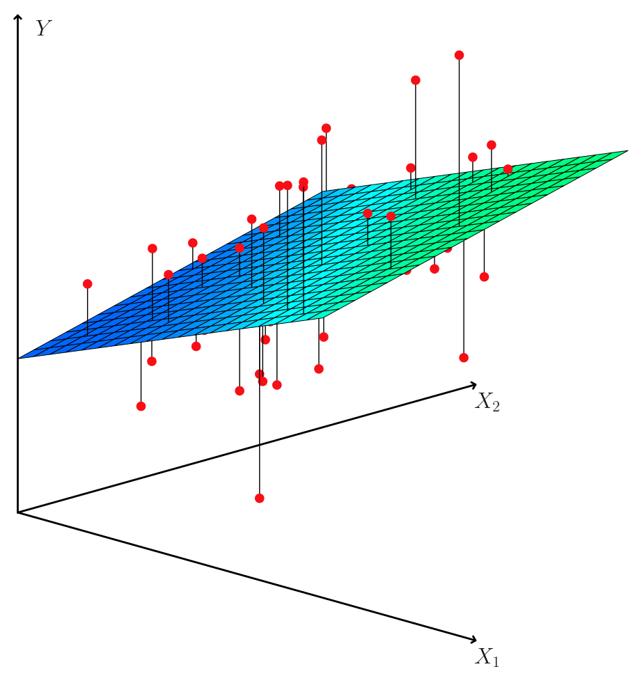
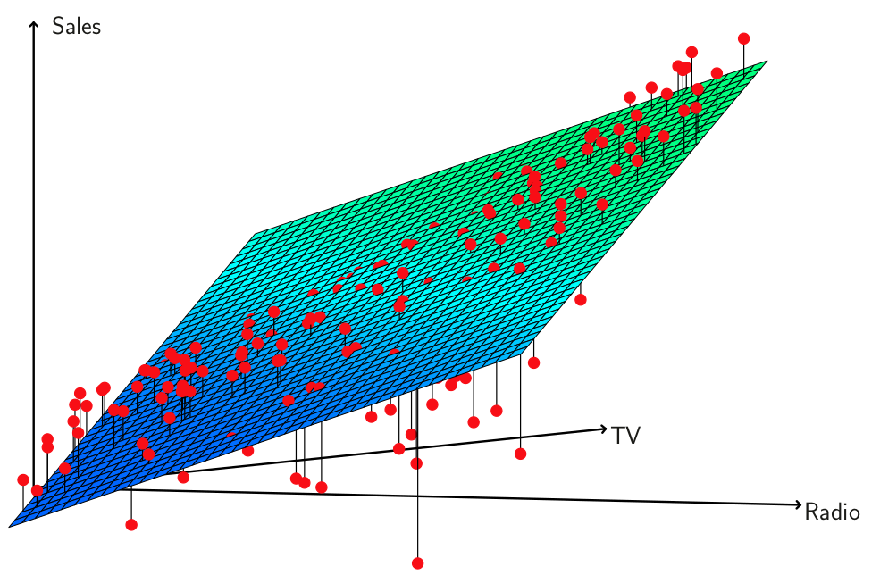
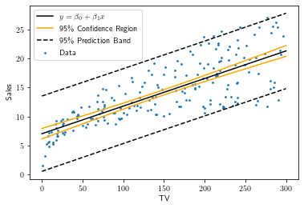
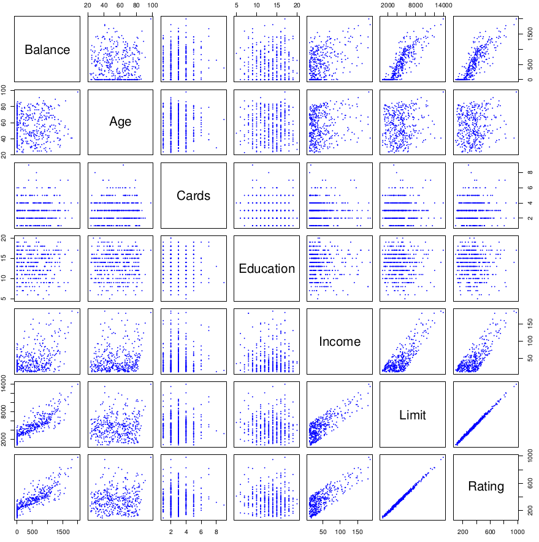
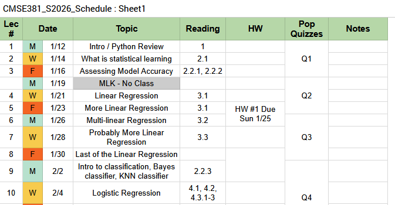

## Announcements

:::::: {.columns}

::::: {.column width="45%"}

**Last time:**
	- 3.2 Multiple Linear Regression

:::::

::::: {.column width="45%"}

**Announcements:**
	- HW #2 Due Sunday Feb 8.

:::::

::::::

## Covered in this lecture

:::::: {.columns}

::::: {.column width="40%"}

- RSE, $R^2$
- Confidence intervals and prediction intervals
- Qualitative predictors

:::::

::::: {.column width="40%"}

:::::

::::::

# Continued: Questions to ask of your model

## Linear Regression with Multiple Variables

:::::: {.columns}

::::: {.column width="45%"}

{fig-alt="3D scatter plot of two predictor variables and a response variable, with a fitted regression plane spanning the two predictors illustrating multiple linear regression" width="50%"}
- Predict $Y$ on a multiple variables $X$ $$
Y = \beta_0 + \beta_1 X_1 + \beta_2X_2 + \cdots \beta_p x_p + \epsilon
$$
- Find good guesses for $\hat \beta_0$, $\hat \beta_1,\cdots $.
- $	\hat y_i = \hat \beta_0 + \hat \beta_1 x_i + \cdots + \hat \beta_px_p$

:::::

::::: {.column width="40%"}

- $e_i = y_i - \hat y_i$ is the $i$th residual
- RSS $= \sum_i e_i^2$
- RSS is minimized at *least squares coefficient estimates*

:::::

::::::

## Review: Questions to ask of your model

:::::: {.columns}

::::: {.column width="45%"}

\begin{enumerate}
		\item Is at least one of the predictors $X_1, \cdots, X_p$ useful in predicting the response?
	\item Do all the predictors help to explain $Y$, or is only a subset of the predictors useful?
	
	
	
	\end{enumerate}

:::::

::::: {.column width="45%"}

::: {.notes}

- Hypothesis test, F-statistic, at least one $\beta_j$ is non-zero
- Forward and Backward selection
- RSE, $R^2$, eyeball test
- Confidence intervals and prediction intervals

:::

:::::

::::::

## Untitled

:::::: {.columns}

::::: {.column width="50%"}

::: {.callout-note appearance="simple"}

### Q3
How well does the model fit the data?

:::

:::::

::::::

## Assessing the accuracy of the model

{Almost the same as before}
	
:::::: {.columns}

::::: {.column width="40%"}

**Residual standard error (RSE):**
$$
\begin{aligned}
RSE &= \sqrt{ \frac{1}{n-p-1} RSS}\\
\end{aligned}
$$

::: {.notes}

measure lack of fit;

:::

:::::

::::: {.column width="45%"}

**R squared:**
$$
\begin{aligned}
R^2 &= \frac{TSS-RSS}{TSS} = 1-\frac{RSS}{TSS}
\end{aligned}
$$

$$
TSS = \sum_i (y_i - \overline y)^2
$$

::: {.notes}

- Proportion in [0,1]; variability in $Y$ that can be explained using $X$
- 0 means $Y$ not explained by linear regression on $X$

:::

:::::

::::::

## $R^2$ on Advertising data

:::::: {.columns}

::::: {.column width="45%"}

- Just TV: $R^2 = 0.61$
- Just TV and radio: $R^2 = 0.89719$
- All three variables: $R^2 = 0.8972$

:::::

::::: {.column width="45%"}

::: {.notes}

- $R^2$ always increases with more variables, even if those variables are weakly associated to the response
- Adding another variable decreases RSS on training
- Small increase in $R^2$ if we include newspaper to other two, so can safely ignore
- Large increase going from just TV to TV and Radio, so likely want to keep that

:::

:::::

::::::

## RSE on Advertising Data

:::::: {.columns}

::::: {.column width="40%"}

- Just TV: $RSE = 3.26$
- Just TV and radio: $RSE = 1.681$
- All three variables: $RSE = 1.686$

:::::

::::: {.column width="40%"}

::: {.notes}

- Similar argument about big jump from TV to TV and radio, but small difference after that
- Even though RSS went down, RSE goes up at the end because increase in $p$ made a difference in the fraction $RSE = \sqrt{\frac{RSS}{n- p - 1}}$

:::

:::::

::::::

## If all else fails, look at the data

:::::: {.columns}

::::: {.column width="50%"}

{fig-alt="TODO: describe this figure" width="70%"}

:::::

::::: {.column width="40%"}

::: {.notes}

- Model overestimates sales for cases where either spent only on TV, or only spent on radio
- Underestimates sales where budget was split between the two
- Implies there are some synergy (interaction effects) between the two
- Later (next time?) we'll extend the model to allow for this interaction

:::

:::::

::::::

## Untitled

:::::: {.columns}

::::: {.column width="70%"}

::: {.callout-note appearance="simple"}

### Q4
Given a set of predictor values, what response value should we predict, and how accurate is our prediction?

:::

:::::

::::::

## Q4: Making predictions

:::::: {.columns}

::::: {.column width="55%"}

Given estimates $\hat \beta_0,\cdots, \hat \beta_p$ for $\beta_0, \cdots, \beta_p$

Least squares plane:
$$
\hat Y = \hat \beta_0 + \hat \beta_1 X_1 + \cdots + \hat \beta_p X_p
$$
estimate for the true population regression plane
$$
f(X) =  \beta_0 +  \beta_1 X_1 + \cdots +  \beta_p X_p
$$

:::::

::::: {.column width="40%"}

{fig-alt="TODO: describe this figure" width="70%"}

:::::

::::::

## Confidence vs Prediction Model

:::::: {.columns}

::::: {.column width="45%"}

**Confidence Interval**
	
	
	The range likely to contain the population parameter (mean, standard deviation) of interest.
	
	

::: {.notes}

Schrink with more data (n), converge to population regression line/plane.

:::

	\qquad
	
	**Prediction Interval**
	
	The range that likely contains the value of the dependent variable for a single new observation given specific values of the independent variables.

	

::: {.notes}

bound by irreducible error, increase n won't shrink it

:::

:::::

::::: {.column width="45%"}

{fig-alt="TODO: describe this figure" width="70%"}

:::::

::::::

## Specific to the Advertising Data

:::::: {.columns}

::::: {.column width="40%"}

**Confidence interval**: 
	quantify the uncertainty surrounding the \emph{average} sales over a large number of cities.
	
	
	
	\qquad
	
	**Advertising example:**   
	If \$100K is spent on TV, and \$20K on radio, **in each of $n$ cities** 
	
	\qquad 

	95\% CI for \emph{average} sales: 
	
	[10,985,\, 11,528].

	\tiny
	 

::: {.notes}

Interpretation: if we collect a large number of data sets like the Advertising data
	 set, and we construct a confidence interval for the average sales on the basis of each
	 data set (given \$100,000 in TV and \$20,000 in radio advertising), then 95 \% of these 	 confidence intervals will contain the true value of average sales.

:::

:::::

::::: {.column width="40%"}

**Prediction Interval:**
	quantify the uncertainty in sales for a particular city.
	
	\qquad
	
	**Advertising example:**   
	Given that \$100,000 is spent on TV advertising and \$20,000 is spent on radio advertising in **Gotham City**  

	\qquad 

	
	95\% prediction interval for Gotham:  

	  [7,930, 14,580].
	
	

::: {.notes}

We interpret this to mean that 95\% of intervals of this form will contain the true value of Y for this city.

:::

:::::

::::::

## Comparing the two

:::::: {.columns}

::::: {.column width="40%"}

::: {.notes}

- Example showing the 1-d regression case
- Fixing TV = \$150, confindence interval for sales is tiny
- High probability the correct model takes a value in there
- OTOH, prediction interval is large
- Need wider band to be confident that a new observation is contained in there

:::

:::::

::::: {.column width="50%"}

{fig-alt="TODO: describe this figure" width="70%"}

:::::

::::::

\bvfill

## Review: Questions to ask of your model

:::::: {.columns}

::::: {.column width="45%"}

\begin{enumerate}
		\item Is at least one of the predictors $X_1, \cdots, X_p$ useful in predicting the response?
	\item Do all the predictors help to explain $Y$, or is only a subset of the predictors useful?
	\item How well does the model fit the data?
	\item Given a set of predictor values, what response value should we predict, and how accurate is our prediction?
	
	\end{enumerate}

	Test your understanding: [PollEv](https://PollEv.com/multiple_choice_polls/mdZHSz9oQiNNvBuAYDjU0/respond)

:::::

::::: {.column width="45%"}

::: {.notes}

- Hypothesis test, F-statistic, at least one $\beta_j$ is non-zero
- Forward and Backward selection
- RSE, $R^2$, eyeball test
- Confidence intervals and prediction intervals

:::

:::::

::::::

# Qualitative Predictors

## Reminder: Qualitative vs Quantitative predictors

:::::: {.columns}

::::: {.column width="45%"}

**Quantitative:**

::: {.notes}

- Anything with values in either integers or real numbers
- Temperature
- Year (even though integers)
- Weight
- Number of cylinders in a car

:::

:::::

::::: {.column width="45%"}

**Qualitative/Categorical:**

::: {.notes}

- Anything from an unordered set
- Country of origin
- Brand names
- Anything yes/no (married, has a cat)

:::

:::::

::::::

## New data set! Credit card balance

:::::: {.columns}

::::: {.column width="45%"}

{fig-alt="TODO: describe this figure" width="70%"}

:::::

::::: {.column width="45%"}

- \texttt{own}: house ownership    ::: {.notes} This is referenced in the text, but isn't in any of the online versions of the data set that I can find :::
- \texttt{student}: student status
- \texttt{status}: marital status
- \texttt{region}:	East, West, or South   ::: {.notes} Also referenced in the book, but not in the online data sets :::

:::::

::::::

## What if....

:::::: {.columns}

::::: {.column width="45%"}

... your variables aren't quantitative?

- Home ownership
- Student status
- Major
- Gender
- Ethnicity
- Country of origin

:::::

::::: {.column width="45%"}

::: {.callout-note appearance="simple"}

### Example
Investigate differences in credit card balance between people who own a house and those who don't, ignoring the other variables.

:::

:::::

::::::

## One-hot encoding

\bvfill

:::::: {.columns}

::::: {.column width="60%"}

Create a new variable
$$
x_i =
	\begin{cases}
		1 & \text{if $i$th person is a student}\\
		0 & \text{if $i$th person is not a student}
	\end{cases}
$$

Model:
$$
\begin{aligned}
y_i &= \beta_0 + \beta_1x_i+\epsilon_i\\
&= 
	\begin{cases}
		\beta_0 + \beta_1+\epsilon_i	 & \text{if $i$th person is student}\\
		\beta_0 +\epsilon_i & \text{if $i$th person isn't}
	\end{cases}
\end{aligned}
$$
\tiny

::: {.notes}

- $\beta_0$ is avg credit card balance among those who are not a student
- $\beta_0 + \beta_1$ is the avg for those are
- $\beta_1$ is avg diff in balance

:::

:::::

::::::

## Interpretation

```{python}
#| echo: true
from ISLP import load_data
from ISLP.models import ModelSpec as MS, summarize
import statsmodels.api as sm

credit = load_data('Credit')
X = MS(['Student']).fit_transform(credit)
results_student = sm.OLS(credit['Balance'], X).fit()
summarize(results_student)
```

::: {.notes}

`ModelSpec` automatically one-hot encodes the categorical `Student`
column, matching Table 3.7 in the book directly -- no need to build the
dummy variable by hand first.

:::

:::::: {.columns}

::::: {.column width="45%"}

Model:

$$
y = 480.36 + 396.46 \cdot x_{student}
$$

:::::

::::::

::: {.notes}

- Avg CC balance for non-students \$480.36,
- Students have \$396.46 additional debt, so \$876.83

:::

## Who cares about 0/1?

:::::: {.columns}

::::: {.column width="45%"}

**Old version: 0/1**
$$
x_i =
	\begin{cases}
		1 & \text{if $i$th person is a student}\\
		0 & \text{if $i$th person is not a student}
	\end{cases}
$$

Model:
$$
\begin{aligned}
y_i &= \beta_0 + \beta_1x_i+\epsilon_i\\
&= 
	\begin{cases}
		\beta_0 + \beta_1+\epsilon_i	 & \text{if $i$th person is student}\\
		\beta_0 +\epsilon_i & \text{if $i$th person isn't}
	\end{cases}
\end{aligned}
$$

:::::

::::: {.column width="45%"}

**Alternative version: $\pm 1$**
$$
x_i =
	\begin{cases}
		1 & \text{if $i$th person is a student}\\
		-1 & \text{if $i$th person is not a student}
	\end{cases}
$$

Model:
$$
\begin{aligned}
y_i &= \beta_0 + \beta_1x_i+\epsilon_i\\
&= 
	\begin{cases}
		\beta_0 + \beta_1+\epsilon_i	 & \text{if $i$th person is student}\\
		\beta_0 - \beta_1+\epsilon_i & \text{if $i$th person isn't}
	\end{cases}
\end{aligned}
$$

:::::

::::::

\bvfill

::: {.notes}

Note that the predictions will be the same

:::

## Qualitiative Predictor with More than Two Levels

:::::: {.columns}

::::: {.column width="30%"}

`Region`:

| Region | $x_{i1}$ | $x_{i2}$ |
|:-------|:--------:|:--------:|
| South  | 1        | 0        |
| West   | 0        | 1        |
| East   | 0        | 0        |

::: {.notes}

If presenting this blank for students to fill in live: build the values
one row/column at a time using reveal.js fragments (`.fragment` class on
each value) rather than a color-toggle trick, so the reveal doesn't rely
on color alone.

:::

:::::

::::: {.column width="45%"}

Create spare dummy variables:

$$
\begin{aligned}
x_{i1} &=
	\begin{cases}
		1 & \text{if $i$th person from South}\\
		0 & \text{if $i$th person not from South}
	\end{cases}\\

		x_{i2} &=
	\begin{cases}
		1 & \text{if $i$th person from West}\\
		0 & \text{if $i$th person not from West}
	\end{cases}
\end{aligned}
$$

:::::

::::::

$$
\begin{aligned}
y_i &= \beta_0 + \beta_1x_{i1}+ \beta_2x_{i2}+\epsilon_i\\
&=
	\begin{cases}
		\beta_0 + \beta_1x_{i1}+\epsilon_i & \text{if $i$th person from South}\\
		\beta_0 +  \beta_2x_{i2}+\epsilon_i& \text{if $i$th person from West}\\
		\beta_0 + \epsilon_i & \text{if $i$th person from East}
	\end{cases}
\end{aligned}
$$

## More on multiple levels

:::::: {.columns}

::::: {.column width="35%"}

::: {.notes}

- Always one less variable than levels
- Level with no dummy variable is called the baseline

:::

:::::

::::: {.column width="60%"}

```{python}
#| echo: true
#| eval: false
# Illustrative: the Region column is in the book's Credit data but not in ISLP's version.
X = MS(['Region']).fit_transform(credit)
results_region = sm.OLS(credit['Balance'], X).fit()
summarize(results_region)
```

::: {.notes}

Matches Table 3.8: `ModelSpec` picks a baseline level automatically (here
East) and creates dummy variables for the other two, same as the $x_{i1}$,
$x_{i2}$ setup on the previous slide.

:::

::: {.notes}

- Balance for the baseline (EAST) is \$531
- South has \$18.69 less than east
- West has \$12.50 less than east
- p-values for dummy variables are large, so can't reject null hypothesis
- No statistical evidence that there's a diff in CC balance in different regions

:::

:::::

::::::

## Next time

{fig-alt="TODO: describe this figure" width="65%"}

## Source and reading

- Textbook reading: Ch. 3.3 of [*An Introduction to Statistical Learning with Applications in Python*](https://www.statlearning.com/).
- Figures and datasets are from the textbook (ISLP) unless noted.
