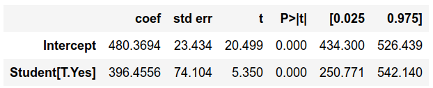
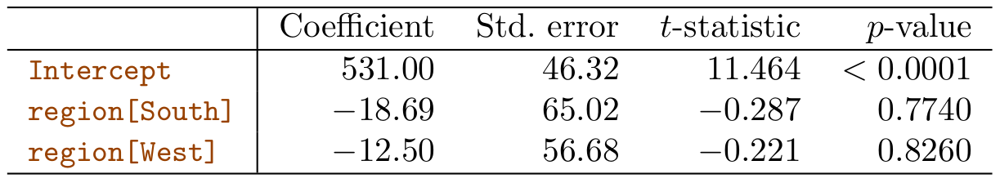
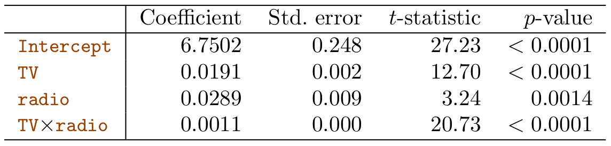
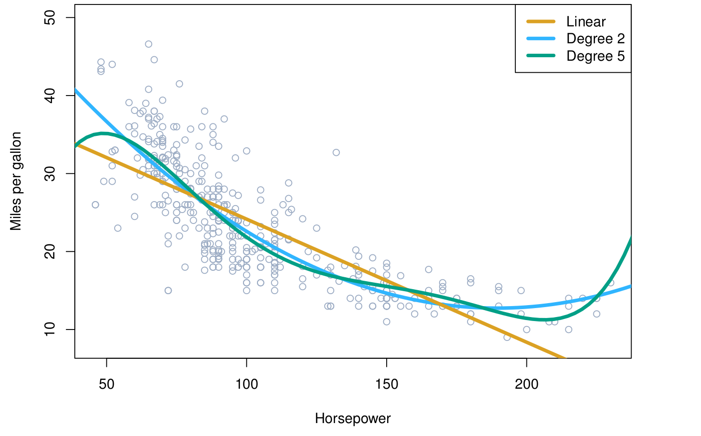
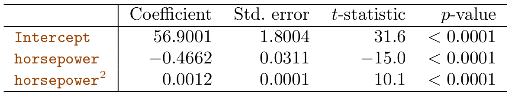

## Announcements

:::::: {.columns}

::::: {.column width="45%"}

**Last time:**

- Started 3.3 Questions of linear regression

:::::

::::: {.column width="45%"}

**Announcements:**

- HW #2 due Wed 9/23

:::::

::::::

## Covered in this lecture

- Extending the linear model with interaction terms
- Hierarchy principle
- Polynomial regression

# Review from last time

## Linear Regression with Multiple Variables

:::::: {.columns}

::::: {.column width="48%"}

{fig-alt="3D scatter plot of Y versus X1 and X2, with a planar fit and the residual for each data point" width="50%"}

- Predict $Y$ from multiple variables $X$
$$
Y = \beta_0 + \beta_1 X_1 + \beta_2 X_2 + \cdots + \beta_p X_p + \epsilon
$$
- Find good guesses for $\hat \beta_0, \hat \beta_1, \cdots$
- $\hat y_i = \hat \beta_0 + \hat \beta_1 x_{i1} + \cdots + \hat \beta_p x_{ip}$

:::::

::::: {.column width="42%"}

- $e_i = y_i - \hat y_i$ is the $i$th residual
- RSS $= \sum_i e_i^2$
- RSS is minimized at the *least squares coefficient estimates*

:::::

::::::

# Categorical Input Variables

## Reminder: Qualitative vs Quantitative predictors

:::::: {.columns}

::::: {.column width="45%"}

**Quantitative:**

*Fill in during class.*

:::::

::::: {.column width="45%"}

**Qualitative / Categorical:**

*Fill in during class.*

:::::

::::::

## Credit card balance

:::::: {.columns}

::::: {.column width="48%"}

{fig-alt="A grid of scatter plots of credit card balance against several variables, including age, education, income, limit, and rating" width="100%"}

:::::

::::: {.column width="45%"}

- `own`: house ownership
- `student`: student status
- `status`: marital status
- `region`: East, West, or South

:::::

::::::

## What if....

:::::: {.columns}

::::: {.column width="45%"}

... your variables aren't quantitative?

- Home ownership
- Student status
- Major
- Gender
- Ethnicity
- Country of origin

:::::

::::: {.column width="45%"}

::: {.callout-note appearance="simple" title="Example"}
Investigate differences in credit card balance between people who own a house and those who don't, ignoring the other variables.
:::

:::::

::::::

## One-hot encoding of a categorical input variable

:::::: {.columns}

::::: {.column width="60%"}

Create a new variable
$$
x_i =
\begin{cases}
1 & \text{if } i\text{th person is a student}\\
0 & \text{if } i\text{th person is not a student}
\end{cases}
$$

Model:
$$
\begin{aligned}
y_i &= \beta_0 + \beta_1 x_i + \epsilon_i\\
&= \begin{cases}
\beta_0 + \beta_1 + \epsilon_i & \text{if } i\text{th person is a student}\\
\beta_0 + \epsilon_i & \text{if } i\text{th person isn't}
\end{cases}
\end{aligned}
$$

:::::

::::::

## Interpretation

:::::: {.columns}

::::: {.column width="48%"}

{fig-alt="Table showing the coefficients for a linear fit of credit card balance versus student status (yes/no)" width="100%"}

:::::

::::: {.column width="45%"}

Model:
$$
y = 480.36 + 396.46 \cdot x_{\text{student}}
$$

Test your understanding: [Poll Everywhere poll](https://PollEv.com/multiple_choice_polls/6sD3UGt2HYfOlQsN13MVp/respond)

:::::

::::::

## Who cares about 0/1?

:::::: {.columns}

::::: {.column width="48%"}

**Old version: 0/1**

$$
x_i =
\begin{cases}
1 & \text{if } i\text{th person is a student}\\
0 & \text{if } i\text{th person is not a student}
\end{cases}
$$

Model:
$$
\begin{aligned}
y_i &= \beta_0 + \beta_1 x_i + \epsilon_i\\
&= \begin{cases}
\beta_0 + \beta_1 + \epsilon_i & \text{if student}\\
\beta_0 + \epsilon_i & \text{if not}
\end{cases}
\end{aligned}
$$

:::::

::::: {.column width="48%"}

**Alternative version: $\pm 1$**

$$
x_i =
\begin{cases}
1 & \text{if } i\text{th person is a student}\\
-1 & \text{if } i\text{th person is not a student}
\end{cases}
$$

Model:
$$
\begin{aligned}
y_i &= \beta_0 + \beta_1 x_i + \epsilon_i\\
&= \begin{cases}
\beta_0 + \beta_1 + \epsilon_i & \text{if student}\\
\beta_0 - \beta_1 + \epsilon_i & \text{if not}
\end{cases}
\end{aligned}
$$

:::::

::::::

## Qualitative predictor with more than two levels

:::::: {.columns}

::::: {.column width="30%"}

`Region`:

| Region | $x_{i1}$ | $x_{i2}$ |
|---|---|---|
| South | | |
| West | | |
| East | | |

:::::

::::: {.column width="55%"}

Create dummy variables:

$$
\begin{aligned}
x_{i1} &= \begin{cases}
1 & \text{if } i\text{th person from South}\\
0 & \text{if } i\text{th person not from South}
\end{cases}\\
x_{i2} &= \begin{cases}
1 & \text{if } i\text{th person from West}\\
0 & \text{if } i\text{th person not from West}
\end{cases}
\end{aligned}
$$

:::::

::::::

$$
\begin{aligned}
y_i &= \beta_0 + \beta_1 x_{i1} + \beta_2 x_{i2} + \epsilon_i\\
&= \begin{cases}
\beta_0 + \beta_1 + \epsilon_i & \text{if } i\text{th person from South}\\
\beta_0 + \beta_2 + \epsilon_i & \text{if } i\text{th person from West}\\
\beta_0 + \epsilon_i & \text{if } i\text{th person from East}
\end{cases}
\end{aligned}
$$

## More on multiple levels

:::::: {.columns}

::::: {.column width="35%"}

*Fill in during class.*

:::::

::::: {.column width="60%"}

{fig-alt="Table of coefficients, t-statistics, and p-values for a linear model of credit card balance versus region (South and West)" width="100%"}

:::::

::::::

## Notebook activity {background-color="#FDDDA0"}

Do the code section on "Dummy Variables for Multi-level Categorical Inputs".

# Extending the linear model

## Assumptions so far

*Back to our Advertising data set*

$$
\hat Y_{\text{sales}} = \beta_0 + \beta_1 \cdot X_{\text{TV}} + \beta_2 \cdot X_{\text{radio}} + \beta_3 \cdot X_{\text{newspaper}}
$$

:::::: {.columns}

::::: {.column width="45%"}

We assumed (implicitly) that the effect on sales of increasing one medium is independent of the others.

:::::

::::: {.column width="45%"}

What if spending money on radio advertising increases the effectiveness of TV advertising? How do we model it?

:::::

::::::

## Interaction Term

:::::: {.columns}

::::: {.column width="55%"}

$$
Y = \beta_0 + \beta_1 X_1 + \beta_2 X_2 + \beta_3 X_1 X_2 + \epsilon
$$

$$
\begin{aligned}
Y_{\text{sales}} &= \beta_0 + \beta_1 X_{\text{TV}} + \beta_2 X_{\text{radio}} + \beta_3 X_{\text{radio}} X_{\text{TV}} + \epsilon\\
&= \beta_0 + (\beta_1 + \beta_3 X_{\text{radio}}) X_{\text{TV}} + \beta_2 X_{\text{radio}} + \epsilon\\
&= \beta_0 + \tilde{\beta}_1 X_{\text{TV}} + \beta_2 X_{\text{radio}} + \epsilon
\end{aligned}
$$

:::::

::::::

## Interaction Term (continued)

:::::: {.columns}

::::: {.column width="48%"}

$$
Y = \beta_0 + \beta_1 X_1 + \beta_2 X_2 + \beta_3 X_1 X_2 + \epsilon
$$

$$
\begin{aligned}
Y_{\text{sales}} &= \beta_0 + \beta_1 X_{\text{TV}} + \beta_2 X_{\text{radio}} + \beta_3 X_{\text{radio}} X_{\text{TV}} + \epsilon\\
&= \beta_0 + (\beta_1 + \beta_3 X_{\text{radio}}) X_{\text{TV}} + \beta_2 X_{\text{radio}} + \epsilon
\end{aligned}
$$

:::::

::::: {.column width="45%"}

{fig-alt="Table of coefficients, standard errors, t-statistics, and p-values for Sales versus TV, radio, and the TV times radio interaction, with spending in thousands of dollars" width="100%"}

:::::

::::::

## Interpretation

:::::: {.columns}

::::: {.column width="55%"}

{fig-alt="Table of coefficients, standard errors, t-statistics, and p-values for Sales versus TV, radio, and the TV times radio interaction, with spending in thousands of dollars" width="100%"}

:::::

::::::

## Hierarchy principle

:::::: {.columns}

::::: {.column width="45%"}

Sometimes the $p$-value for an interaction term is very small, but the associated main effects are not.

:::::

::::: {.column width="45%"}

The hierarchy principle:

*Fill in during class.*

:::::

::::::

## Nonlinear relationships

$$
\texttt{mpg} = \beta_0 + \beta_1 \cdot \texttt{horsepower} + \beta_2 \cdot \texttt{horsepower}^2 + \epsilon
$$

:::::: {.columns}

::::: {.column width="45%"}

*Fill in during class.*

:::::

::::: {.column width="48%"}

{fig-alt="Scatter plot of miles per gallon versus horsepower with linear, degree 2, and degree 5 fits" width="100%"}

{fig-alt="Table of coefficients, standard errors, t-statistics, and p-values for a quadratic polynomial fit of miles per gallon versus horsepower" width="100%"}

:::::

::::::

## Notebook activity {background-color="#FDDDA0"}

Do the section on "Interaction Terms".

## Next time

- Intro to classification, Bayes classifier, KNN classifier

See also the [course schedule](../../../Course_Info/Schedule.html).

## Source and reading

- Textbook reading: Ch. 3.3 of [*An Introduction to Statistical Learning with Applications in Python*](https://www.statlearning.com/).
- Figures and datasets are from the textbook (ISLP) unless noted.
