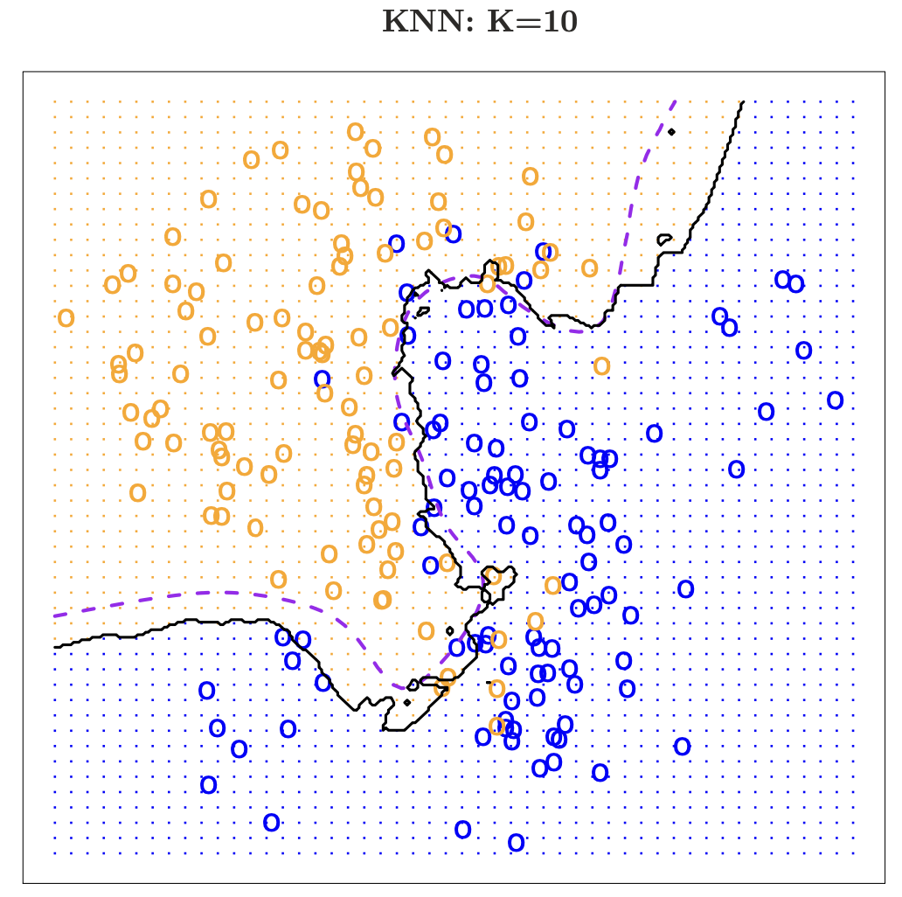

## Announcements

**Last time:**

- Finished linear regression

**Announcements:**

- Homework #2 due Wednesday 9/23
- Next Monday (9/28): review day. What we cover depends on what you ask.
- Wednesday 9/30: Exam #1
  - Bring one 8.5x11 sheet of paper, handwritten on both sides
  - Anything you want on it, but it must be your own work
  - It must have your name and group number
  - You must turn it in

## Covered in this lecture

- Ch 2.2.3
- Error rate (classification)
- Bayes classifier
- $K$-NN classification

# Classification Overview

## What is classification?

:::::: {.columns}

::::: {.column width="45%"}

**Classification:** when the response variable is qualitative (an unordered set of categories).

*Fill in during class: examples.*

:::::

::::: {.column width="50%"}

- Given a feature vector $X$ and a qualitative response $Y$ in the set $S$, the goal is to find a function (classifier) $C(X)$ that takes $X$ as input and predicts its value for $Y$.
- We are more interested in estimating the probabilities that $X$ belongs to each category.

:::::

::::::

## Some examples

- Predict whether a COVID-19 vaccine will work on a patient, given the patient's age.
- An online banking service wants to determine whether a transaction is fraudulent, based on the user's IP address, past transactions, and so on.

**Question:** what set does $Y$ come from in each case?

# Ch 2.2.3: Classification

## Error rate

:::::: {.columns}

::::: {.column width="50%"}

- Training data: $\{ (x_1,y_1),\cdots,(x_n,y_n) \}$ with $y_i$ qualitative
- Estimate $\hat y = \hat f (x)$
- Indicator variable: $\mathrm{I}(y_i \neq \hat y_i)$ is 1 if the prediction is wrong and 0 otherwise.

:::::

::::: {.column width="45%"}

Training error rate:
$$
\frac{1}{n} \sum_{i = 1}^n \mathrm{I}(y_i \neq \hat y_i)
$$

Test error rate:
$$
\mathrm{Ave}(\mathrm{I} (y_0 \neq \hat y_0))
$$

*Fill in during class: what makes a good classifier?*

:::::

::::::

## Best ever classifier

*We can't have nice things.*

:::::: {.columns}

::::: {.column width="45%"}

**Bayes classifier:**

Give every observation the *highest probability* class given its predictor variables:
$$
\Pr (Y = j \mid X = x_0)
$$

:::::

::::: {.column width="45%"}

*Fill in during class.*

:::::

::::::

## An example

:::::: {.columns}

::::: {.column width="55%"}

- Survey students for their amount of programming experience and current GPA.
- Try to predict whether they will pass CMSE 381.
- If we had a survey of all students that could ever exist, we could determine the probability of failure for each combination of those features.

:::::

::::: {.column width="40%"}

*Fill in during class.*

:::::

::::::

## Bayes decision boundary

:::::: {.columns}

::::: {.column width="50%"}

{fig-alt="Scatter plot of simulated points in two classes, blue and orange, plotted against X1 and X2, with a purple curve showing the Bayes decision boundary between the two regions" width="100%"}

:::::

::::: {.column width="45%"}

*Fill in during class.*

:::::

::::::

## Bayes error rate

:::::: {.columns}

::::: {.column width="50%"}

- Error at $X = x_0$:
$$
1 - \max_j \Pr(Y = j \mid X = x_0)
$$
- Overall Bayes error:
$$
1 - E \left(\max_j \Pr(Y = j \mid X = x_0) \right)
$$

:::::

::::: {.column width="45%"}

{fig-alt="Scatter plot of simulated points in two classes, blue and orange, with a purple curve showing the Bayes decision boundary" width="100%"}

:::::

::::::

## The game

:::::: {.columns}

::::: {.column width="50%"}

*Fill in during class.*

:::::

::::: {.column width="45%"}

{fig-alt="Scatter plot of simulated points in two classes, blue and orange, with a purple curve showing the Bayes decision boundary" width="100%"}

Test your understanding: [Poll Everywhere poll](https://PollEv.com/multiple_choice_polls/3uFsHVAocmUaGCYAc4Ynm/respond)

:::::

::::::

# $K$-Nearest Neighbors Classifier

## $K$-Nearest Neighbors

:::::: {.columns}

::::: {.column width="22%"}

{fig-alt="Small scatter plot of blue and orange points with a circle around the three nearest neighbors of a new point, labeled K = 3" width="100%"}

$K = 3$

:::::

::::: {.column width="50%"}

- Fix a positive integer $K$.
- $N(x)$ is the set of the $K$ closest neighbors to $x$.
- Estimate the conditional probability:
$$
\Pr(Y = j \mid X = x_0)
= \frac{1}{K} \sum_{i \in N(x_0)} \mathrm{I}(y_i = j)
$$
- Pick the $j$ with the highest value.

:::::

::::: {.column width="25%"}

{fig-alt="Scatter plot of blue and orange points, with a black line showing the K = 3 nearest neighbors decision boundary" width="100%"}

Black line: KNN decision boundary.

:::::

::::::

## Example: KNN predictions

Each point is labeled O or X. What are the KNN predictions for points A, B and C when $k=1$ and when $k=3$?

:::::: {.columns}

::::: {.column width="45%"}

{fig-alt="Scatter plot of points labeled O and X, with three unlabeled points marked A, B and C" width="100%"}

:::::

::::: {.column width="50%"}

| Point | $k=1$ prediction | $k=3$ prediction |
|-------|------------------|------------------|
| A     | *Fill in*        | *Fill in*        |
| B     | *Fill in*        | *Fill in*        |
| C     | *Fill in*        | *Fill in*        |

:::::

::::::

## Tradeoff

:::::: {.columns}

::::: {.column width="30%"}

$K = 1$

:::::

::::: {.column width="33%"}

{fig-alt="KNN decision boundary with K = 10 on the simulated data, close to the purple Bayes decision boundary" width="100%"}

$K = 10$

:::::

::::: {.column width="30%"}

$K = 100$

:::::

::::::

The purple curve is the Bayes decision boundary, the same in all three plots.

*Fill in during class: what is happening with $K=1$ and $K=100$?*

## More on tradeoff

:::::: {.columns}

::::: {.column width="58%"}

{fig-alt="Line plot of training and test error rates against 1 over K on a log scale; training error falls to zero as 1 over K grows, while test error is U-shaped" width="100%"}

:::::

::::: {.column width="40%"}

*Fill in during class.*

:::::

::::::

## Jupyter notebook

Open the Day 09 Jupyter notebook from the course site and work through it with your group.

## Next time

- Logistic regression

See also the [course schedule](../../../Course_Info/Schedule.html).

## Source and reading

- Textbook reading: Ch. 2.2.3 of [*An Introduction to Statistical Learning with Applications in Python*](https://www.statlearning.com/).
- Figures and datasets are from the textbook (ISLP) unless noted.
