## Announcements

- Monday 9/28: review day
- Wednesday 9/30: Exam #1
  - Bring one 8.5x11 sheet of paper, handwritten on both sides
  - Anything you want on it, but it must be your own work
  - It must have your name and group number
  - You will turn it in
  - Calculator without internet access

## Covered in this lecture

:::::: {.columns}

::::: {.column width="45%"}

**Last time:**

- Classification basics
- Bayes classifier
- KNN classifier

:::::

::::: {.column width="45%"}

**This time:**

- Logistic regression

:::::

::::::

# Review from last time

## Error rate

:::::: {.columns}

::::: {.column width="50%"}

- Training data: $\{ (x_1,y_1),\cdots,(x_n,y_n) \}$ with $y_i$ qualitative
- Estimate $\hat y = \hat f (x)$
- Indicator variable: $\mathrm{I}(y_i \neq \hat y_i)$ is 1 if the prediction is wrong and 0 otherwise.

:::::

::::: {.column width="45%"}

Training error rate:
$$
\frac{1}{n} \sum_{i = 1}^n \mathrm{I}(y_i \neq \hat y_i)
$$

Test error rate:
$$
\mathrm{Ave}(\mathrm{I} (y_0 \neq \hat y_0))
$$

:::::

::::::

## Best ever classifier

*We can't have nice things.*

:::::: {.columns}

::::: {.column width="45%"}

**Bayes classifier:**

Give every observation the highest probability class given its predictor variables:
$$
\Pr (Y = j \mid X = x_0)
$$

:::::

::::: {.column width="45%"}

Bayes decision boundary:

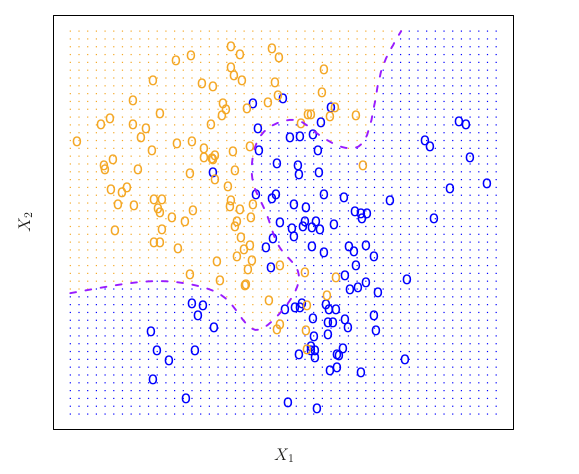{fig-alt="Scatter plot of simulated points in two classes, blue and orange, with a purple curve showing the Bayes decision boundary" width="100%"}

:::::

::::::

## Bayes error rate

:::::: {.columns}

::::: {.column width="50%"}

- Error at $X = x_0$:
$$
1 - \max_j \Pr(Y = j \mid X = x_0)
$$
- Overall Bayes error:
$$
1 - E \left(\max_j \Pr(Y = j \mid X = x_0) \right)
$$

:::::

::::: {.column width="45%"}

{fig-alt="Scatter plot of simulated points in two classes, blue and orange, with a purple curve showing the Bayes decision boundary" width="100%"}

:::::

::::::

## $K$-Nearest Neighbors

:::::: {.columns}

::::: {.column width="20%"}

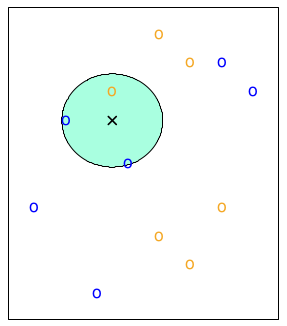{fig-alt="Small scatter plot with a circle around the three nearest neighbors of a new point, K = 3" width="100%"}

$K = 3$

:::::

::::: {.column width="20%"}

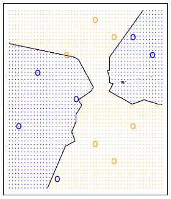{fig-alt="Scatter plot with a black line showing the K = 3 nearest neighbors decision boundary" width="100%"}

Decision boundary

:::::

::::: {.column width="50%"}

- Fix a positive integer $K$.
- $N(x)$ is the set of the $K$ closest neighbors to $x$.
- Estimate the conditional probability:
$$
\Pr(Y = j \mid X = x_0)
= \frac{1}{K} \sum_{i \in N(x_0)} \mathrm{I}(y_i = j)
$$
- Pick the $j$ with highest value.

:::::

::::::

:::::: {.columns}

::::: {.column width="30%"}

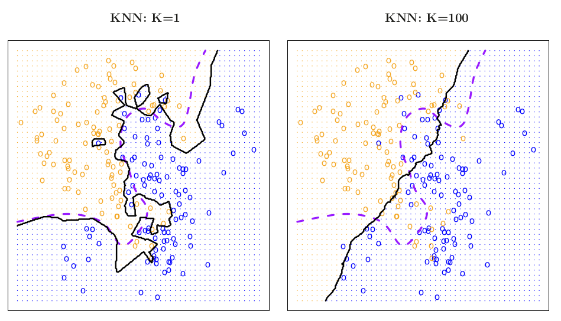{fig-alt="Two scatter plots with KNN decision boundaries for K = 1 and K = 100 compared to the Bayes boundary" width="100%"}

:::::

::::: {.column width="30%"}

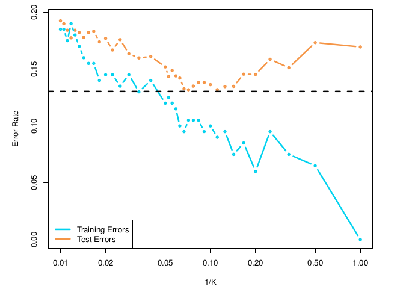{fig-alt="Line plot of training and test error rates against 1 over K; training error falls to zero as 1 over K grows, while test error is U-shaped" width="100%"}

:::::

::::::

# Logistic Regression

## Simulated `Default` data set

:::::: {.columns}

::::: {.column width="45%"}

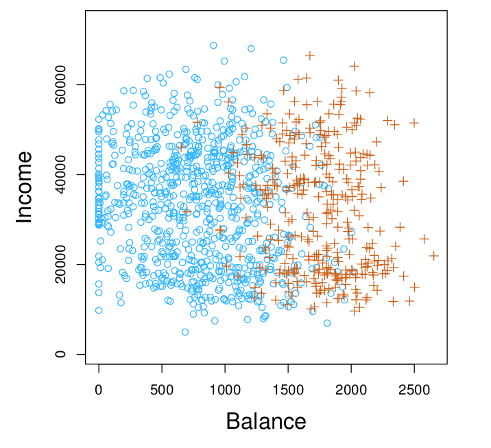{fig-alt="Scatter plot of income against balance for 10,000 simulated people, with those who defaulted shown in orange and those who did not in blue" width="100%"}

:::::

::::: {.column width="45%"}

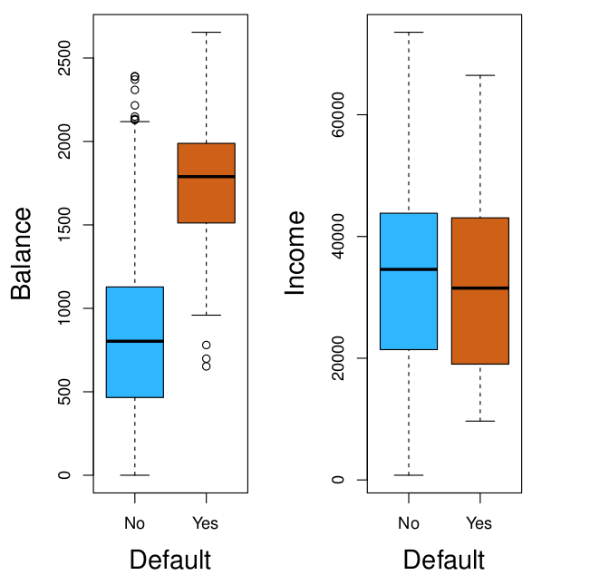{fig-alt="Box plots of balance and of income, split by whether the person defaulted. Defaulters have noticeably higher balances; income looks similar for both groups" width="80%"}

*Fill in during class.*

:::::

::::::

## What is classification?

:::::: {.columns}

::::: {.column width="55%"}

- Classification: the response variable is qualitative.
- Goal: model the probability that $Y$ belongs to a particular category.

$$
p(\texttt{balance}) =
\Pr(\texttt{default} = \texttt{yes} \mid \texttt{balance})
$$

:::::

::::: {.column width="35%"}

{fig-alt="Scatter plot of income against balance for simulated people, with defaulters in orange" width="100%"}

:::::

::::::

## Goal for the `Balance` data set

:::::: {.columns}

::::: {.column width="35%"}

{fig-alt="Scatter plot of income against balance for simulated people, with defaulters in orange" width="100%"}

:::::

::::: {.column width="55%"}

Goal: model the probability that $Y$ belongs to a particular category.

For example: $\Pr(\texttt{default} = \texttt{yes} \mid \texttt{balance})$

*Fill in during class.*

:::::

::::::

## Let's just use linear regression!

*Just kidding, that's a bad idea.*

:::::: {.columns}

::::: {.column width="45%"}

**Bad idea:**

- Set $Y$ to be a dummy variable taking values in $\{1,2,3,\cdots\}$.
- Run regression, and choose the category based on which integer value $\hat y$ is closest to.

:::::

::::: {.column width="50%"}

Example:
$$
Y =
\begin{cases}
1 & \text{if stroke}\\
2 & \text{if drug overdose}\\
3 & \text{if epileptic seizure}
\end{cases}
$$
versus
$$
Y =
\begin{cases}
1 & \text{if mild}\\
2 & \text{if moderate}\\
3 & \text{if severe}
\end{cases}
$$

:::::

::::::

*Fill in during class: what does the numbering imply?*

## Still not a great idea for two levels

:::::: {.columns}

::::: {.column width="45%"}

$$
p(\texttt{balance})=\Pr(\texttt{default} = \texttt{yes} \mid \texttt{balance})
$$
$$
Y =
\begin{cases}
0 & \text{if not default}\\
1 & \text{if default}
\end{cases}
$$

- Fit linear regression.
- Predict default if $\hat y > 0.5$; not default otherwise.

*Fill in during class.*

:::::

::::: {.column width="45%"}

$$
p(\texttt{balance}) = \beta_0 + \beta_1 \texttt{balance}
$$

:::::

::::::

## Approximating the probability

:::::: {.columns}

::::: {.column width="45%"}

$\Pr(\texttt{default} = \texttt{yes} \mid \texttt{balance})$

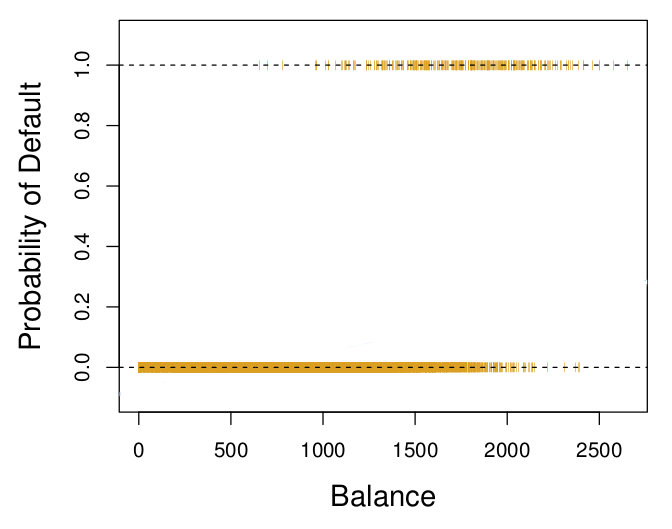{fig-alt="Plot of default (0 or 1) against balance: points at 0 for most balances and at 1 for high balances, with no fitted curve" width="100%"}

:::::

::::: {.column width="45%"}

*Fill in during class: what kind of function could approximate the probability?*

:::::

::::::

## Logistic function

:::::: {.columns}

::::: {.column width="45%"}

{fig-alt="S-shaped logistic curve that rises smoothly from 0 on the left to 1 on the right" width="100%"}

:::::

::::: {.column width="45%"}

$$
p(X) =
\frac{e^{\beta_0 + \beta_1X}}{1 +e^{\beta_0 + \beta_1X} }
$$

**Try it out:** [Desmos graph of the logistic function](https://www.desmos.com/calculator/cw1pyzzqci)

:::::

::::::

## Logistic regression

$$
\Pr(\texttt{default} = \texttt{yes} \mid \texttt{balance})
=
\frac{e^{\beta_0 + \beta_1 \texttt{balance}}}{1 +e^{\beta_0 + \beta_1\texttt{balance}} }
$$

Left: linear regression (previous slide). Right: logistic regression, shown here.

## Check your understanding

What will the drawn logistic regression classifier predict for each of the following values of `Balance`?

:::::: {.columns}

::::: {.column width="45%"}

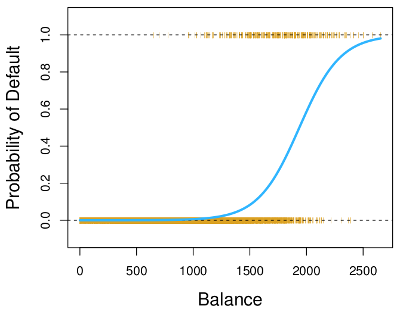{fig-alt="Logistic regression curve of probability of default against balance, with data points at 0 and 1" width="100%"}

:::::

::::: {.column width="45%"}

| Balance | Prediction |
|---------|------------|
| 0       | *Fill in*  |
| 500     | *Fill in*  |
| 1000    | *Fill in*  |
| 1500    | *Fill in*  |
| 2000    | *Fill in*  |
| 2500    | *Fill in*  |

:::::

::::::

## Odds

$$
\frac{p(x)}{1-p(x)}
= \frac{\Pr(Y = 1 \mid X=x)}{1-\Pr(Y = 1 \mid X=x)}
= \frac{\Pr(Y = 1 \mid X=x)}{\Pr(Y = 0 \mid X=x)}
$$

:::::: {.columns}

::::: {.column width="40%"}

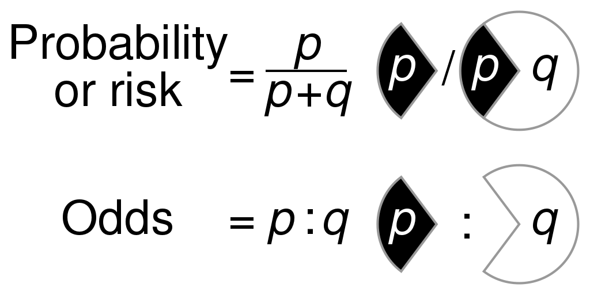{fig-alt="Graph showing how odds grow as probability increases from 0 to 1" width="70%"}

:::::

::::: {.column width="50%"}

Examples:

- If the probability of default is 90%, what are the odds?
  - $p(x) =0.9$
  - $\frac{0.9}{1-0.9} = 9$
- If the odds are 1/3, what is the probability of default?
  - $\frac{p}{1-p} = 1/3$
  - $3p = 1-p$
  - $4p = 1$
  - $p = 1/4$

:::::

::::::

## Making the nonlinear linear

Assume the (natural) log odds (logits) follow a linear model:
$$
\log \left( \frac{p(x)}{1-p(x)} \right) = \beta_0 + \beta_1x
$$

Do some algebra and get $p(x)$:
$$
p(x) = \frac{e^{\beta_0 + \beta_1x}}{1+e^{\beta_0 + \beta_1x}}
$$

Playing with the logistic function: [Desmos graph](https://www.desmos.com/calculator/cw1pyzzqci)

## Using coefficients to make predictions

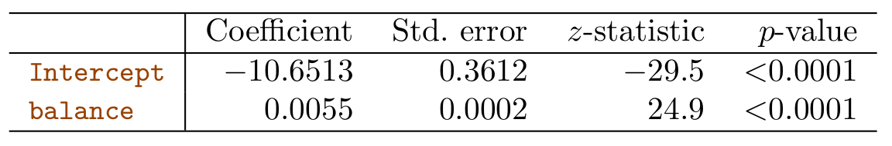{fig-alt="Table of logistic regression coefficient estimates for predicting default from balance, with a row for the intercept and a row for balance, and columns for the coefficient, standard error, z-statistic and p-value" width="60%"}

- What is the estimated probability of default for someone with a balance of \$1,000?
- What is the estimated probability of default for someone with a balance of \$2,000?

*Work these out in class.*

## Interpreting the coefficients

:::::: {.columns}

::::: {.column width="45%"}

$$
p(x) = \frac{e^{\beta_0 + \beta_1x}}{1+e^{\beta_0 + \beta_1x}}
$$

$$
\log \left( \frac{p(x)}{1-p(x)} \right) = \beta_0 + \beta_1x
$$

:::::

::::: {.column width="50%"}

{fig-alt="Table of logistic regression coefficient estimates for predicting default from balance, with a row for the intercept and a row for balance, and columns for the coefficient, standard error, z-statistic and p-value" width="100%"}

*Fill in during class: what does $\beta_1$ mean?*

:::::

::::::

## Confusion matrix: predicting `default` from `balance`

:::::: {.columns}

::::: {.column width="48%"}

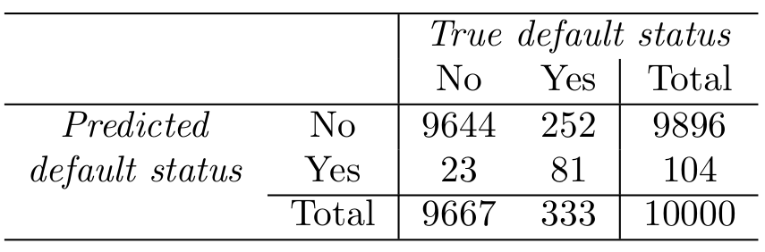{fig-alt="Confusion matrix of predicted default status against true default status, with counts of correct and incorrect predictions in each cell" width="100%"}

This table comes from the LDA section of the textbook, but we can use it to understand the confusion matrix.

:::::

::::: {.column width="48%"}

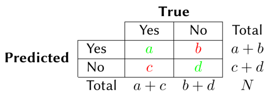{fig-alt="Labeled confusion matrix showing true positives, false positives, true negatives and false negatives" width="100%"}

:::::

::::::

## Jupyter notebook

Open the Day 10 Jupyter notebook from the course site and work through it with your group.

## Next time

- Multiple logistic regression and multinomial logistic regression

See also the [course schedule](../../../Course_Info/Schedule.html).

## Source and reading

- Textbook reading: Ch. 4.1–4.3 of [*An Introduction to Statistical Learning with Applications in Python*](https://www.statlearning.com/).
- Figures and datasets are from the textbook (ISLP) unless noted.
