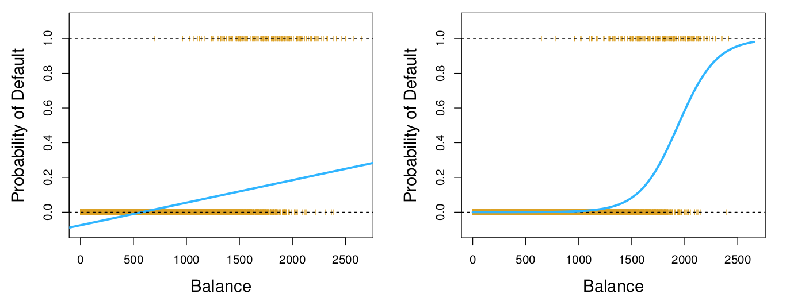
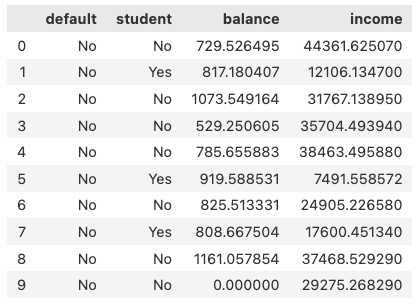

## Announcements

- Monday 9/28: project day. We will talk about the project.
- Monday 9/28: review day
- Wednesday 9/30: Exam #1
  - Bring one 8.5x11 sheet of paper, handwritten on both sides
  - Anything you want on it, but it must be your own work
  - It must have your name and group number
  - You will turn it in
  - Calculator without internet access

## Covered in this lecture

:::::: {.columns}

::::: {.column width="45%"}

**Last time:**

- Logistic regression

:::::

::::: {.column width="45%"}

**This time:**

- Multiple logistic regression
- Multinomial logistic regression

:::::

::::::

# Review of Logistic Regression from last time

## Logistic regression

:::::: {.columns}

::::: {.column width="45%"}

- Assume a single input $\texttt{X}$.
- The output takes values $\texttt{Y} \in \{\texttt{Yes}, \texttt{No}\}$.

:::::

::::: {.column width="45%"}

$$
p(\texttt{X})=\Pr(\texttt{Y} = \texttt{yes} \mid \texttt{balance})
$$

:::::

::::::

:::::: {.columns}

::::: {.column width="45%"}

:::::

::::: {.column width="45%"}

$$
p(\texttt{x}) = \frac{e^{\beta_0 + \beta_1 \texttt{x}}}{1 +e^{\beta_0 + \beta_1\texttt{x}} }
$$

:::::

::::::

## How to get the logistic function

:::::: {.columns}

::::: {.column width="45%"}

Assume the (natural) log odds (logits) follow a linear model:
$$
\log \left( \frac{p(x)}{1-p(x)} \right) = \beta_0 + \beta_1x
$$

:::::

::::: {.column width="45%"}

Solve for $p(x)$:
$$
p(x) = \frac{e^{\beta_0 + \beta_1x}}{1+e^{\beta_0 + \beta_1x}}
$$

:::::

::::::

Playing with the logistic function: [Desmos graph](https://www.desmos.com/calculator/cw1pyzzqci)

# Multiple Logistic Regression

## New assumption

:::::: {.columns}

::::: {.column width="45%"}

$p\geq 1$ input variables:
$$
X_1,X_2,\cdots, X_p
$$

:::::

::::: {.column width="45%"}

The output variable $Y$ has only two levels.

:::::

::::::

## Multiple logistic regression

**Multiple features:**
$$
p(X) = \frac{e^{\beta_0 + \beta_1X_1 + \cdots + \beta_pX_p}}{1+e^{\beta_0 + \beta_1X_1 + \cdots + \beta_pX_p}}
$$

**Equivalent to:**
$$
\log\left( \frac{p(X)}{1-p(X)} \right)
= \beta_0 + \beta_1X_1 + \cdots + \beta_pX_p
$$

## Example

:::::: {.columns}

::::: {.column width="45%"}

{fig-alt="Table showing the first rows of the Default data set, with columns default, student, balance and income" width="100%"}

The `Default` data set

:::::

::::: {.column width="45%"}

Predict `default` from `balance`, `student`, and `income`.

*Fill in during class: write the model.*

:::::

::::::

# Multinomial Logistic Regression

## New assumption

:::::: {.columns}

::::: {.column width="45%"}

$p\geq 1$ input variables:
$$
X_1,X_2,\cdots, X_p
$$

:::::

::::: {.column width="45%"}

The output variable $Y$ has $K$ levels.

:::::

::::::

## Remember dummy variables?

*A slide from the linear regression days.*

:::::: {.columns}

::::: {.column width="35%"}

`Region`:

| Region | $x_{i1}$ | $x_{i2}$ |
|--------|----------|----------|
| South  | 1        | 0        |
| West   | 0        | 1        |
| East   | 0        | 0        |

:::::

::::: {.column width="55%"}

Create sparse dummy variables:

$$
x_{i1} =
\begin{cases}
1 & \text{if $i$th person from South}\\
0 & \text{if $i$th person not from South}
\end{cases}
$$

$$
x_{i2} =
\begin{cases}
1 & \text{if $i$th person from West}\\
0 & \text{if $i$th person not from West}
\end{cases}
$$

:::::

::::::

$$
y_i = \beta_0 + \beta_1x_{i1}+ \beta_2x_{i2}+\epsilon_i
$$

*Fill in during class: are we doing this now?*

## Example

Predict $Y \in \{\texttt{stroke, overdose, seizure}\}$ for hospital visits based on some input(s) $X$.

$$
\begin{aligned}
\Pr(Y = \texttt{stroke} \mid X = x) &= \;?\\
\Pr(Y = \texttt{overdose} \mid X = x) &= \;?\\
\Pr(Y = \texttt{seizure} \mid X = x) &= \;?
\end{aligned}
$$

*Fill in during class.*

## Multinomial logistic regression, Plan A

:::::: {.columns}

::::: {.column width="35%"}

- Assume $Y$ has $K$ levels.
- Make level $K$ (the last one) the baseline.

:::::

::::: {.column width="60%"}

For $k = 1, \ldots, K-1$:
$$
\Pr(Y = k \mid X = x) =
\frac{e^{\beta_{k0} + \beta_{k1}x_1 + \cdots + \beta_{kp}x_p}}
{1 + \sum_{l=1}^{K-1} e^{\beta_{l0} + \beta_{l1}x_1 + \cdots + \beta_{lp}x_p}}
$$

and for the baseline:
$$
\Pr(Y = K \mid X = x) =
\frac{1}
{1 + \sum_{l=1}^{K-1} e^{\beta_{l0} + \beta_{l1}x_1 + \cdots + \beta_{lp}x_p}}
$$

:::::

::::::

## Example

Predict $Y \in \{\texttt{stroke, overdose, seizure}\}$ for hospital visits based on $X$.

$$
\begin{aligned}
\Pr(Y = \texttt{stroke} \mid X = x) &= \frac{\exp(\beta_{\texttt{str},0} + \beta_{\texttt{str},1}x)}{1 + \exp(\beta_{\texttt{str},0} + \beta_{\texttt{str},1}x) + \exp(\beta_{\texttt{OD},0} + \beta_{\texttt{OD},1}x) }\\[1ex]
\Pr(Y = \texttt{overdose} \mid X = x) &= \frac{\exp(\beta_{\texttt{OD},0} + \beta_{\texttt{OD},1}x)}{1 + \exp(\beta_{\texttt{str},0} + \beta_{\texttt{str},1}x) + \exp(\beta_{\texttt{OD},0} + \beta_{\texttt{OD},1}x) }\\[1ex]
\Pr(Y = \texttt{seizure} \mid X = x) &= \frac{1}{1 + \exp(\beta_{\texttt{str},0} + \beta_{\texttt{str},1}x) + \exp(\beta_{\texttt{OD},0} + \beta_{\texttt{OD},1}x) }
\end{aligned}
$$

*Fill in during class: which level is the baseline?*

## Log odds

The model is built so that the log odds between *any pair of* classes is linear.

Specifically, for $Y=k$ versus $Y=K$, we have
$$
\log\left(
\frac{\Pr(Y = k \mid X = x)}{\Pr(Y = K \mid X = x)}
\right)
= \beta_{k0} + \beta_{k1}x_1 + \cdots + \beta_{kp}{x_p}
$$

## Plan B: Softmax coding

Treat all levels symmetrically:
$$
\Pr(Y = k \mid X = x) =
\frac{e^{\beta_{k0} + \beta_{k1}x_1 + \cdots + \beta_{kp}x_p}}
{\sum_{l=1}^{K} e^{\beta_{l0} + \beta_{l1}x_1 + \cdots + \beta_{lp}x_p}}
$$

The log odds between two classes $k$ and $k'$ is still linear:
$$
\log\left(
\frac{\Pr(Y = k \mid X = x)}{\Pr(Y = k' \mid X = x)}
\right)
= (\beta_{k0} - \beta_{k'0}) + (\beta_{k1} - \beta_{k'1})x_1 + \cdots + (\beta_{kp} - \beta_{k'p})x_p
$$

## Softmax example

$$
\begin{aligned}
\Pr(Y = \texttt{stroke} \mid X = x) &= \frac{\exp(\beta_{\texttt{str},0} + \beta_{\texttt{str},1}x)}
{\exp(\beta_{\texttt{str},0} + \beta_{\texttt{str},1}x) + \exp(\beta_{\texttt{OD},0} + \beta_{\texttt{OD},1}x) + \exp(\beta_{\texttt{seiz},0} + \beta_{\texttt{seiz},1}x) }\\[1ex]
\Pr(Y = \texttt{overdose} \mid X = x) &= \frac{\exp(\beta_{\texttt{OD},0} + \beta_{\texttt{OD},1}x)}{ \exp(\beta_{\texttt{str},0} + \beta_{\texttt{str},1}x) + \exp(\beta_{\texttt{OD},0} + \beta_{\texttt{OD},1}x) + \exp(\beta_{\texttt{seiz},0} + \beta_{\texttt{seiz},1}x) }\\[1ex]
\Pr(Y = \texttt{seizure} \mid X = x) &= \frac{\exp(\beta_{\texttt{seiz},0} + \beta_{\texttt{seiz},1}x) }{ \exp(\beta_{\texttt{str},0} + \beta_{\texttt{str},1}x) + \exp(\beta_{\texttt{OD},0} + \beta_{\texttt{OD},1}x) + \exp(\beta_{\texttt{seiz},0} + \beta_{\texttt{seiz},1}x) }
\end{aligned}
$$

## Jupyter notebook

Open the Day 11 Jupyter notebook from the course site and work through it with your group.

## Next time

- Project and review day

See also the [course schedule](../../../Course_Info/Schedule.html).

## Source and reading

- Textbook reading: Ch. 4.3–4.5 of [*An Introduction to Statistical Learning with Applications in Python*](https://www.statlearning.com/).
- Figures and datasets are from the textbook (ISLP) unless noted.
