## Announcements

**Last time:**

- Exam #1

**Announcements:**

- Exam 1 grades: hopefully soon.
- The full semester plan is on the [course schedule](../../../Course_Info/Schedule.html).

## Covered in this lecture

- Validation set
- LOO CV

# Validation set

## What's the problem?

- How well is my ML method doing? *Model assessment*
- Which method is best for our data?
- How many features should I use? Which ones? *Model selection*
- What is the uncertainty in the learned parameters?

## Training error vs testing error

:::::: {.columns}

::::: {.column width="45%"}

**Training error**

*Fill in during class.*

:::::

::::: {.column width="45%"}

**Testing error**

*Fill in during class.*

:::::

::::::

## Throw-back

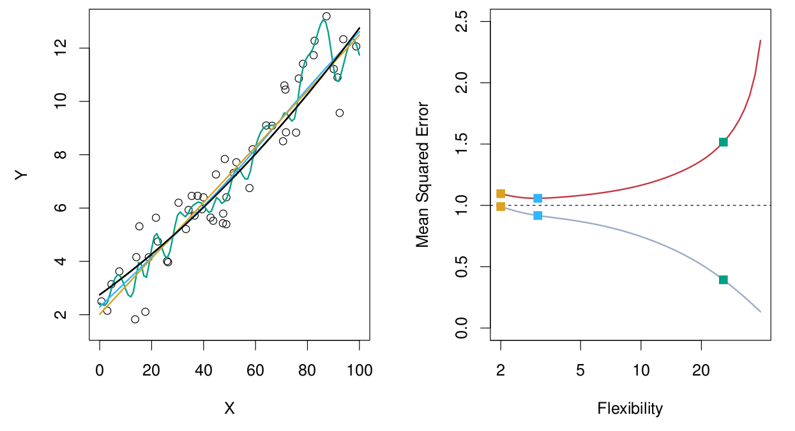{fig-alt="Plot on left is scatter plot for simulated close to linear data with three different fits of varying flexibility. Plot on right shows the training and testing MSE as a function of flexibility" width="80%"}

## Model tradeoffs

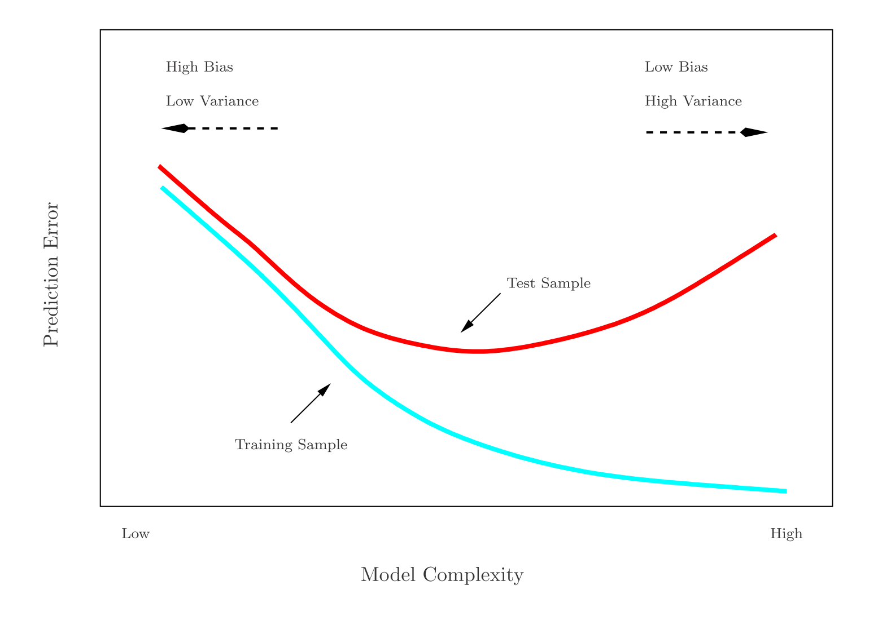{fig-alt="Prediction error versus model complexity. One curve shows the training sample error, while another curve shows the test sample error." width="70%"}

## Validation set approach

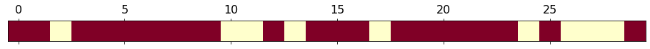{fig-alt="A horizontal bar representing data points with random chunks colored as either red (training set) or yellow (test set)." width="100%"}

:::::: {.columns}

::::: {.column width="55%"}

- Divide randomly into two parts:
  - Training set
  - Validation / hold-out / testing set
- Fit the model on the training set.
- Use the fitted model to predict the response for the observations in the test set.
- Evaluate the quality (for example, MSE).

:::::

::::: {.column width="40%"}

*Fill in during class.*

:::::

::::::

## Example with the `auto` data

:::::: {.columns}

::::: {.column width="45%"}

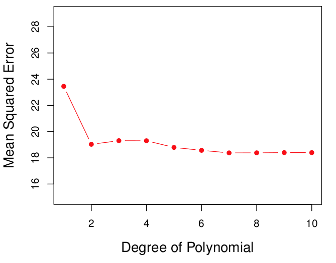{fig-alt="Plot of validation set mean squared error against the degree of the polynomial, for predicting mpg from horsepower" width="100%"}

:::::

::::: {.column width="45%"}

Predicting `mpg` using `horsepower`:
$$
\texttt{mpg} = \beta_0 + \beta_1 \texttt{hp} + \beta_2 \texttt{hp}^2  + \cdots + \beta_p \texttt{hp} ^p
$$

*Fill in during class.*

:::::

::::::

## Rinse and repeat

{fig-alt="Random split 1 of 5. A horizontal bar representing data points with random chunks colored as either red (training set) or yellow (test set)." width="90%"}

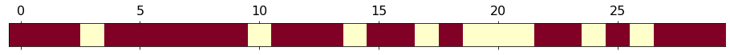{fig-alt="Random split 2 of 5. A horizontal bar representing data points with random chunks colored as either red (training set) or yellow (test set)." width="90%"}

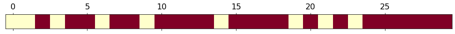{fig-alt="Random split 3 of 5. A horizontal bar representing data points with random chunks colored as either red (training set) or yellow (test set)." width="90%"}

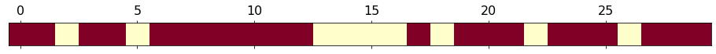{fig-alt="Random split 4 of 5. A horizontal bar representing data points with random chunks colored as either red (training set) or yellow (test set)." width="90%"}

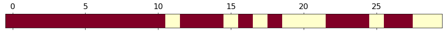{fig-alt="Random split 5 of 5. A horizontal bar representing data points with random chunks colored as either red (training set) or yellow (test set)." width="90%"}

## Again, example with `auto` data

:::::: {.columns}

::::: {.column width="45%"}

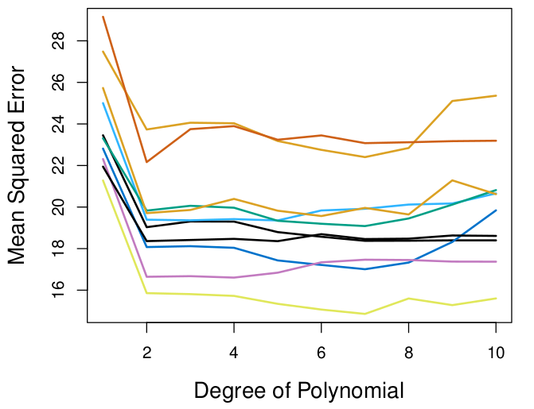{fig-alt="Mean squared error versus degree of polynomial. Multiple curves corresponding to different validation sets are shown." width="100%"}

:::::

::::: {.column width="45%"}

*Fill in during class: what do the different curves tell us?*

:::::

::::::

## Coding example in the Jupyter notebook

Open the Day 14 Jupyter notebook from the course site and work through the validation set section.

# Leave-One-Out Cross-Validation (LOOCV)

## The idea

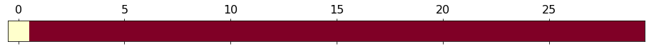{fig-alt="A horizontal bar representing data points with a yellow square (test set) at the zeroth position of the bar with the rest of the bar red (training set)" width="90%"}

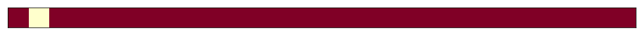{fig-alt="A horizontal bar representing data points with a yellow square (test set) at the first position of the bar with the rest of the bar red (training set)" width="90%"}

{fig-alt="A horizontal bar representing data points with a yellow square (test set) at the second position of the bar with the rest of the bar red (training set)" width="90%"}

{fig-alt="A horizontal bar representing data points with a yellow square (test set) at the third position of the bar with the rest of the bar red (training set)" width="90%"}

{fig-alt="A horizontal bar representing data points with a yellow square (test set) at the fourth position of the bar with the rest of the bar red (training set)" width="90%"}

$\vdots$

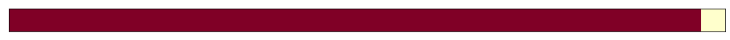{fig-alt="A horizontal bar representing data points with a yellow square (test set) at the last, rightmost position of the bar with the rest of the bar red (training set)" width="90%"}

## The idea in mathy words

:::::: {.columns}

::::: {.column width="55%"}

- Remove $(x_1,y_1)$ for testing.
- Train the model on $n-1$ points: $\{(x_2,y_2), \cdots, (x_n,y_n)\}$.
- Calculate $\mathrm{MSE}_1 = (y_1-\hat y_1)^2$.
- Remove $(x_2,y_2)$ for testing.
- Train the model on $n-1$ points: $\{(x_1,y_1),(x_3,y_3), \cdots, (x_n,y_n)\}$.
- Calculate $\mathrm{MSE}_2 = (y_2-\hat y_2)^2$.
- Rinse and repeat.

:::::

::::: {.column width="40%"}

Return the score:
$$
CV_{(n)} = \frac{1}{n}\sum_{i=1}^n \mathrm{MSE}_i
$$

:::::

::::::

## Again, example with `auto` data

:::::: {.columns}

::::: {.column width="45%"}

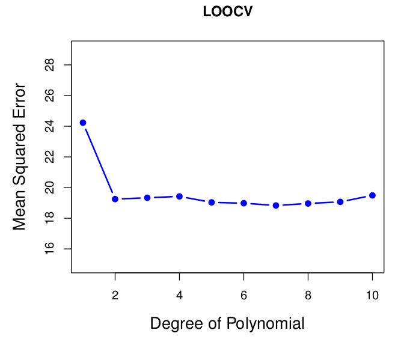{fig-alt="Mean squared error versus degree of polynomial for LOOCV." width="100%"}

:::::

::::: {.column width="45%"}

*Fill in during class.*

:::::

::::::

## LOOCV coding section

Open the Day 14 Jupyter notebook from the course site and work through the LOOCV section.

## LOOCV pros and cons

:::::: {.columns}

::::: {.column width="45%"}

**Advantages:**

*Fill in during class.*

:::::

::::: {.column width="45%"}

**Disadvantages:**

*Fill in during class.*

:::::

::::::

## TL;DR

:::::: {.columns}

::::: {.column width="30%"}

**Validation set**

{fig-alt="Random split 1 of 5. A horizontal bar representing data points with random chunks colored as either red (training set) or yellow (test set)." width="100%"}

{fig-alt="Random split 2 of 5. A horizontal bar representing data points with random chunks colored as either red (training set) or yellow (test set)." width="100%"}

{fig-alt="Random split 3 of 5. A horizontal bar representing data points with random chunks colored as either red (training set) or yellow (test set)." width="100%"}

{fig-alt="Random split 4 of 5. A horizontal bar representing data points with random chunks colored as either red (training set) or yellow (test set)." width="100%"}

{fig-alt="Random split 5 of 5. A horizontal bar representing data points with random chunks colored as either red (training set) or yellow (test set)." width="100%"}

:::::

::::: {.column width="30%"}

**LOO-CV**

{fig-alt="A horizontal bar representing data points with a yellow square (test set) at the zeroth position of the bar with the rest of the bar red (training set)" width="100%"}

{fig-alt="A horizontal bar representing data points with a yellow square (test set) at the first position of the bar with the rest of the bar red (training set)" width="100%"}

{fig-alt="A horizontal bar representing data points with a yellow square (test set) at the second position of the bar with the rest of the bar red (training set)" width="100%"}

$\vdots$

{fig-alt="A horizontal bar representing data points with a yellow square (test set) at the last, rightmost position of the bar with the rest of the bar red (training set)" width="100%"}

:::::

::::: {.column width="35%"}

**LOO-CV score**

$$
CV_{(n)} = \frac{1}{n}\sum_{i=1}^n \mathrm{MSE}_i
$$

:::::

::::::

## Next time

- More $K$-fold CV

See also the [course schedule](../../../Course_Info/Schedule.html).

## Source and reading

- Textbook reading: Ch. 5.1.1–5.1.3 of [*An Introduction to Statistical Learning with Applications in Python*](https://www.statlearning.com/).
- Figures and datasets are from the textbook (ISLP) unless noted.
