## Announcements

**Last time:**

- $k$-fold CV

**This lecture:**

- More $k$-fold CV
- Bias-variance tradeoff
- $k$-fold CV for polynomial regression

See also the [course schedule](../../../Course_Info/Schedule.html).

# $k$-fold CV

## Approximations of test error

:::::: {.columns}

::::: {.column width="30%"}

**Validation set**

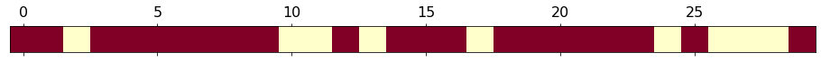{fig-alt="Random split 1 of 5. A horizontal bar representing data points with random chunks colored as either red (training set) or yellow (test set)." width="100%"}

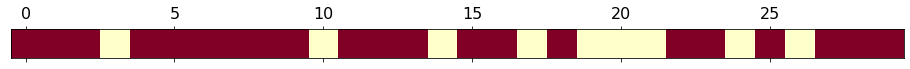{fig-alt="Random split 2 of 5. A horizontal bar representing data points with random chunks colored as either red (training set) or yellow (test set)." width="100%"}

{fig-alt="Random split 3 of 5. A horizontal bar representing data points with random chunks colored as either red (training set) or yellow (test set)." width="100%"}

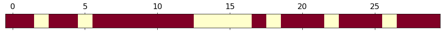{fig-alt="Random split 4 of 5. A horizontal bar representing data points with random chunks colored as either red (training set) or yellow (test set)." width="100%"}

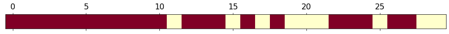{fig-alt="Random split 5 of 5. A horizontal bar representing data points with random chunks colored as either red (training set) or yellow (test set)." width="100%"}

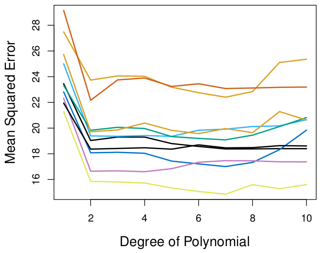{fig-alt="Validation set approach on the auto data: mean squared error versus degree of polynomial, with multiple curves for different random validation sets." width="80%"}

:::::

::::: {.column width="30%"}

**LOOCV**

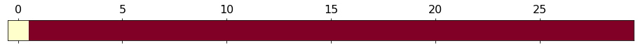{fig-alt="A horizontal bar representing data points with a yellow square (test set) at the first position of the bar with the rest of the bar red (training set)" width="100%"}

{fig-alt="A horizontal bar representing data points with a yellow square (test set) at the second position of the bar with the rest of the bar red (training set)" width="100%"}

{fig-alt="A horizontal bar representing data points with a yellow square (test set) at the third position of the bar with the rest of the bar red (training set)" width="100%"}

$\vdots$

{fig-alt="A horizontal bar representing data points with a yellow square (test set) at the last, rightmost position of the bar with the rest of the bar red (training set)" width="100%"}

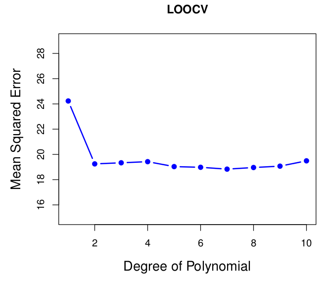{fig-alt="Mean squared error versus degree of polynomial for LOOCV on the auto data. The curve is the same every time." width="80%"}

:::::

::::: {.column width="30%"}

**$K$-fold CV**

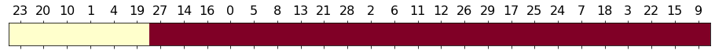{fig-alt="Five-fold cross-validation, split 1 of 5. The first fold is yellow (test set) and the other four folds are red (training set)." width="100%"}

{fig-alt="Five-fold cross-validation, split 2 of 5. The second fold is yellow (test set) and the other four folds are red (training set)." width="100%"}

{fig-alt="Five-fold cross-validation, split 3 of 5. The third fold is yellow (test set) and the other four folds are red (training set)." width="100%"}

{fig-alt="Five-fold cross-validation, split 4 of 5. The fourth fold is yellow (test set) and the other four folds are red (training set)." width="100%"}

{fig-alt="Five-fold cross-validation, split 5 of 5. The fifth fold is yellow (test set) and the other four folds are red (training set)." width="100%"}

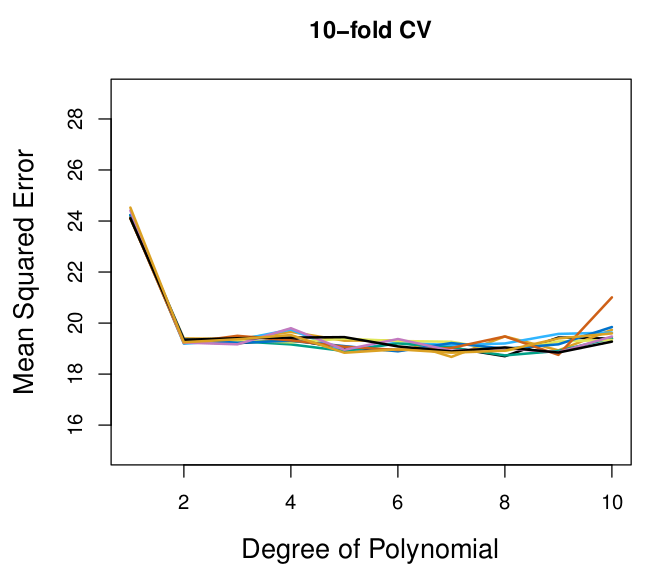{fig-alt="Mean squared error versus degree of polynomial for 10-fold cross-validation on the auto data, repeated with several different random splits into folds." width="80%"}

:::::

::::::

## Definition of $k$-fold CV

:::::: {.columns}

::::: {.column width="55%"}

- Randomly split the data into $k$ groups (folds).
- The folds are approximately equal in size. For notation, say each fold has $\ell$ points.
- Remove the $i$th fold $U_i$ and reserve it for testing.
- Train the model on the remaining points.
- Calculate $\mathrm{MSE}_i = \frac{1}{\ell} \sum_{(x_j,y_j) \in U_i}(y_j-\hat y_j)^2$.
- Rinse and repeat.

Return
$$
CV_{(k)} = \frac{1}{k} \sum_{i=1}^k \mathrm{MSE}_i
$$

:::::

::::: {.column width="40%"}

{fig-alt="Five-fold cross-validation, split 1 of 5. The first fold is yellow (test set) and the other four folds are red (training set)." width="100%"}

{fig-alt="Five-fold cross-validation, split 2 of 5. The second fold is yellow (test set) and the other four folds are red (training set)." width="100%"}

{fig-alt="Five-fold cross-validation, split 3 of 5. The third fold is yellow (test set) and the other four folds are red (training set)." width="100%"}

{fig-alt="Five-fold cross-validation, split 4 of 5. The fourth fold is yellow (test set) and the other four folds are red (training set)." width="100%"}

{fig-alt="Five-fold cross-validation, split 5 of 5. The fifth fold is yellow (test set) and the other four folds are red (training set)." width="100%"}

:::::

::::::

## Comparison with simulated data: Example 3

:::::: {.columns}

::::: {.column width="35%"}

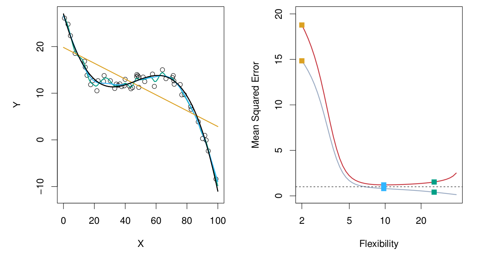

:::::

::::: {.column width="30%"}

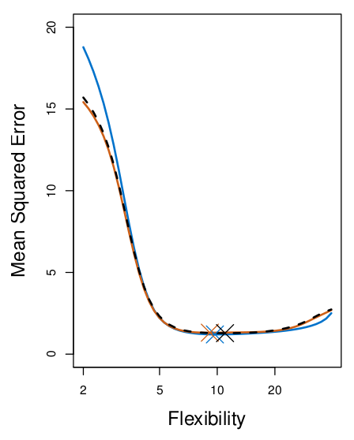{fig-alt="Plot comparing the true test MSE, the LOOCV estimate, and the 10-fold CV estimate against flexibility. The three curves are very similar." width="100%"}

:::::

::::: {.column width="30%"}

*Fill in during class: the blue curve is the true test MSE, the black dashed curve is LOOCV, and the orange curve is 10-fold CV. The crosses mark the minimum of each curve.*

:::::

::::::

## Comparison with simulated data: Example 1

:::::: {.columns}

::::: {.column width="35%"}

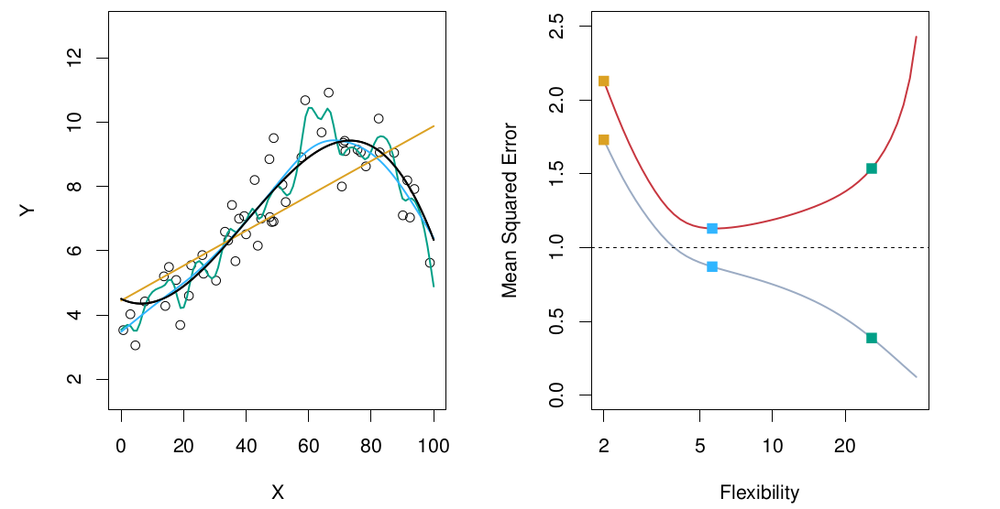

:::::

::::: {.column width="32%"}

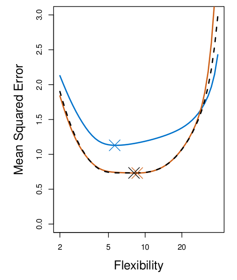{fig-alt="Plot comparing the true test MSE, the LOOCV estimate, and the 10-fold CV estimate against flexibility. The cross-validation estimates are below the true test MSE." width="100%"}

:::::

::::: {.column width="30%"}

*Fill in during class.*

:::::

::::::

## Comparison with simulated data: Example 2

:::::: {.columns}

::::: {.column width="35%"}

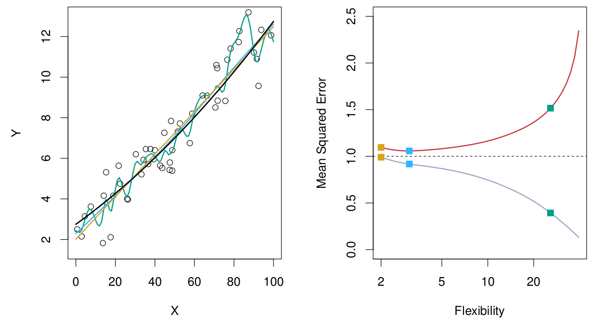

:::::

::::: {.column width="32%"}

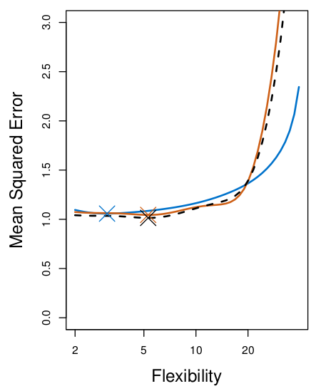{fig-alt="Plot comparing the true test MSE, the LOOCV estimate, and the 10-fold CV estimate against flexibility. The estimates are close at low flexibility and differ from the true test MSE at higher flexibility." width="100%"}

:::::

::::: {.column width="30%"}

*Fill in during class.*

:::::

::::::

## Takeaways from the examples

*Fill in during class.*

## Bias-variance tradeoff: bias

$$
E(y_0 - \hat f (x_0))^2 = \mathrm{Var}(\hat f (x_0))
	+ \left[\mathrm{Bias}(\hat f(x_0)) \right] ^2
	+ \mathrm{Var}(\epsilon)
$$

*Fill in during class: here we talk about the bias in the estimate of the test error. Compare the validation set, $k$-fold CV, and LOOCV.*

## Bias-variance tradeoff: variance

$$
E(y_0 - \hat f (x_0))^2 = \mathrm{Var}(\hat f (x_0))
	+ \left[\mathrm{Bias}(\hat f(x_0)) \right] ^2
	+ \mathrm{Var}(\epsilon)
$$

:::::: {.columns}

::::: {.column width="48%"}

**LOOCV**

*Fill in during class.*

:::::

::::: {.column width="48%"}

**$k$-fold CV**

*Fill in during class.*

:::::

::::::

## In short: validation versus test

- All the time, we are pretending that the validation set (or each fold) is the test set...
- ...when it is not.

*Fill in during class.*

## Real-world example: Chekroud et al., Science 383, 164–167 (2024)

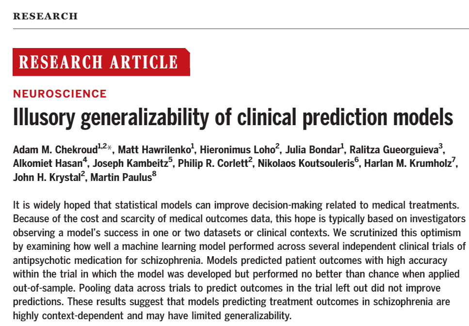{fig-alt="First figure from Chekroud et al., Science 383, 164-167 (2024), on the illusory generalizability of clinical prediction models." width="70%" fig-align="center"}

## Real-world example: Chekroud et al., Science 383, 164–167 (2024)

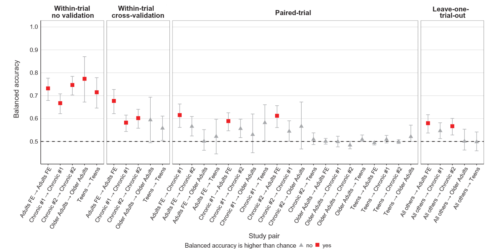{fig-alt="Second figure from Chekroud et al., Science 383, 164-167 (2024), on the illusory generalizability of clinical prediction models." width="90%" fig-align="center"}

# Using $k$-fold CV on polynomial linear regression

## Polynomial regression

:::::: {.columns}

::::: {.column width="48%"}

Replace the linear model
$$
y_i = \beta_0 + \beta_1x_1 + \epsilon_i
$$
with
$$
y_i = \beta_0 + \beta_1x_1 + \beta_2x_1^2 + \cdots + \beta_dx_1^d + \epsilon_i
$$

:::::

::::: {.column width="48%"}

*Fill in during class.*

:::::

::::::

## Faking linear regression into doing our work for us

*Fill in during class.*

## Coding: polynomial regression with $k$-fold CV

Open the Jupyter notebook on the Day 15 page.

## Next time

- $k$-fold CV for classification

See also the [course schedule](../../../Course_Info/Schedule.html).

## Source and reading

- Textbook reading: Ch. 5.1.4–5.1.5 of [*An Introduction to Statistical Learning with Applications in Python*](https://www.statlearning.com/).
- Chekroud, A. M., et al. (2024). Illusory generalizability of clinical prediction models. *Science*, 383, 164–167.
- Figures and datasets are from the textbook (ISLP) unless noted.
