## Announcements

**Last time:**

- $k$-fold CV

**This lecture:**

- CV for classification

See also the [course schedule](../../../Course_Info/Schedule.html).

# Last time

## Approximations of test error

:::::: {.columns}

::::: {.column width="30%"}

**Validation set**

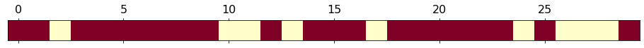{fig-alt="Random split 1 of 5. A horizontal bar representing data points with random chunks colored as either red (training set) or yellow (test set)." width="100%"}

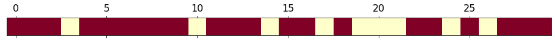{fig-alt="Random split 2 of 5. A horizontal bar representing data points with random chunks colored as either red (training set) or yellow (test set)." width="100%"}

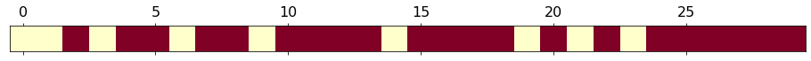{fig-alt="Random split 3 of 5. A horizontal bar representing data points with random chunks colored as either red (training set) or yellow (test set)." width="100%"}

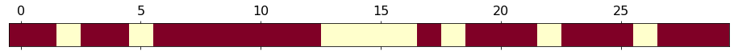{fig-alt="Random split 4 of 5. A horizontal bar representing data points with random chunks colored as either red (training set) or yellow (test set)." width="100%"}

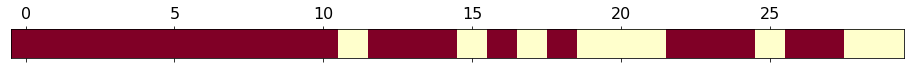{fig-alt="Random split 5 of 5. A horizontal bar representing data points with random chunks colored as either red (training set) or yellow (test set)." width="100%"}

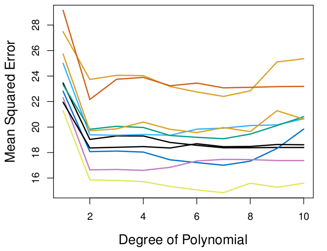{fig-alt="Validation set approach on the auto data: mean squared error versus degree of polynomial, with multiple curves for different random validation sets." width="80%"}

:::::

::::: {.column width="30%"}

**LOOCV**

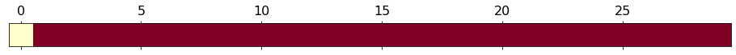{fig-alt="A horizontal bar representing data points with a yellow square (test set) at the first position of the bar with the rest of the bar red (training set)" width="100%"}

{fig-alt="A horizontal bar representing data points with a yellow square (test set) at the second position of the bar with the rest of the bar red (training set)" width="100%"}

{fig-alt="A horizontal bar representing data points with a yellow square (test set) at the third position of the bar with the rest of the bar red (training set)" width="100%"}

$\vdots$

{fig-alt="A horizontal bar representing data points with a yellow square (test set) at the last, rightmost position of the bar with the rest of the bar red (training set)" width="100%"}

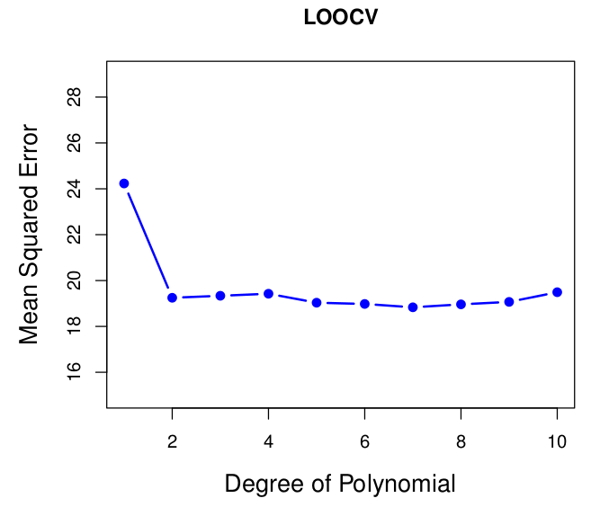{fig-alt="Mean squared error versus degree of polynomial for LOOCV on the auto data. The curve is the same every time." width="80%"}

:::::

::::: {.column width="30%"}

**$K$-fold CV**

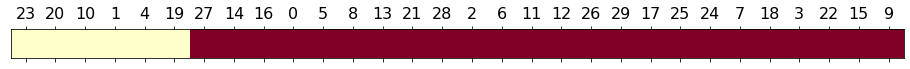{fig-alt="Five-fold cross-validation, split 1 of 5. The first fold is yellow (test set) and the other four folds are red (training set)." width="100%"}

{fig-alt="Five-fold cross-validation, split 2 of 5. The second fold is yellow (test set) and the other four folds are red (training set)." width="100%"}

{fig-alt="Five-fold cross-validation, split 3 of 5. The third fold is yellow (test set) and the other four folds are red (training set)." width="100%"}

{fig-alt="Five-fold cross-validation, split 4 of 5. The fourth fold is yellow (test set) and the other four folds are red (training set)." width="100%"}

{fig-alt="Five-fold cross-validation, split 5 of 5. The fifth fold is yellow (test set) and the other four folds are red (training set)." width="100%"}

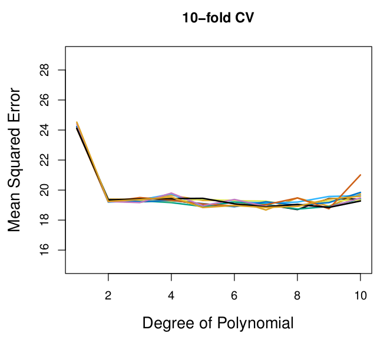{fig-alt="Mean squared error versus degree of polynomial for 10-fold cross-validation on the auto data, repeated with several different random splits into folds." width="80%"}

:::::

::::::

## Definition of $k$-fold CV

:::::: {.columns}

::::: {.column width="55%"}

- Randomly split the data into $k$ groups (folds).
- The folds are approximately equal in size. For notation, say each fold has $\ell$ points.
- Remove the $i$th fold $U_i$ and reserve it for testing.
- Train the model on the remaining points.
- Calculate $\mathrm{MSE}_i = \frac{1}{\ell} \sum_{(x_j,y_j) \in U_i}(y_j-\hat y_j)^2$.
- Rinse and repeat.

Return
$$
CV_{(k)} = \frac{1}{k} \sum_{i=1}^k \mathrm{MSE}_i
$$

:::::

::::: {.column width="40%"}

{fig-alt="Five-fold cross-validation, split 1 of 5. The first fold is yellow (test set) and the other four folds are red (training set)." width="100%"}

{fig-alt="Five-fold cross-validation, split 2 of 5. The second fold is yellow (test set) and the other four folds are red (training set)." width="100%"}

{fig-alt="Five-fold cross-validation, split 3 of 5. The third fold is yellow (test set) and the other four folds are red (training set)." width="100%"}

{fig-alt="Five-fold cross-validation, split 4 of 5. The fourth fold is yellow (test set) and the other four folds are red (training set)." width="100%"}

{fig-alt="Five-fold cross-validation, split 5 of 5. The fifth fold is yellow (test set) and the other four folds are red (training set)." width="100%"}

:::::

::::::

# $k$-fold CV for classification

## Setup: LOOCV

:::::: {.columns}

::::: {.column width="50%"}

- Remove the $i$th point $(x_i,y_i)$ and reserve it for testing.
- Train the model on the remaining points.
- Calculate $\mathrm{Err}_i = \mathrm{I}(y_i\neq\hat y_i)$.
- Rinse and repeat.

Return
$$
CV_{(n)} = \frac{1}{n} \sum_{i=1}^n \mathrm{Err}_i
$$

:::::

::::: {.column width="40%"}

{fig-alt="A horizontal bar representing data points with a yellow square (test set) at the first position of the bar with the rest of the bar red (training set)" width="100%"}

{fig-alt="A horizontal bar representing data points with a yellow square (test set) at the second position of the bar with the rest of the bar red (training set)" width="100%"}

{fig-alt="A horizontal bar representing data points with a yellow square (test set) at the third position of the bar with the rest of the bar red (training set)" width="100%"}

{fig-alt="A horizontal bar representing data points with a yellow square (test set) at the fourth position of the bar with the rest of the bar red (training set)" width="100%"}

{fig-alt="A horizontal bar representing data points with a yellow square (test set) at the fifth position of the bar with the rest of the bar red (training set)" width="100%"}

$\vdots$

{fig-alt="A horizontal bar representing data points with a yellow square (test set) at the last, rightmost position of the bar with the rest of the bar red (training set)" width="100%"}

:::::

::::::

## Setup: $k$-fold

:::::: {.columns}

::::: {.column width="55%"}

- Randomly split the data into $k$ groups (folds).
- The folds are approximately equal in size. For notation, say each fold has $\ell$ points.
- Remove the $i$th fold $U_i$ and reserve it for testing.
- Train the model on the remaining points.
- Calculate $\mathrm{Err}_i = \frac{1}{\ell} \sum_{(x_j,y_j) \in U_i}\mathrm{I}(y_j\neq\hat y_j)$.
- Rinse and repeat.

Return
$$
CV_{(k)} = \frac{1}{k} \sum_{i=1}^k \mathrm{Err}_i
$$

:::::

::::: {.column width="40%"}

{fig-alt="Five-fold cross-validation, split 1 of 5. Fold 1 is yellow (test set) and the other four folds are red (training set)." width="100%"}

{fig-alt="Five-fold cross-validation, split 2 of 5. Fold 2 is yellow (test set) and the other four folds are red (training set)." width="100%"}

{fig-alt="Five-fold cross-validation, split 3 of 5. Fold 3 is yellow (test set) and the other four folds are red (training set)." width="100%"}

{fig-alt="Five-fold cross-validation, split 4 of 5. Fold 4 is yellow (test set) and the other four folds are red (training set)." width="100%"}

{fig-alt="Five-fold cross-validation, split 5 of 5. Fold 5 is yellow (test set) and the other four folds are red (training set)." width="100%"}

:::::

::::::

## Example on simulated data: linear

:::::: {.columns}

::::: {.column width="42%"}

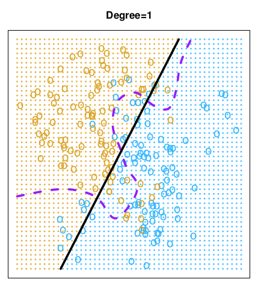{fig-alt="Simulated two-class data in the plane with the purple Bayes decision boundary and the black straight-line decision boundary from logistic regression." width="100%"}

:::::

::::: {.column width="50%"}

- Purple: Bayes decision boundary.
    - Error rate: 0.133
- Black: logistic regression
    - $\log(p/(1-p)) = \beta_0 + \beta_1X_1 + \beta_2 X_2$
    - Error rate: 0.201

*Fill in during class.*

:::::

::::::

## Example on simulated data: quadratic logistic regression

:::::: {.columns}

::::: {.column width="42%"}

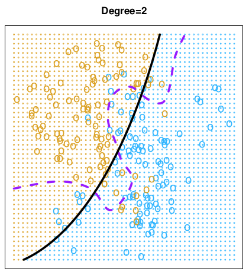{fig-alt="Simulated two-class data in the plane with the purple Bayes decision boundary and the black curved decision boundary from quadratic logistic regression." width="100%"}

:::::

::::: {.column width="50%"}

- Purple: Bayes decision boundary.
    - Error rate: 0.133
- Black: logistic regression
    - $\log(p/(1-p)) = \beta_0 + \beta_1X_1 + \beta_2X_1^2 + \beta_3 X_2 + \beta_4X_2^2$
    - Error rate: 0.197

*Fill in during class.*

:::::

::::::

## Example on simulated data: all the polynomials!

:::::: {.columns}

::::: {.column width="48%"}

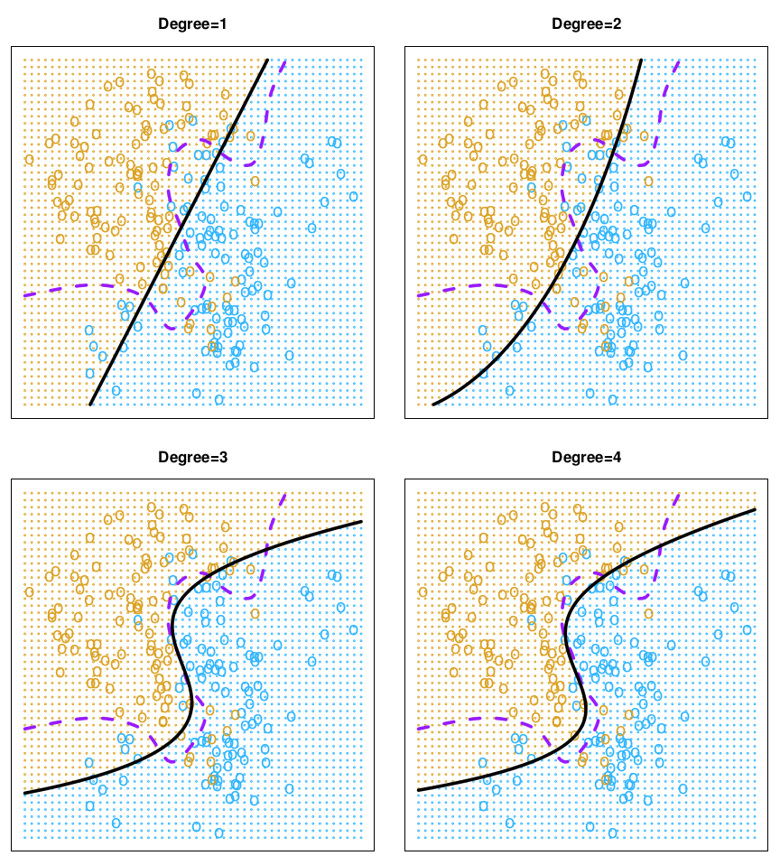{fig-alt="Simulated two-class data in the plane with the purple Bayes decision boundary and the black decision boundaries from logistic regression with polynomial degrees 1 through 4." width="100%"}

:::::

::::: {.column width="45%"}

- Purple: Bayes decision boundary.
    - Error rate: 0.133
- Black: logistic regression
    - Degree 1 error rate: 0.201
    - Degree 2 error rate: 0.197
    - Degree 3 error rate: 0.160
    - Degree 4 error rate: 0.162

*Fill in during class: normally we don't have the Bayes decision boundary. How do you pick between models?*

:::::

::::::

## Decide the degree based on CV

:::::: {.columns}

::::: {.column width="48%"}

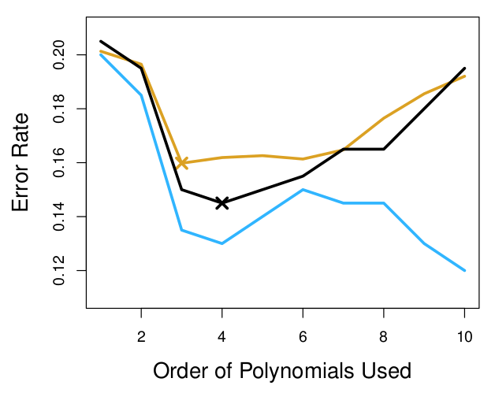{fig-alt="Error rate against polynomial degree of logistic regression. Three curves are shown: the training error, the test error, and the 10-fold cross-validation error." width="100%"}

:::::

::::: {.column width="48%"}

- Test error (brown)
- Training error (blue)
- 10-fold CV error (black)

*Fill in during class.*

:::::

::::::

## Similar game for KNN

:::::: {.columns}

::::: {.column width="48%"}

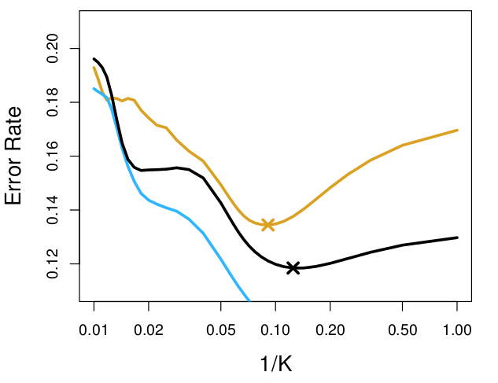{fig-alt="Error rate against 1 over K for K-nearest neighbors classification. Three curves are shown: the training error, the test error, and the 10-fold cross-validation error." width="100%"}

:::::

::::: {.column width="48%"}

- Test error (brown)
- Training error (blue)
- 10-fold CV error (black)

*Fill in during class.*

:::::

::::::

## Coding: $k$-fold for penguin classification

Open the Jupyter notebook on the Day 16 page.

## TL;DR

:::::: {.columns}

::::: {.column width="48%"}

**$k$-fold CV**

{fig-alt="Five-fold cross-validation, split 1 of 5. Fold 1 is yellow (test set) and the other four folds are red (training set)." width="100%"}

{fig-alt="Five-fold cross-validation, split 2 of 5. Fold 2 is yellow (test set) and the other four folds are red (training set)." width="100%"}

{fig-alt="Five-fold cross-validation, split 3 of 5. Fold 3 is yellow (test set) and the other four folds are red (training set)." width="100%"}

{fig-alt="Five-fold cross-validation, split 4 of 5. Fold 4 is yellow (test set) and the other four folds are red (training set)." width="100%"}

{fig-alt="Five-fold cross-validation, split 5 of 5. Fold 5 is yellow (test set) and the other four folds are red (training set)." width="100%"}

$$
CV_{(k)} = \frac{1}{k} \sum_{i=1}^k \mathrm{MSE}_i
$$

Use $k=5$ or $10$ usually.

:::::

::::: {.column width="48%"}

**$k$-fold CV for classification**

$$
\mathrm{Err}_i = \mathrm{I}(y_j\neq\hat y_j)
$$

$$
CV_{(k)} = \frac{1}{k} \sum_{i=1}^k \mathrm{Err}_i
$$

:::::

::::::

## Next time

- Subset selection (Ch. 6.1)

See also the [course schedule](../../../Course_Info/Schedule.html).

## Source and reading

- Textbook reading: Ch. 5.1.5 of [*An Introduction to Statistical Learning with Applications in Python*](https://www.statlearning.com/).
- Figures and datasets are from the textbook (ISLP) unless noted.
