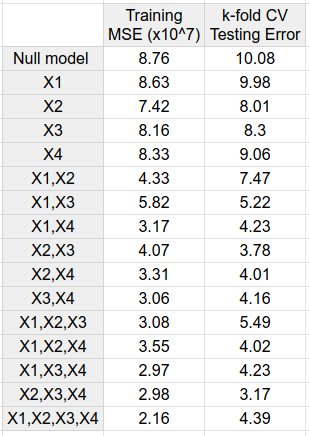

## Announcements

:::::: {.columns}

::::: {.column width="48%"}

**Last time:**

- $k$-fold CV for classification

**Covered in this lecture:**

- Subset selection
- Forward and backward selection

:::::

::::: {.column width="48%"}

**Announcements:**

- HW #3 is due Sunday 10/18.

:::::

::::::

## What should you learn from this lecture?

- Why shouldn't you have as many predictors in your model as possible?
- What are the three basic methods that can be used to select the appropriate predictors (feature selection)?
- What are the steps of the algorithm for each of these methods?
- How do you carry out these procedures by hand, given the training error and the CV test error for each combination of predictors?
- What are the pros and cons of each of these feature selection methods? When can you or can't you use them?
- How do you implement the feature selection algorithms in Python?

# Previously on linear regression ...

## The problem of many features ($p$) relative to samples ($n$)

Up to now, we've focused on the standard linear model
$$
Y = \beta_0 + \beta_1 X_1 + \cdots + \beta_p X_p + \epsilon
$$
and done least squares estimation.

:::::: {.columns}

::::: {.column width="48%"}

**Prediction accuracy**

*Fill in during class.*

:::::

::::: {.column width="48%"}

**Model interpretability**

*Fill in during class.*

:::::

::::::

# Best subset selection

## Go through each combination of variables exhaustively (exhausting?)

All subsets of 4 variables ($2^4 = 16$):

| Number of variables | Subsets |
|:--|:--|
| 0 | $\emptyset$ |
| 1 | $X_1$; $X_2$; $X_3$; $X_4$ |
| 2 | $X_1X_2$; $X_1X_3$; $X_1X_4$; $X_2X_3$; $X_2X_4$; $X_3X_4$ |
| 3 | $X_1X_2X_3$; $X_1X_2X_4$; $X_1X_3X_4$; $X_2X_3X_4$ |
| 4 | $X_1X_2X_3X_4$ |

*Fill in during class.*

## One way of breaking this up: best subset selection

1. Let $\mathcal{M}_0$ be the *null model*, which has no predictors. It predicts the sample mean for every observation.
2. For $k = 1, 2, \dots, p$:
    a. Fit all $\binom{p}{k}$ models that contain exactly $k$ predictors.
    b. Pick the best among these $\binom{p}{k}$ models, and call it $\mathcal{M}_k$. Here "best" means the smallest training error (RSS), or equivalently the largest $R^2$.
3. Select a single best model from among $\mathcal{M}_0, \dots, \mathcal{M}_p$ using cross-validated prediction error (or an adjusted training score such as $C_p$, AIC, BIC, or adjusted $R^2$).

*Fill in during class.*

## Calculate by hand

We train a model using four variables, $X_1, X_2, X_3, X_4$. We are interested in getting a subset of the variables to use. The table shows the training error and the CV test error for the model learned using each possible subset of variables.

:::::: {.columns}

::::: {.column width="45%"}

{fig-alt="Table of the mean squared error values for the models fit using each of the 16 possible subsets of the four variables X1, X2, X3, X4." width="60%"}

:::::

::::: {.column width="50%"}

1. What subset of variables is found for each of the sets $\mathcal{M}_0, \mathcal{M}_1, \mathcal{M}_2, \mathcal{M}_3, \mathcal{M}_4$ when using best subset selection?
2. What subset of variables is returned using best subset selection?

*Fill in during class.*

:::::

::::::

## Extra work space

:::::: {.columns}

::::: {.column width="35%"}

{fig-alt="Table of the mean squared error values for the models fit using each of the 16 possible subsets of the four variables X1, X2, X3, X4." width="100%"}

:::::

::::: {.column width="60%"}

| Number of variables | Subsets |
|:--|:--|
| 0 | $\emptyset$ |
| 1 | $X_1$; $X_2$; $X_3$; $X_4$ |
| 2 | $X_1X_2$; $X_1X_3$; $X_1X_4$; $X_2X_3$; $X_2X_4$; $X_3X_4$ |
| 3 | $X_1X_2X_3$; $X_1X_2X_4$; $X_1X_3X_4$; $X_2X_3X_4$ |
| 4 | $X_1X_2X_3X_4$ |

:::::

::::::

## Code to do this

Open the Jupyter notebook on the Day 17 page.

# Forward selection

## What's the problem with best subset selection?

*Fill in during class.*

## Forward stepwise selection

1. Let $\mathcal{M}_0$ be the null model, which has no predictors.
2. For $k = 0, 1, \dots, p-1$:
    a. Consider all $p-k$ models that augment the predictors in $\mathcal{M}_k$ with one additional predictor.
    b. Choose the best among these $p-k$ models, and call it $\mathcal{M}_{k+1}$. Here "best" means the smallest RSS, or equivalently the largest $R^2$.
3. Select a single best model from among $\mathcal{M}_0, \dots, \mathcal{M}_p$ using cross-validated prediction error (or an adjusted training score such as $C_p$, AIC, BIC, or adjusted $R^2$).

## An example for forward stepwise selection

| Number of variables | Subsets |
|:--|:--|
| 0 | $\emptyset$ |
| 1 | $X_1$; $X_2$; $X_3$; $X_4$ |
| 2 | $X_1X_2$; $X_1X_3$; $X_1X_4$; $X_2X_3$; $X_2X_4$; $X_3X_4$ |
| 3 | $X_1X_2X_3$; $X_1X_2X_4$; $X_1X_3X_4$; $X_2X_3X_4$ |
| 4 | $X_1X_2X_3X_4$ |

*Fill in during class.*

## Group work: by hand, same example with forward selection

We train a model using four variables, $X_1, X_2, X_3, X_4$. The table shows the training error and the CV test error for the model learned using each possible subset of variables.

:::::: {.columns}

::::: {.column width="45%"}

{fig-alt="Table of the mean squared error values for the models fit using each of the 16 possible subsets of the four variables X1, X2, X3, X4." width="60%"}

:::::

::::: {.column width="50%"}

1. What subset of variables is found for each of the sets $\mathcal{M}_0, \mathcal{M}_1, \mathcal{M}_2, \mathcal{M}_3, \mathcal{M}_4$ when using forward selection?
2. What subset of variables is returned using forward selection?

*Fill in during class.*

:::::

::::::

## Extra work space

:::::: {.columns}

::::: {.column width="35%"}

{fig-alt="Table of the mean squared error values for the models fit using each of the 16 possible subsets of the four variables X1, X2, X3, X4." width="100%"}

:::::

::::: {.column width="60%"}

| Number of variables | Subsets |
|:--|:--|
| 0 | $\emptyset$ |
| 1 | $X_1$; $X_2$; $X_3$; $X_4$ |
| 2 | $X_1X_2$; $X_1X_3$; $X_1X_4$; $X_2X_3$; $X_2X_4$; $X_3X_4$ |
| 3 | $X_1X_2X_3$; $X_1X_2X_4$; $X_1X_3X_4$; $X_2X_3X_4$ |
| 4 | $X_1X_2X_3X_4$ |

:::::

::::::

## Pros and cons of forward stepwise selection

:::::: {.columns}

::::: {.column width="48%"}

**Pros:**

*Fill in during class.*

:::::

::::: {.column width="48%"}

**Cons:**

*Fill in during class.*

:::::

::::::

# Backward selection

## Backward stepwise selection

1. Let $\mathcal{M}_p$ be the *full model*, which contains all $p$ predictors.
2. For $k = p, p-1, \dots, 1$:
    a. Consider all $k$ models that contain all but one of the predictors in $\mathcal{M}_k$, for a total of $k-1$ predictors.
    b. Choose the best among these $k$ models, and call it $\mathcal{M}_{k-1}$. Here "best" means the smallest RSS, or equivalently the largest $R^2$.
3. Select a single best model from among $\mathcal{M}_0, \dots, \mathcal{M}_p$ using cross-validated prediction error (or an adjusted training score such as $C_p$, AIC, BIC, or adjusted $R^2$).

## Pros and cons of backward stepwise selection

:::::: {.columns}

::::: {.column width="48%"}

**Pros:**

*Fill in during class.*

:::::

::::: {.column width="48%"}

**Cons:**

*Fill in during class.*

:::::

::::::

## TL;DR

- Best subset selection checks every combination of predictors, which is infeasible for large $p$.
- Modify step 2 with forward or backward stepwise selection.
- Choose the best model in step 3 using one of our adjusted training scores or CV.

## Next time

- Shrinkage: ridge regression

See also the [course schedule](../../../Course_Info/Schedule.html).

## Source and reading

- Textbook reading: Ch. 6.1 of [*An Introduction to Statistical Learning with Applications in Python*](https://www.statlearning.com/).
- Figures and datasets are from the textbook (ISLP) unless noted.
