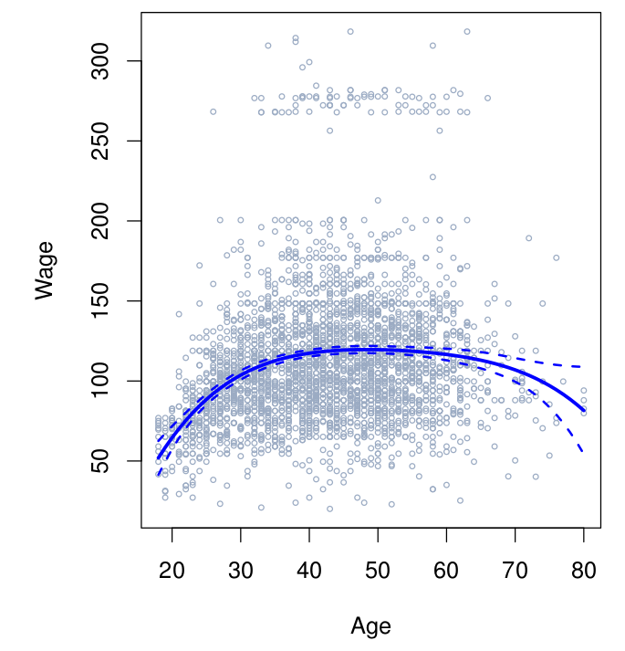
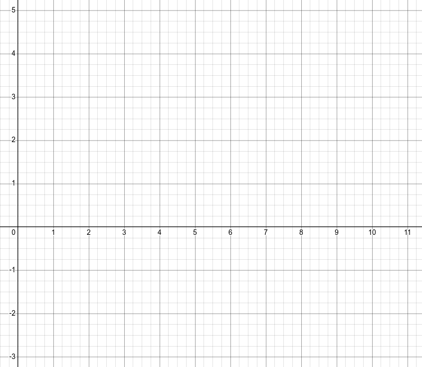
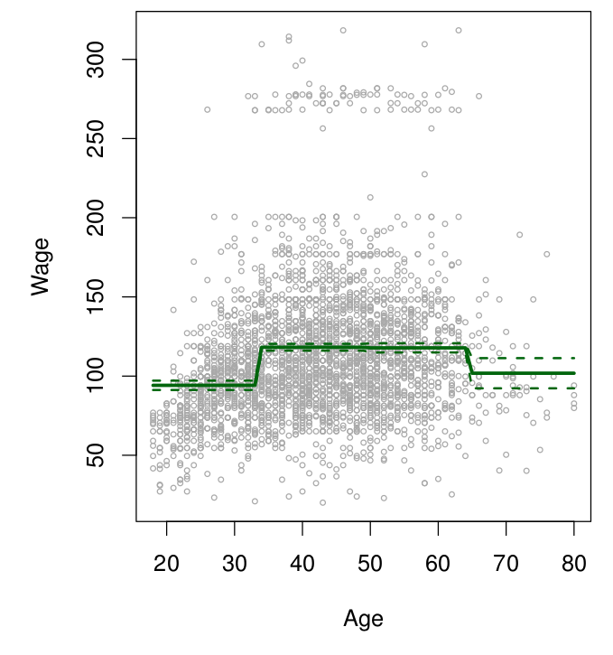

## Announcements

**Last time:**

- Exam 2

**This lecture:**

- 7.1 Polynomial regression
- 7.2 Step functions

**Announcements:**

- HW #4 due Sun 11/1
- Project updates
- Dr. Bao will be out of town. Christy will cover Lecture 26 (Mon 11/2) and Lecture 27 (Wed 11/4).

## What should you learn from today's lecture?

- Why do people want to use polynomial regression rather than simple linear regression?
- How do you fit polynomial regression models?
- Why do people want to use step functions rather than simple linear regression?
- How do you fit step function models?
- What is common between polynomial regression and step functions?
- What is different between polynomial regression and step functions?

# Polynomial Regression

## Polynomial regression

Replace the linear model
$$
y_i = \beta_0 + \beta_1x_i + \epsilon_i
$$
with
$$
y_i = \beta_0 + \beta_1x_i + \beta_2x_i^2 + \cdots + \beta_dx_i^d + \epsilon_i
$$

*Fill in during class.*

## Example: Wage data

$$
\texttt{wage} = \beta_0 + \beta_1 \texttt{age} + \beta_2 \texttt{age}^2 + \cdots + \beta_p \texttt{age}^p +\varepsilon
$$

My code learned (degree 4):
$$
-184.1542 + 21.24552 \cdot \texttt{age} - 0.56386 \cdot \texttt{age}^2 + 0.00681 \cdot \texttt{age}^3 - (3\times 10^{-5}) \cdot \texttt{age}^4
$$

*Fill in during class: how do we build the predictors and learn the coefficients?*

## Example with wage data

:::::: {.columns}

::::: {.column width="48%"}

{fig-alt="Scatter plot of wage against age for men in the central Atlantic region of the US. A dark curve shows the degree 4 polynomial fit, with dashed curves above and below it marking about two standard errors" width="100%"}

:::::

::::: {.column width="45%"}

*Fill in during class.*

:::::

::::::

# Step Functions

## Step functions

$$
\mathrm{I}(X < c) \qquad \mathrm{I}(c_1 \leq X < c_2) \qquad \mathrm{I} (c \leq X)
$$

*Fill in during class: draw each of these functions.*

## More on step function setup

Choose values $c_1,\cdots, c_K$ and define
$$
\begin{aligned}
C_0(X) &= \mathrm{I}(X < c_1),\\
C_1(X) &= \mathrm{I}(c_1 \leq X < c_2),\\
C_2(X) &= \mathrm{I}(c_2 \leq X < c_3),\\
&\;\;\vdots\\
C_{K-1}(X) &= \mathrm{I}(c_{K-1} \leq X < c_K),\\
C_K(X) &= \mathrm{I}(c_K \leq X).
\end{aligned}
$$

*Fill in during class.*

## Example: build the step function columns

Given knots $c_1 = 3$, $c_2 = 5$, $c_3 = 7$, determine the entries in the columns for $C_i(X)$ in the table below.

| $X$ | $C_0(X)$ | $C_1(X)$ | $C_2(X)$ | $C_3(X)$ |
|-----|----------|----------|----------|----------|
| 1   |          |          |          |          |
| 2   |          |          |          |          |
| 3   |          |          |          |          |
| 4   |          |          |          |          |
| 5   |          |          |          |          |
| 6   |          |          |          |          |
| 7   |          |          |          |          |
| 8   |          |          |          |          |
| 9   |          |          |          |          |
| 10  |          |          |          |          |

## Draw the function

My code doing regression on the step function input returned the function
$$
f(X) = -1 + 3 C_1(X) +4 C_2(X) - 2 C_3(X).
$$
Fill in the table of values, then draw this function.

:::::: {.columns}

::::: {.column width="30%"}

| $X$ | $f(X)$ |
|-----|--------|
| 1   |        |
| 2   |        |
| 3   |        |
| 4   |        |
| 5   |        |
| 6   |        |
| 7   |        |
| 8   |        |
| 9   |        |
| 10  |        |

:::::

::::: {.column width="50%"}

{fig-alt="Blank graph axes for X from 1 to 10, to draw the step function on" width="100%"}

:::::

::::::

## Step function: learned model

$$
y_i = \beta_0 + \beta_1C_1(x_i) + \beta_2 C_2(x_i) + \cdots + \beta_K C_K(x_i) + \epsilon_i
$$

*Fill in during class: why is there no $C_0$ term, and what does each $\beta_j$ mean?*

## Coding bit

Back to the `wage` data set. Open the Day 24 Jupyter notebook from the course site and work through it with your group.

## Step function example

:::::: {.columns}

::::: {.column width="48%"}

{fig-alt="Scatter plot of wage against age with a red step function fit made of flat horizontal segments, one for each age interval" width="100%"}

:::::

::::: {.column width="45%"}

*Fill in during class.*

:::::

::::::

## Next time

- Step functions; basis functions; start splines

See also the [course schedule](../../../Course_Info/Schedule.html).

## Source and reading

- Textbook reading: Ch. 7.1–7.2 of [*An Introduction to Statistical Learning with Applications in Python*](https://www.statlearning.com/).
- Figures and datasets are from the textbook (ISLP) unless noted.
