## Announcements

:::::: {.columns}

::::: {.column width="48%"}

**Last time:**

- 7.1 Polynomial regression
- 7.2 Step functions

**This lecture:**

- 7.2 Step functions
- 7.3 Basis functions
- 7.4 Regression splines (finish next lecture)

:::::

::::: {.column width="48%"}

**Announcements:**

- HW #4 due Sun 11/1
- Dr. Bao will be out of town. Christy will cover Lecture 26 (Mon 11/2) and Lecture 27 (Wed 11/4).

:::::

::::::

# Last time

## Polynomial regression

Replace the linear model
$$
y_i = \beta_0 + \beta_1x_i + \epsilon_i
$$
with
$$
y_i = \beta_0 + \beta_1x_i + \beta_2x_i^2 + \cdots + \beta_dx_i^d + \epsilon_i
$$

## Example with wage data

:::::: {.columns}

::::: {.column width="45%"}

{fig-alt="Scatter plot of Wage versus Age showing a non-linear polynomial fit with dashed standard error bands" width="100%"}

:::::

::::: {.column width="48%"}

*Fill in during class.*

:::::

::::::

$$
-184.1542 + 21.24552 \cdot \texttt{age} - 0.56386 \cdot \texttt{age}^2 + 0.00681 \cdot \texttt{age}^3 - (3\times 10^{-5}) \cdot \texttt{age}^4
$$

## Step functions

:::::: {.columns}

::::: {.column width="30%"}

- $\mathrm{I}(X<c)$
- $\mathrm{I}(c_1 \leq X <c_2)$
- $\mathrm{I}(c \leq X)$

:::::

::::: {.column width="60%"}

Choose values $c_1,\cdots, c_K$ and define
$$
\begin{aligned}
C_0(X) &= \mathrm{I}(X < c_1),\\
C_1(X) &= \mathrm{I}(c_1 \leq X < c_2),\\
&\;\;\vdots\\
C_{K-1}(X) &= \mathrm{I}(c_{K-1} \leq X < c_K),\\
C_K(X) &= \mathrm{I}(c_K \leq X).
\end{aligned}
$$

:::::

::::::

Learned model:
$$
y_i = \beta_0 + \beta_1C_1(x_i) + \beta_2 C_2(x_i) + \cdots + \beta_K C_K(x_i) + \epsilon_i
$$

## Example: cut points at -4, -1, 3, 6

:::::: {.columns}

::::: {.column width="30%"}

$C_0(X)$

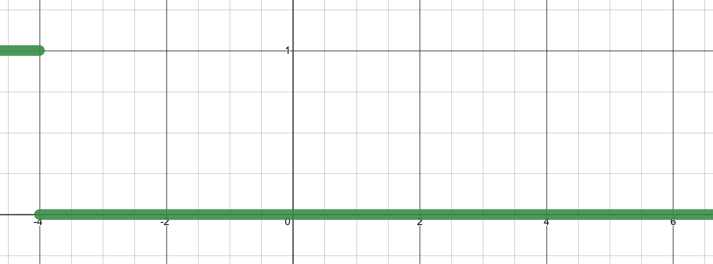{fig-alt="Graph of indicator function C0(X) which equals one for X less than negative four and zero otherwise." width="100%"}

:::::

::::: {.column width="30%"}

$C_1(X)$

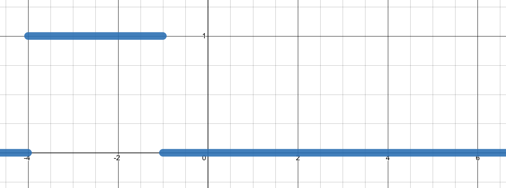{fig-alt="Graph of indicator function C1(X) which equals one for X between negative four and negative one, and zero otherwise." width="100%"}

$C_2(X)$

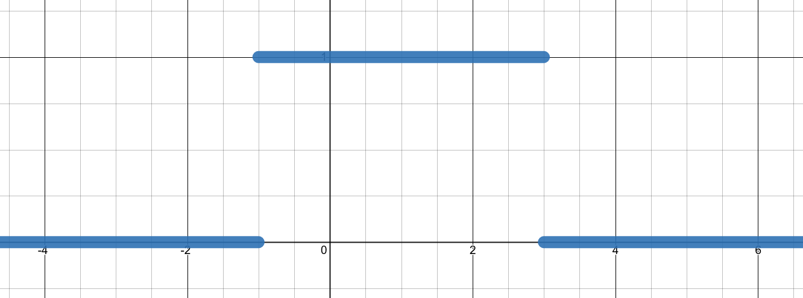{fig-alt="Graph of indicator function C2(X) which equals one for X between negative one and three, and zero otherwise." width="100%"}

$C_3(X)$

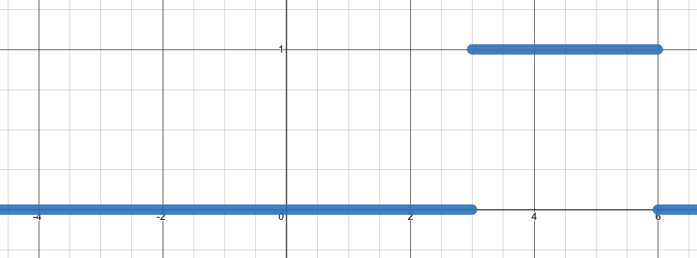{fig-alt="Graph of indicator function C3(X) which equals one for X between three and six, and zero otherwise." width="100%"}

:::::

::::: {.column width="30%"}

$C_4(X)$

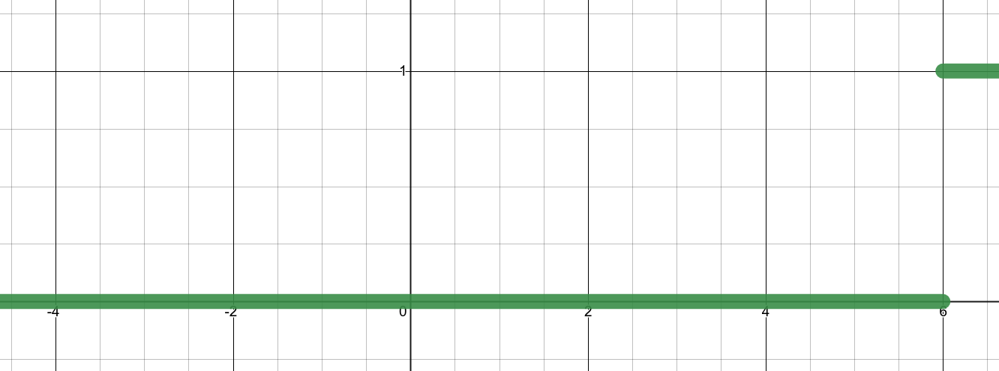{fig-alt="Graph of indicator function C4(X) which equals one for X greater than six and zero otherwise." width="100%"}

:::::

::::::

## Step function example

:::::: {.columns}

::::: {.column width="48%"}

{fig-alt="Scatter plot of Wage versus Age with a green step function fit and dashed standard error bands" width="100%"}

:::::

::::: {.column width="45%"}

*Fill in during class.*

:::::

::::::

## What will you learn today?

- How to fit step function models for classification problems?
  - You should also be able to implement them in `Python`.
- What are basis functions?
  - You should be able to articulate what the basis functions $b_i$ are for different models that we have covered.
  - Examples include polynomial, step functions, and cubic splines.
- What is the purpose of using basis functions?
  - How do they influence model flexibility?
  - How does this purpose manifest in different models, such as regression splines?
- How to define cubic splines mathematically?
  - You should be able to write down the equations for the model between knots.
  - And the equations for constraints at the knots.
- How to calculate the cubic spline coefficients by hand by applying the above mathematical definitions?

# Classification versions

## Remember logistic regression?

:::::: {.columns}

::::: {.column width="45%"}

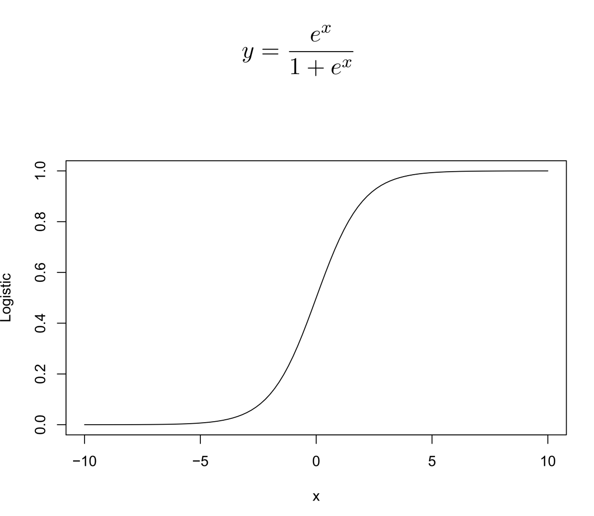{fig-alt="Graph and formula of the logistic function y equals e to the x over one plus e to the x, showing its characteristic S-curve from zero to one." width="100%"}

:::::

::::: {.column width="48%"}

$$
p(X) =
\frac{e^{\beta_0 + \beta_1X}}{1 +e^{\beta_0 + \beta_1X} }
$$

**Multiple features:**
$$
p(X) = \frac{e^{\beta_0 + \beta_1X_1 + \cdots + \beta_pX_p}}{1+e^{\beta_0 + \beta_1X_1 + \cdots + \beta_pX_p}}
$$

:::::

::::::

## Classification version: polynomial regression

$$
\Pr(y_i>250 \mid x_i) =
\frac{\exp(\beta_0 + \beta_1x_i + \cdots + \beta_dx_i^d)}
{1+\exp(\beta_0 + \beta_1x_i + \cdots + \beta_dx_i^d)}
$$

:::::: {.columns}

::::: {.column width="40%"}

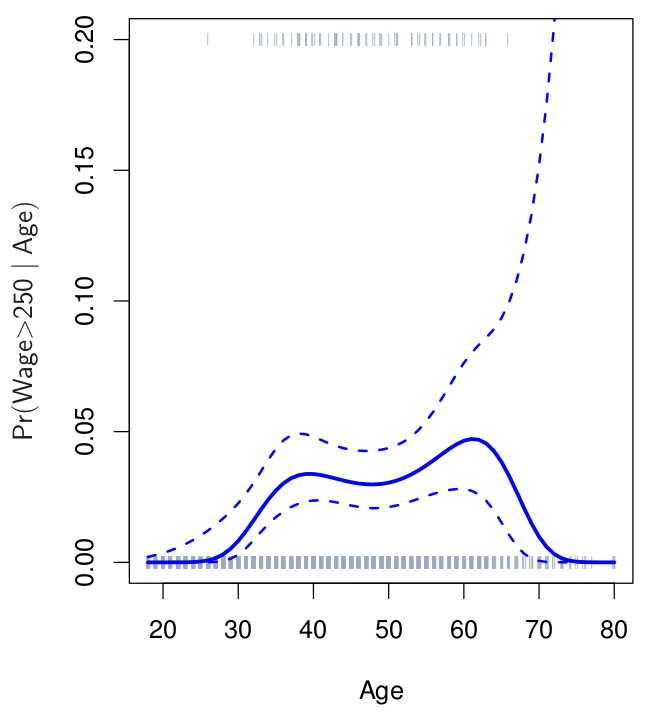{fig-alt="Plot showing the probability of high wage versus age using a non-linear fit with confidence bands." width="100%"}

:::::

::::: {.column width="48%"}

*Fill in during class.*

:::::

::::::

## Classification version: step functions

$$
\Pr(y_i>250 \mid x_i) =
\frac{\exp(\beta_0 + \beta_1C_1(x_i) + \beta_2 C_2(x_i) + \cdots + \beta_K C_K(x_i))}
{1+\exp(\beta_0 + \beta_1C_1(x_i) + \beta_2 C_2(x_i) + \cdots + \beta_K C_K(x_i))}
$$

:::::: {.columns}

::::: {.column width="40%"}

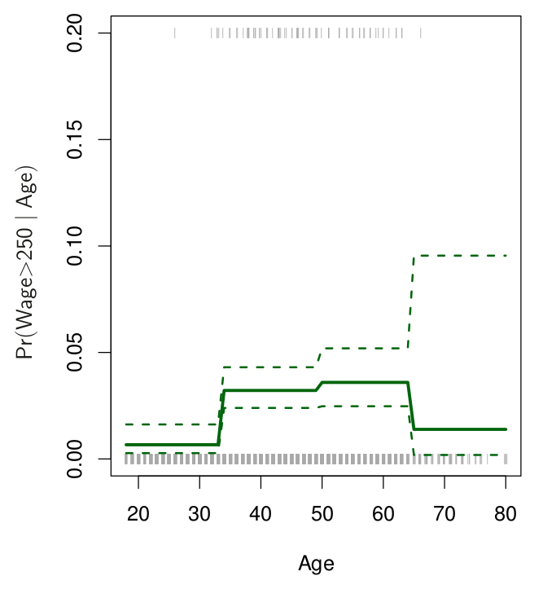{fig-alt="Plot showing the probability of high wage versus age using a green step function fit with dashed confidence bands." width="100%"}

:::::

::::: {.column width="48%"}

*Fill in during class.*

:::::

::::::

## Coding bit: classification version

Open the Day 25 Jupyter notebook from the course site and work through it.

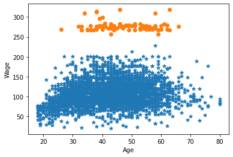{fig-alt="Scatter plot of wage data with points colored and separated by a 250 threshold." width="55%"}

## A few more comments on step functions

- Gives the chance to break up the domain and avoid forcing a global structure.
- You need to make decisions about the $c_i$. This is a bit arbitrary unless your data has natural breakpoints.
- Popular in biostatistics and epidemiology.

# Basis functions

## Basis functions setup

Polynomial and piecewise-constant regression models are special cases of a *basis function* approach.

$$
y_i = \beta_0 + \beta_1b_1(x_i) + \beta_2 b_2(x_i) + \cdots + \beta_K b_K(x_i) + \epsilon_i
$$

*Fill in during class: what are the $b_i$ for polynomial and step function models?*

# Regression splines

## Piecewise polynomials

:::::: {.columns}

::::: {.column width="55%"}

- Fit a polynomial regression
$$
y_i = \beta_0 + \beta_1x_i + \beta_2x_i^2 + \cdots + \beta_dx_i^d + \epsilon_i
$$
- Let the $\beta_i$'s be different at different locations of the range.

:::::

::::: {.column width="40%"}

*Fill in during class.*

:::::

::::::

## Example of piecewise polynomial

:::::: {.columns}

::::: {.column width="48%"}

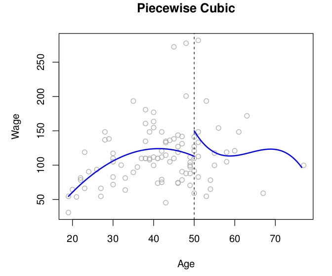{fig-alt="Scatter plot of Wage versus Age with a discontinuous piecewise cubic regression line split at age fifty." width="100%"}

:::::

::::: {.column width="48%"}

Example: a piecewise cubic model with a knot at $c$.

$$
y_i =
\begin{cases}
\beta_{01} + \beta_{11}x_i + \beta_{21}x_i^2 + \beta_{31}x_i^3 + \epsilon_i & \text{if } x_i < c\\
\beta_{02} + \beta_{12}x_i + \beta_{22}x_i^2 + \beta_{32}x_i^3 + \epsilon_i & \text{if } x_i \geq c
\end{cases}
$$

:::::

::::::

## The fix

:::::: {.columns}

::::: {.column width="45%"}

- Fit a piecewise polynomial.
- Require continuity at knots.

:::::

::::: {.column width="48%"}

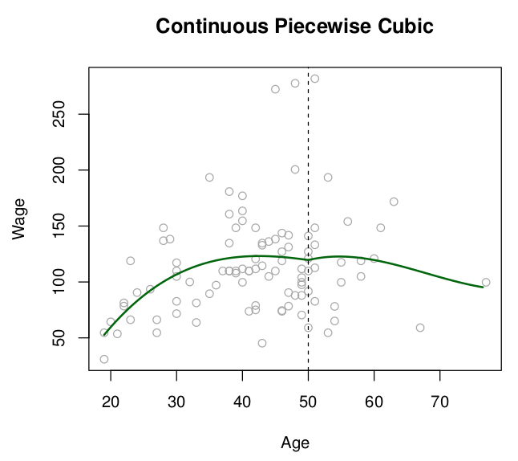{fig-alt="Scatter plot of Wage versus Age with a continuous piecewise cubic regression line joined at age fifty." width="100%"}

:::::

::::::

## The better fix: cubic splines

:::::: {.columns}

::::: {.column width="45%"}

- Fit a piecewise polynomial.
- Require continuity at knots.
- Require the first and second derivatives to be continuous at knots.

*Fill in during class.*

:::::

::::: {.column width="48%"}

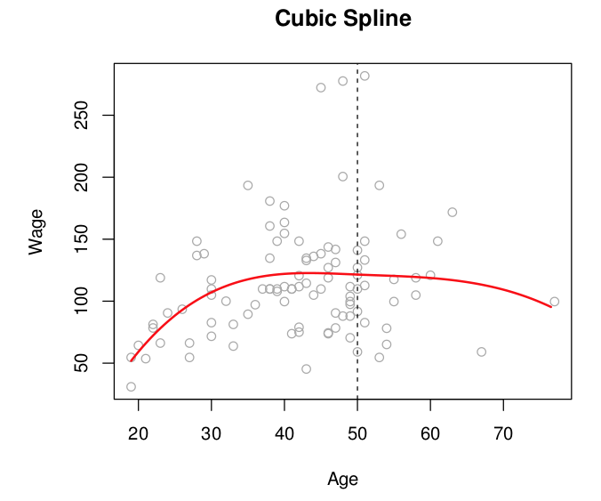{fig-alt="Scatter plot of Wage versus Age with a smooth red cubic spline regression line joined at age fifty." width="100%"}

Test your understanding: [Poll Everywhere poll](https://PollEv.com/multiple_choice_polls/bkj0zshpQHzhiwM3UXroS/respond)

:::::

::::::

## Example: make it a cubic spline

:::::: {.columns}

::::: {.column width="48%"}

We have the following piecewise cubic polynomial:
$$
f(x) =
\begin{cases}
2+x+x^{2}+0.1x^{3} & x \leq 1 \\
b_0 + b_1 x + b_2 x^2 -x^3 & x > 1
\end{cases}
$$

What are $b_0$, $b_1$, and $b_2$ to make this a cubic spline?

:::::

::::: {.column width="48%"}

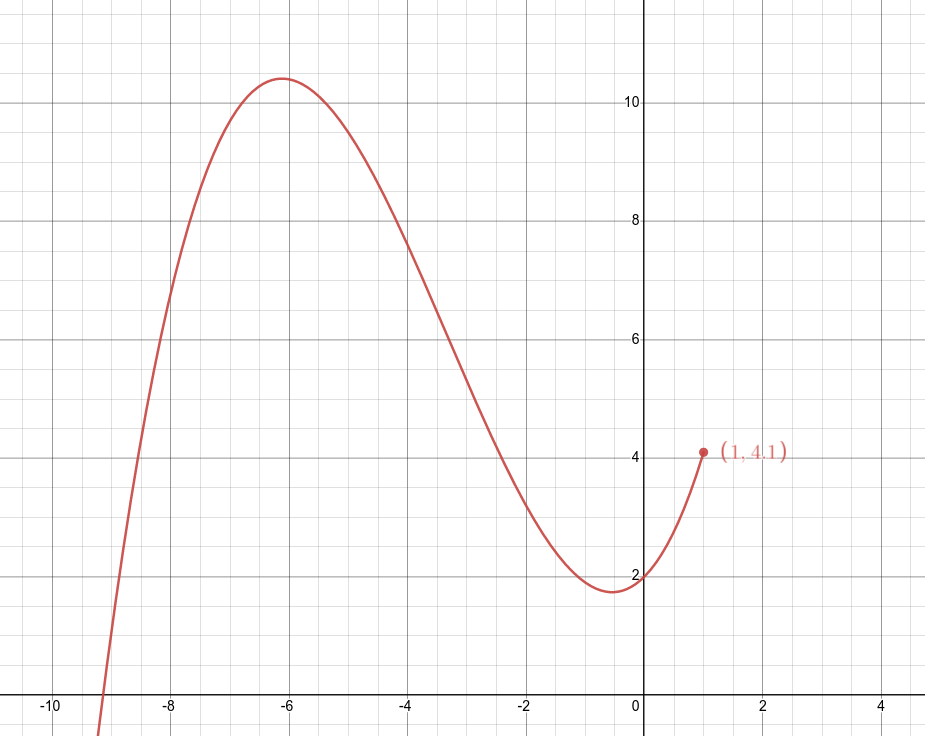{fig-alt="Polynomial curve on a coordinate grid ending at point (1, 4.1)." width="100%"}

:::::

::::::

Check your answers: [Desmos graph](https://www.desmos.com/calculator/kbm0zivqco)

## More space for work

$$
f(x) =
\begin{cases}
2+x+x^{2}+0.1x^{3} & x \leq 1 \\
b_0 + b_1 x + b_2 x^2 -x^3 & x > 1
\end{cases}
$$

*Work this out in class.*

## Next time

- Regression splines

See also the [course schedule](../../../Course_Info/Schedule.html).

## Source and reading

- Textbook reading: Ch. 7.2–7.4 of [*An Introduction to Statistical Learning with Applications in Python*](https://www.statlearning.com/).
- Figures and datasets are from the textbook (ISLP) unless noted.
