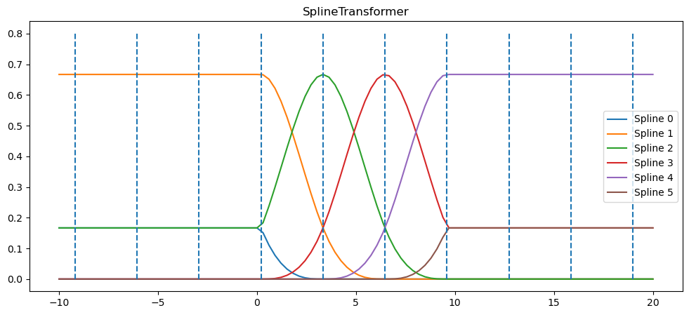
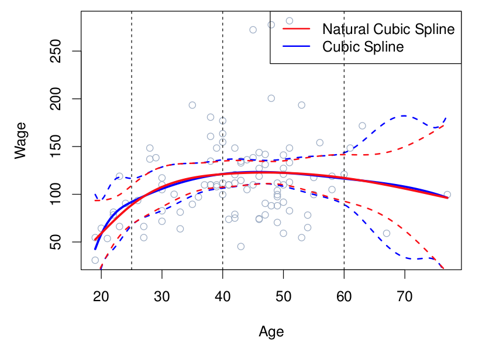
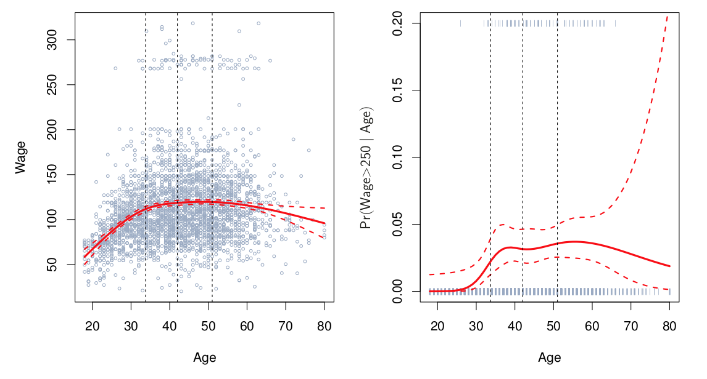
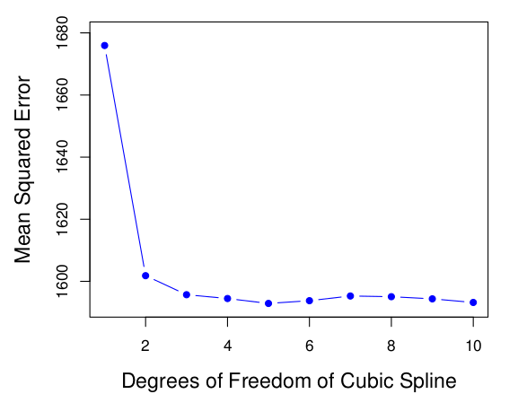
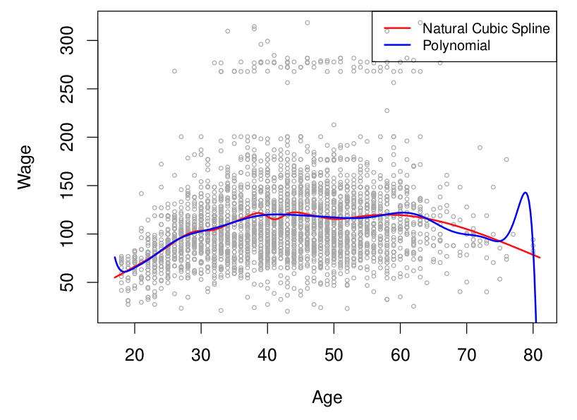

## Announcements

:::::: {.columns}

::::: {.column width="48%"}

**Last time:**

- 7.2 Step functions
- 7.3 Basis functions

**This lecture:**

- 7.4 Cubic splines

:::::

::::: {.column width="48%"}

**Announcements:**

- Homework #5 is due Mon 11/9.

:::::

::::::

# Previously

## Polynomial regression

:::::: {.columns}

::::: {.column width="48%"}

$$
y_i = \beta_0 + \beta_1x_i + \beta_2x_i^2 + \cdots + \beta_dx_i^d + \epsilon_i
$$

:::::

::::: {.column width="45%"}

{fig-alt="Scatter plot of Wage versus Age showing a non-linear polynomial fit with dashed standard error bands" width="100%"}

:::::

::::::

## Step function regression

:::::: {.columns}

::::: {.column width="52%"}

Choose values $c_1,\cdots, c_K$ and define the indicator functions
$$
\begin{aligned}
C_0(X) &= \mathrm{I}(X < c_1),\\
C_1(X) &= \mathrm{I}(c_1 \leq X < c_2),\\
&\;\;\vdots\\
C_K(X) &= \mathrm{I}(c_K \leq X).
\end{aligned}
$$

$$
y_i = \beta_0 + \beta_1C_1(x_i) + \beta_2 C_2(x_i) + \cdots + \beta_K C_K(x_i) + \epsilon_i
$$

:::::

::::: {.column width="45%"}

{fig-alt="Scatter plot of Wage versus Age with a green step function fit and dashed standard error bands" width="100%"}

:::::

::::::

## Classification version

$$
\Pr(y_i>250 \mid x_i) =
$$

:::::: {.columns}

::::: {.column width="48%"}

$$
\frac{\exp(\beta_0 + \beta_1x_i + \cdots + \beta_dx_i^d)}
{1+\exp(\beta_0 + \beta_1x_i + \cdots + \beta_dx_i^d)}
$$

{fig-alt="Plot showing the probability of high wage versus age using a non-linear fit with confidence bands." width="70%"}

:::::

::::: {.column width="48%"}

$$
\frac{\exp(\beta_0 + \beta_1C_1(x_i) + \cdots + \beta_K C_K(x_i))}
{1+\exp(\beta_0 + \beta_1C_1(x_i) + \cdots + \beta_K C_K(x_i))}
$$

{fig-alt="Plot showing the probability of high wage versus age using a green step function fit with dashed confidence bands." width="55%"}

:::::

::::::

## Basis functions setup

Polynomial and piecewise-constant regression models are special cases of a *basis function* approach.

$$
y_i = \beta_0 + \beta_1b_1(x_i) + \beta_2 b_2(x_i) + \cdots + \beta_K b_K(x_i) + \epsilon_i
$$

*Fill in during class.*

## What will you learn today?

- How to define cubic splines mathematically in terms of piecewise polynomials? (review)
  - Write the equations for the model on each interval between knots.
  - Write the continuity constraints (function, first and second derivatives) at each knot.
  - Compute the total degrees of freedom.
- How to define cubic splines in terms of basis functions?
  - Describe them mathematically using the truncated power basis (textbook version).
  - Visualize them as B-spline basis functions (for example, in Python / scikit-learn).
- How to fit a cubic spline model to data in Python?
- How to change the model flexibility?
  - What are the relevant metaparameters?
  - How to choose appropriate flexibility?
- What precautions must you take at the outer boundary? Why?

# Regression Splines

## Piecewise polynomials

:::::: {.columns}

::::: {.column width="55%"}

- Fit a polynomial regression
$$
y_i = \beta_0 + \beta_1x_i + \beta_2x_i^2 + \cdots + \beta_dx_i^d + \epsilon_i
$$
- Let the $\beta_i$'s be different at different locations of the range.

:::::

::::: {.column width="40%"}

*Fill in during class.*

:::::

::::::

## Building up to cubic splines

:::::: {.columns}

::::: {.column width="31%"}

{fig-alt="Scatter plot of Wage versus Age with a discontinuous piecewise cubic regression line split at age fifty" width="100%"}

:::::

::::: {.column width="31%"}

{fig-alt="Scatter plot of Wage versus Age with a continuous piecewise cubic regression line joined at age fifty" width="100%"}

:::::

::::: {.column width="31%"}

{fig-alt="Scatter plot of Wage versus Age with a smooth red cubic spline regression line joined at age fifty" width="100%"}

:::::

::::::

A piecewise cubic model with a knot at $c$:
$$
y_i =
\begin{cases}
\beta_{01} + \beta_{11}x_i + \beta_{21}x_i^2 + \beta_{31}x_i^3 + \epsilon_i & \text{if } x_i < c\\
\beta_{02} + \beta_{12}x_i + \beta_{22}x_i^2 + \beta_{32}x_i^3 + \epsilon_i & \text{if } x_i \geq c
\end{cases}
$$

## Cubic splines: degrees of freedom

:::::: {.columns}

::::: {.column width="52%"}

$$
f(x) =
\begin{cases}
\beta_0^1 + \beta_1^1 x + \beta_2^1 x^2 + \beta_3^1 x^3 & x<c \\
\beta_0^2 + \beta_1^2 x + \beta_2^2 x^2 + \beta_3^2 x^3 & x>c
\end{cases}
$$

*Fill in during class: how many degrees of freedom does a cubic spline with $K$ knots have?*

:::::

::::: {.column width="45%"}

{fig-alt="Scatter plot of Wage versus Age with a smooth red cubic spline regression line joined at age fifty" width="100%"}

:::::

::::::

## Spline basis representation

We want to pick $b_i$ so that we represent a cubic spline with $K$ knots as
$$
y_i = \beta_0 + \beta_1b_1(x_i) + \beta_2 b_2(x_i) + \cdots + \beta_{K+3} b_{K+3}(x_i) + \epsilon_i
$$

## Version 1: truncated power basis function

$$
h(x,z) = (x-z)^3_+ =
\begin{cases}
(x-z)^3 & \text{if } x>z \\
0 & \text{otherwise}
\end{cases}
$$

Desmos link: [Desmos graph of the truncated power function](https://www.desmos.com/calculator/ahllu5glar)

*Fill in during class: draw $h(x,2)$.*

## The (book) basis for cubic splines

Given knots at $z_1,\cdots,z_K$, use the functions:

- $X$
- $X^2$
- $X^3$
- $h(X,z_1)$
- $h(X,z_2)$
- $\vdots$
- $h(X,z_K)$

$$
f(X) = \beta_0 + \beta_1 X + \beta_2 X^2 + \beta_3 X^3 + \beta_4 h(X,z_1) + \beta_5 h(X,z_2) + \cdots + \beta_{K+3}  h(X,z_K)
$$

## Version 2: B-spline basis function

*sklearn's basis*

{fig-alt="Plot of six overlapping B-spline basis functions (Spline 0-5) generated by scikit-learn's SplineTransformer, with vertical dashed lines indicating knot positions." width="80%"}

## Coding example

Open the Day 26 Jupyter notebook from the course site and work through it with your group.

## Notes on cubic splines

:::::: {.columns}

::::: {.column width="45%"}

*Fill in during class.*

:::::

::::: {.column width="48%"}

{fig-alt="Comparison of natural cubic spline and cubic spline fits on Wage versus Age data with three knots and confidence bands." width="100%"}

:::::

::::::

## Where to put the knots?

:::::: {.columns}

::::: {.column width="65%"}

{fig-alt="Left: Wage vs Age with degree-4 polynomial and natural cubic spline. Right: High Wage vs Age with linear and natural splines." width="100%"}

:::::

::::: {.column width="30%"}

*Fill in during class.*

:::::

::::::

## How many knots to use?

*When in doubt, cross-validate.*

:::::: {.columns}

::::: {.column width="45%"}

*Fill in during class.*

:::::

::::: {.column width="48%"}

{fig-alt="Line plot showing Mean Squared Error versus degrees of freedom for a cubic spline, with error dropping and leveling off." width="100%"}

:::::

::::::

## Cubic splines vs polynomial regression

:::::: {.columns}

::::: {.column width="48%"}

{fig-alt="Scatter plot of Wage versus Age comparing a red natural cubic spline with a blue high-degree polynomial regression fit." width="100%"}

:::::

::::: {.column width="45%"}

*Fill in during class.*

:::::

::::::

## Next time

- Decision trees

See also the [course schedule](../../../Course_Info/Schedule.html).

## Source and reading

- Textbook reading: Ch. 7.4 of [*An Introduction to Statistical Learning with Applications in Python*](https://www.statlearning.com/).
- Figures and datasets are from the textbook (ISLP) unless noted.
