## Announcements

:::::: {.columns}

::::: {.column width="48%"}

**Last time:**

- Cubic splines

**This lecture:**

- 8.1 Decision trees

:::::

::::: {.column width="48%"}

**Announcements:**

- Homework #5 is due Mon 11/9.

:::::

::::::

## What will you learn today?

- How does a decision tree make decisions?
    - Given a tree and a data point with multiple predictors $(x_1, x_2, \dots, x_p)$, you should be able to find the predicted outcome $\hat{y}$.
    - You should be able to do this for both regression and classification trees.
- What are the different parts of a decision tree called? What do they represent?
    - You should be able to point out the leaves (terminal nodes), internal nodes, and branches (edges).
    - Given a simple example (e.g., two predictors), you should be able to say which region of the predictor space maps to which leaf.
- How do you fit a decision tree?
    - What is the cost function for regression and classification trees?
    - How does recursive binary splitting work?
    - How does it end?
- What meta-parameter of decision trees determines their flexibility?
- Why do you need to prune the tree?
- What are the advantages and disadvantages of decision trees compared with linear regression?

# Decision trees

## Big idea

:::::: {.columns}

::::: {.column width="48%"}

*Fill in during class.*

:::::

::::: {.column width="48%"}

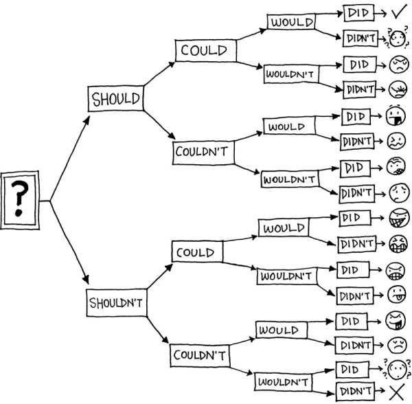{fig-alt="A binary decision tree using modal verbs Should, Could, Would, and Did leading to various emotional faces." width="100%"}

<small>Image: <https://marekbennett.com/2014/02/14/decision-tree/></small>

:::::

::::::

## Subset of Hitters data

:::::: {.columns}

::::: {.column width="40%"}

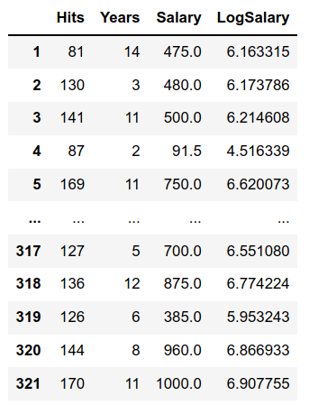{fig-alt="Table displaying baseball hitter data with columns for Hits, Years, Salary, and LogSalary." width="100%"}

:::::

::::: {.column width="55%"}

*Fill in during class.*

:::::

::::::

## First decision tree example

:::::: {.columns}

::::: {.column width="25%"}

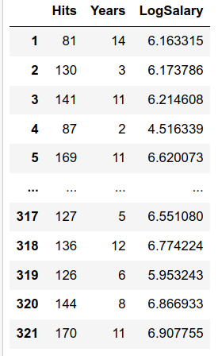{fig-alt="Table displaying baseball hitter data with columns for Hits, Years, and LogSalary." width="100%"}

:::::

::::: {.column width="35%"}

*Fill in during class.*

:::::

::::: {.column width="38%"}

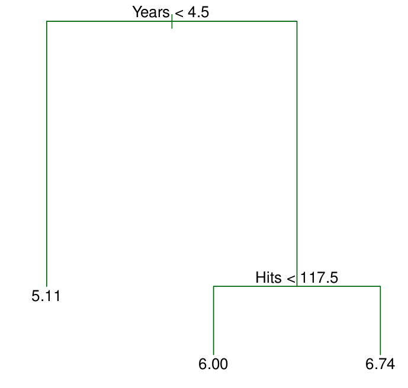{fig-alt="Regression tree for baseball player salaries splitting on Years and Hits to produce three leaf nodes." width="100%"}

:::::

::::::

## Interpretation of the example

:::::: {.columns}

::::: {.column width="40%"}

{fig-alt="Regression tree for baseball player salaries splitting on Years and Hits to produce three leaf nodes." width="100%"}

:::::

::::: {.column width="55%"}

*Fill in during class.*

:::::

::::::

## Coding a regression decision tree

See the **Jupyter notebook** for this lecture.

## Regions defined by the tree

:::::: {.columns}

::::: {.column width="40%"}

{fig-alt="Regression tree for baseball player salaries splitting on Years and Hits to produce three leaf nodes." width="100%"}

:::::

::::: {.column width="55%"}

*Fill in during class: name the leaves (terminal nodes), the internal nodes, and the branches (edges), and write the region $R_1$, $R_2$, $R_3$ for each leaf.*

:::::

::::::

## Viewing the regions defined by the tree

:::::: {.columns}

::::: {.column width="40%"}

{fig-alt="Regression tree for baseball player salaries splitting on Years and Hits to produce three leaf nodes." width="100%"}

:::::

::::: {.column width="55%"}

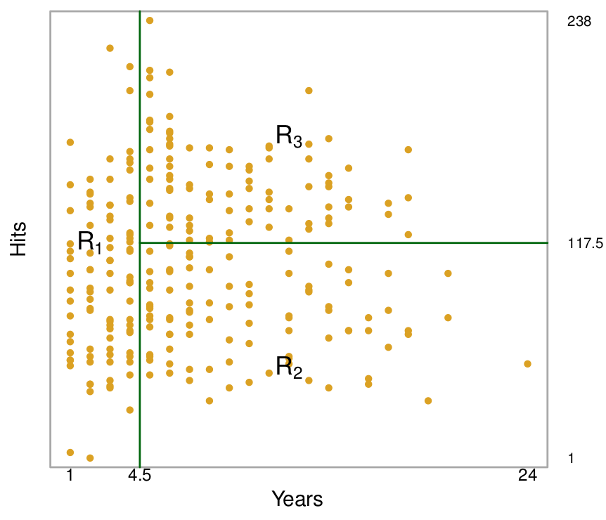{fig-alt="Scatter plot of Hits versus Years partitioned into three regions R1, R2, and R3 by a regression tree." width="100%"}

:::::

::::::

## How do we actually get the tree? Two steps

:::::: {.columns}

::::: {.column width="48%"}

1. We divide the predictor space (the set of possible values for $X_1, X_2, \dots, X_p$) into $J$ distinct and non-overlapping regions $R_1, R_2, \dots, R_J$.
2. For every observation that falls into the region $R_j$, we make the same prediction: the mean of the response values for the training observations in $R_j$.

:::::

::::: {.column width="48%"}

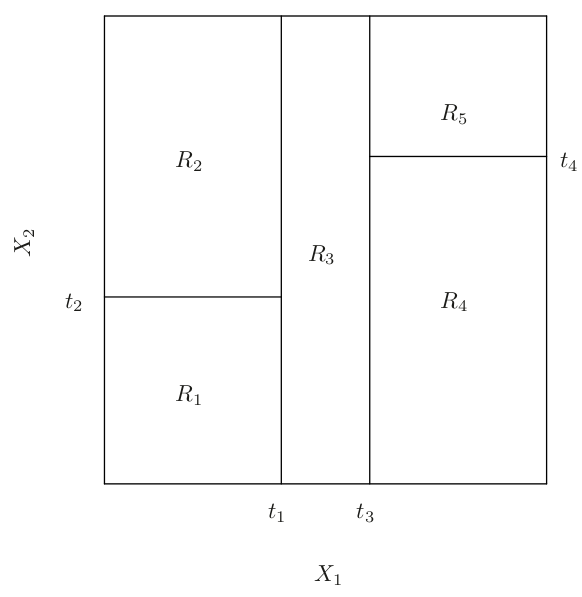{fig-alt="A two-dimensional feature space partitioned into five rectangular regions R1 through R5 by vertical and horizontal splits." width="100%"}

:::::

::::::

## Step 1: How do we decide on the $R_j$'s?

:::::: {.columns}

::::: {.column width="48%"}

**Goal:**

Find boxes $R_1, \dots, R_J$ that minimize

$$
\sum_{j=1}^J \sum_{i \in R_j} (y_i-\hat y_{R_j})^2
$$

where $\hat y_{R_j}$ is the mean response for the training observations in the $j$th box.

:::::

::::: {.column width="48%"}

*Fill in during class.*

:::::

::::::

## Recursive binary splitting

:::::: {.columns}

::::: {.column width="48%"}

**One split:**

- Pick a predictor $X_j$ and a cutpoint $s$,
- so that splitting into $\{X \mid X_j < s\}$ and $\{X \mid X_j \geq s\}$ gives the largest possible reduction in RSS.

*Fill in during class.*

:::::

::::: {.column width="48%"}

$$
\begin{aligned}
R_1(j,s) &= \{X \mid X_j < s\}\\
R_2(j,s) &= \{X \mid X_j \geq s\}
\end{aligned}
$$

$$
\sum_{i:\, x_i \in R_1(j,s)}(y_i - \hat y_{R_1})^2
+
\sum_{i:\, x_i \in R_2(j,s)}(y_i - \hat y_{R_2})^2
$$

:::::

::::::

## Rinse and repeat

:::::: {.columns}

::::: {.column width="28%"}

*Fill in during class.*

:::::

::::: {.column width="35%"}

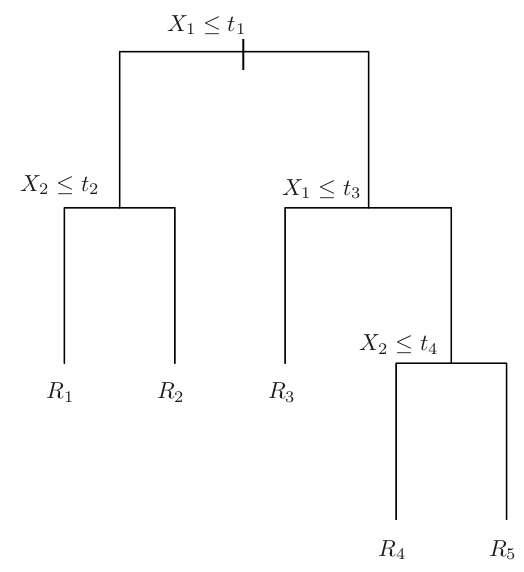{fig-alt="Decision tree diagram illustrating the sequence of binary splits on X1 and X2 resulting in regions R1 through R5." width="100%"}

:::::

::::: {.column width="35%"}

{fig-alt="A two-dimensional feature space partitioned into five rectangular regions R1 through R5 by vertical and horizontal splits." width="100%"}

:::::

::::::

## Pruning

:::::: {.columns}

::::: {.column width="48%"}

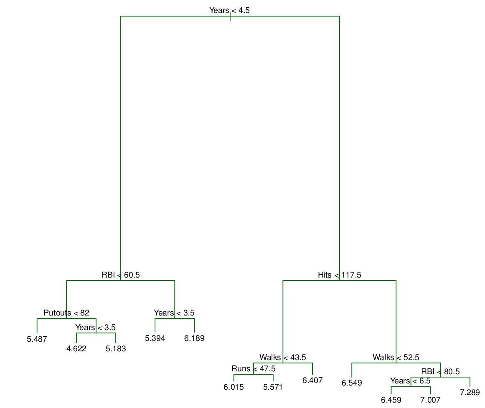{fig-alt="Complex regression tree for baseball player salaries featuring multiple splits on Years, Hits, RBI, Walks, Runs, and Putouts." width="100%"}

:::::

::::: {.column width="48%"}

*Fill in during class.*

:::::

::::::

## Result of pruning

:::::: {.columns}

::::: {.column width="48%"}

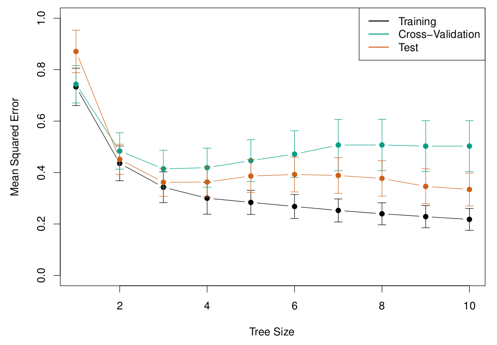{fig-alt="Plot of mean squared error versus tree size for the training, cross-validation, and test sets, with error bars for each." width="100%"}

:::::

::::: {.column width="48%"}

{fig-alt="Complex regression tree for baseball player salaries featuring multiple splits on Years, Hits, RBI, Walks, Runs, and Putouts." width="49%"}
{fig-alt="Pruned regression tree for baseball player salaries with three leaf nodes." width="49%"}

:::::

::::::

*Fill in during class.*

# Classification decision trees

## Basic idea

:::::: {.columns}

::::: {.column width="40%"}

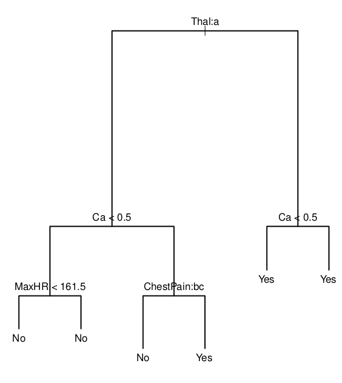{fig-alt="Classification tree for heart disease predicting Yes or No based on splits of Thal, Ca, MaxHR, and ChestPain." width="100%"}

:::::

::::: {.column width="55%"}

- $\hat p_{mk}$ = proportion of training observations in $R_m$ from the $k$th class
- $E = 1-\max_{k}(\hat p_{mk})$

*Fill in during class.*

:::::

::::::

## Example

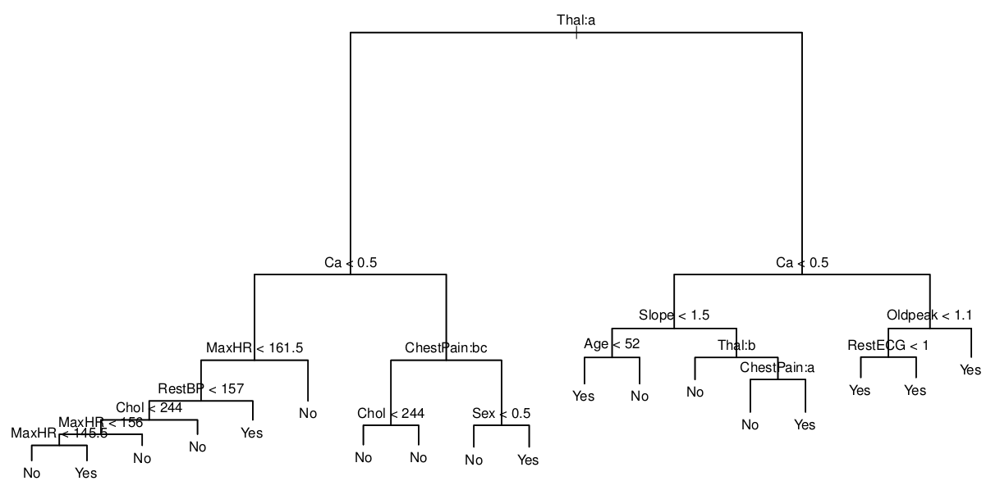{fig-alt="Large, complex classification tree for heart disease predicting Yes or No based on numerous clinical features and splits." width="75%"}

*Fill in during class: what do the terminal nodes Yes and No mean?*

## Pruning the example

:::::: {.columns}

::::: {.column width="48%"}

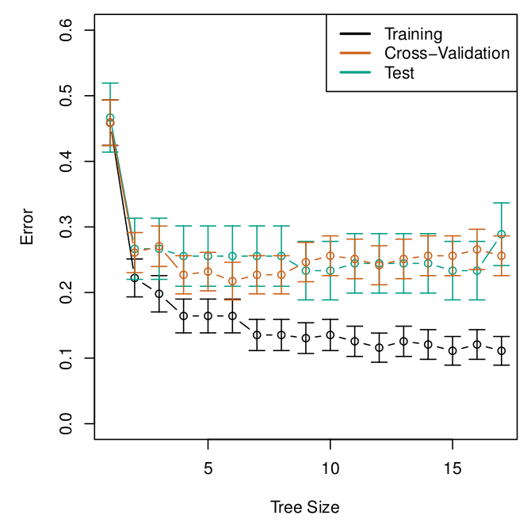{fig-alt="Plot of classification error versus tree size for the training, cross-validation, and test sets, with error bars for each." width="100%"}

:::::

::::: {.column width="40%"}

{fig-alt="Classification tree for heart disease predicting Yes or No based on splits of Thal, Ca, MaxHR, and ChestPain." width="100%"}

:::::

::::::

## More coding!

See the **Jupyter notebook** for this lecture.

## Linear models vs trees

:::::: {.columns}

::::: {.column width="48%"}

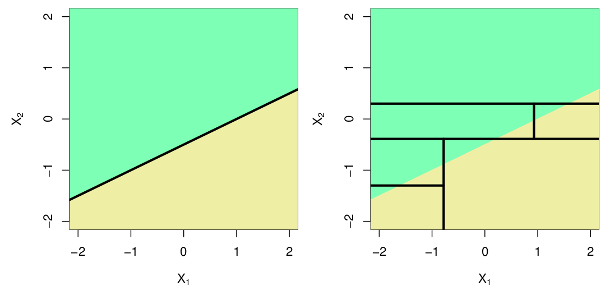{fig-alt="Two plots comparing a linear decision boundary with a decision tree approximation using axis-aligned rectangular splits in feature space." width="100%"}

*Fill in during class.*

:::::

::::: {.column width="48%"}

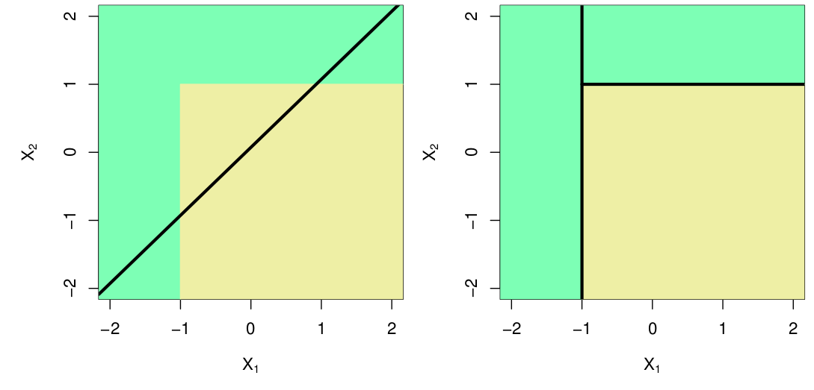{fig-alt="Two plots showing a decision tree perfectly capturing a rectangular boundary with axis-aligned splits, compared to a linear boundary." width="100%"}

*Fill in during class.*

:::::

::::::

## Pros and cons

:::::: {.columns}

::::: {.column width="48%"}

**Pros:**

*Fill in during class.*

:::::

::::: {.column width="48%"}

**Cons:**

*Fill in during class.*

:::::

::::::

## TL;DR

:::::: {.columns}

::::: {.column width="38%"}

- Split into regions by greedily decreasing RSS
- Prune the tree using cost complexity
- Trees are not robust. Next time: how to aggregate trees

:::::

::::: {.column width="28%"}

{fig-alt="Regression tree for baseball player salaries splitting on Years and Hits to produce three leaf nodes." width="100%"}

:::::

::::: {.column width="28%"}

{fig-alt="Scatter plot of Hits versus Years partitioned into three regions R1, R2, and R3 by a regression tree." width="100%"}

:::::

::::::

## Next time

- Random forests

See also the [course schedule](../../../Course_Info/Schedule.html).

## Source and reading

- Textbook reading: Ch. 8.1 of [*An Introduction to Statistical Learning with Applications in Python*](https://www.statlearning.com/).
- Figures and datasets are from the textbook (ISLP) unless noted.
