## Announcements

:::::: {.columns}

::::: {.column width="48%"}

**Last time:**

- 8.1 Decision trees: regression
- 8.1 Decision trees: classification

**This lecture:**

- 8.2.1 Bagging
- 8.2.2 Random forests

:::::

::::: {.column width="48%"}

**Announcements:**

- Homework #5 is due Mon 11/9.

:::::

::::::

# Previously

## First decision tree example

:::::: {.columns}

::::: {.column width="25%"}

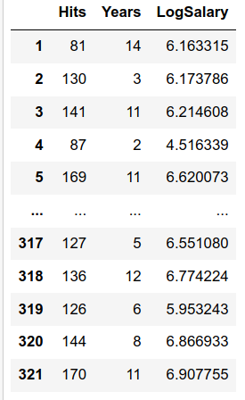{fig-alt="Table displaying baseball hitter data with columns for Hits, Years, and LogSalary." width="100%"}

:::::

::::: {.column width="35%"}

*Fill in during class.*

:::::

::::: {.column width="38%"}

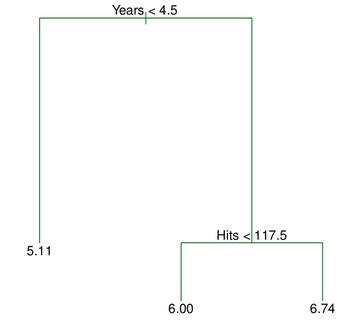{fig-alt="Regression tree for baseball player salaries splitting on Years and Hits to produce three leaf nodes." width="100%"}

:::::

::::::

## Viewing the regions defined by the tree

:::::: {.columns}

::::: {.column width="40%"}

{fig-alt="Regression tree for baseball player salaries splitting on Years and Hits to produce three leaf nodes." width="100%"}

:::::

::::: {.column width="55%"}

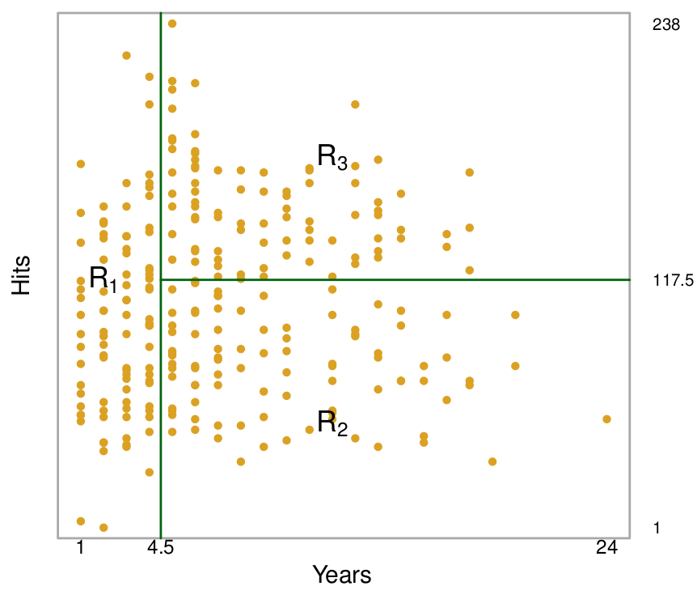{fig-alt="Scatter plot of Hits versus Years partitioned into three regions R1, R2, and R3 by a regression tree." width="100%"}

:::::

::::::

## How do we actually get the tree? Two steps

:::::: {.columns}

::::: {.column width="48%"}

1. We divide the predictor space (the set of possible values for $X_1, X_2, \dots, X_p$) into $J$ distinct and non-overlapping regions $R_1, R_2, \dots, R_J$.
2. For every observation that falls into the region $R_j$, we make the same prediction: the mean of the response values for the training observations in $R_j$.

:::::

::::: {.column width="48%"}

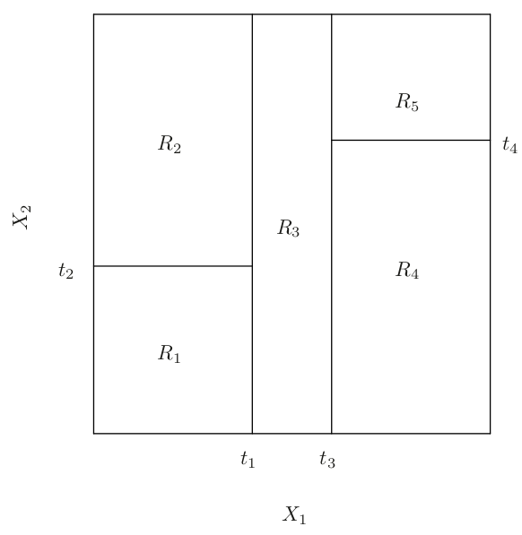{fig-alt="A two-dimensional feature space partitioned into five rectangular regions R1 through R5 by vertical and horizontal splits." width="100%"}

:::::

::::::

## Recursive binary splitting

:::::: {.columns}

::::: {.column width="32%"}

**Goal:**

Find boxes $R_1, \dots, R_J$ that minimize

$$
\sum_{j=1}^J \sum_{i \in R_j} (y_i-\hat y_{R_j})^2
$$

where $\hat y_{R_j}$ is the mean response for the training observations in the $j$th box.

:::::

::::: {.column width="45%"}

Pick $s$ so that splitting into $\{X \mid X_j < s\}$ and $\{X \mid X_j \geq s\}$ gives the largest possible reduction in RSS:

$$
\begin{aligned}
R_1(j,s) &= \{X \mid X_j < s\}\\
R_2(j,s) &= \{X \mid X_j \geq s\}
\end{aligned}
$$

$$
\sum_{i:\, x_i \in R_1(j,s)}(y_i - \hat y_{R_1})^2
+
\sum_{i:\, x_i \in R_2(j,s)}(y_i - \hat y_{R_2})^2
$$

:::::

::::: {.column width="20%"}

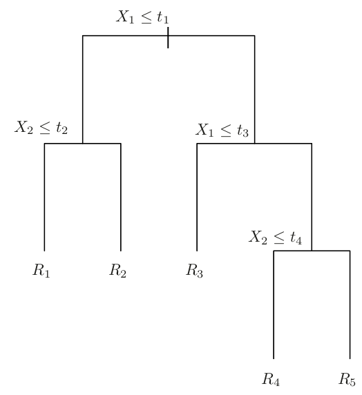{fig-alt="Decision tree diagram illustrating the sequence of binary splits on X1 and X2 resulting in regions R1 through R5." width="100%"}

{fig-alt="A two-dimensional feature space partitioned into five rectangular regions R1 through R5 by vertical and horizontal splits." width="100%"}

:::::

::::::

## Pruning

:::::: {.columns}

::::: {.column width="32%"}

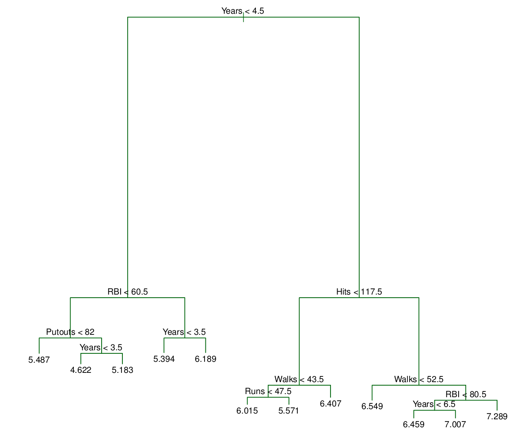{fig-alt="Complex regression tree for baseball player salaries featuring multiple splits on Years, Hits, RBI, Walks, Runs, and Putouts." width="100%"}

:::::

::::: {.column width="32%"}

{fig-alt="Regression tree for baseball player salaries splitting on Years and Hits to produce three leaf nodes." width="100%"}

:::::

::::: {.column width="32%"}

*Fill in during class.*

:::::

::::::

## Classification version

:::::: {.columns}

::::: {.column width="48%"}

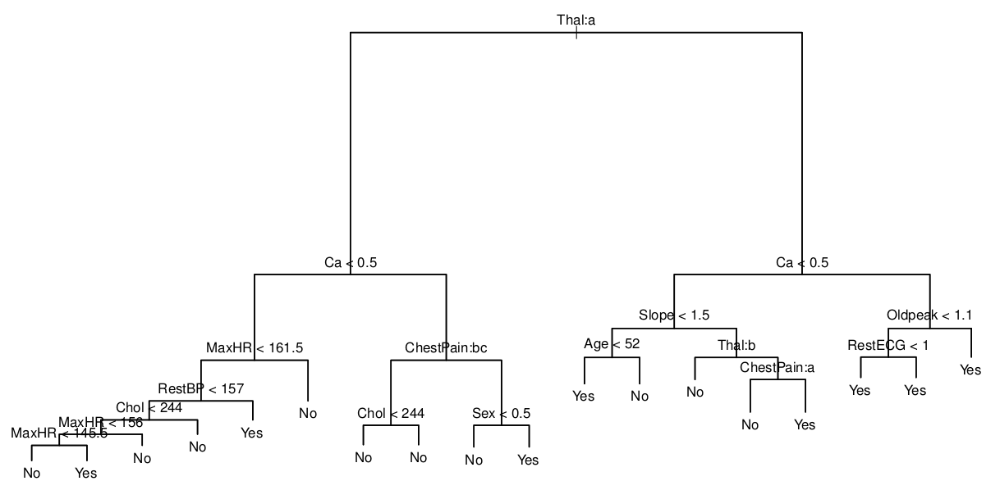{fig-alt="Large, complex classification tree for heart disease predicting Yes or No based on numerous clinical features and splits." width="100%"}

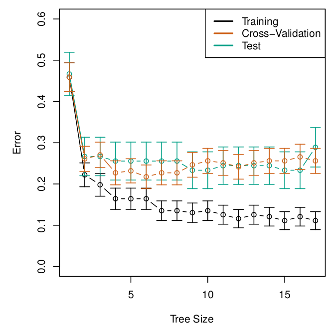{fig-alt="Plot of classification error versus tree size for the training, cross-validation, and test sets, with error bars for each." width="49%"}
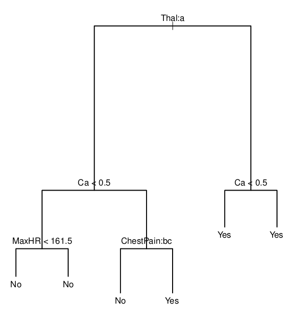{fig-alt="Classification tree for heart disease predicting Yes or No based on splits of Thal, Ca, MaxHR, and ChestPain." width="49%"}

:::::

::::: {.column width="48%"}

**Evaluating the splits:**

- $\hat p_{mk}$ = proportion of training observations in $R_m$ from the $k$th class
- Error: $E = 1-\max_{k}(\hat p_{mk})$
- Gini index:

$$
G = \sum_{k=1}^K \hat p_{mk} (1-\hat p_{mk})
$$

:::::

::::::

## Linear models vs trees

*Fill in during class: we are trying to predict green vs yellow.*

:::::: {.columns}

::::: {.column width="48%"}

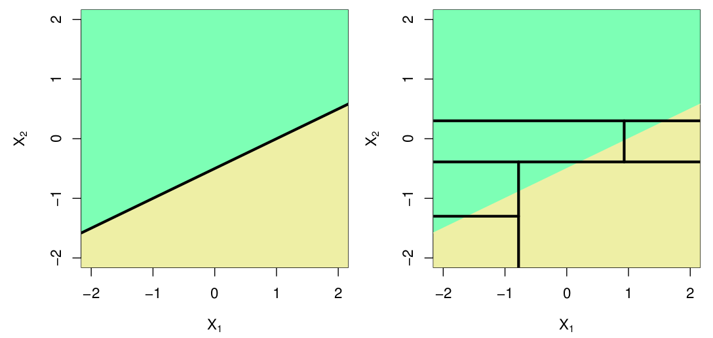{fig-alt="Two plots comparing a linear decision boundary with a decision tree approximation using axis-aligned rectangular splits in feature space." width="100%"}

:::::

::::: {.column width="48%"}

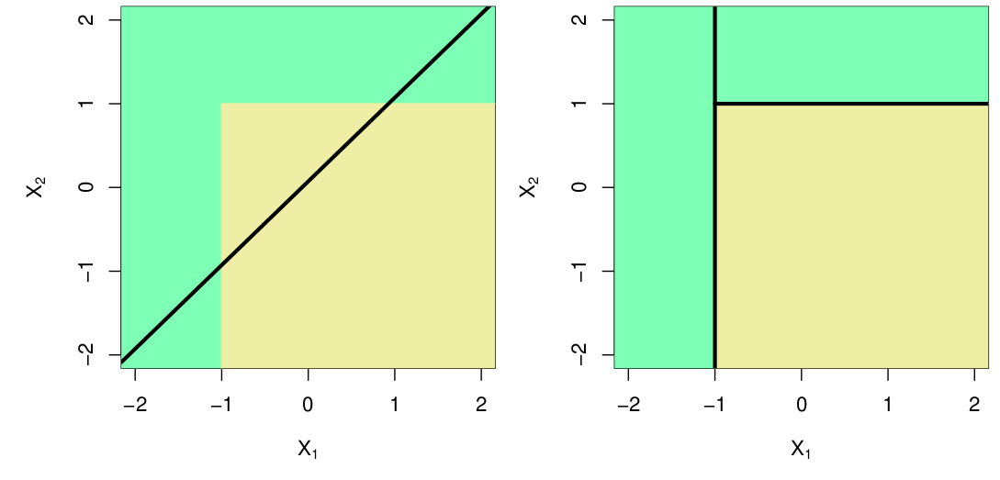{fig-alt="Two plots showing a decision tree perfectly capturing a rectangular boundary with axis-aligned splits, compared to a linear boundary." width="100%"}

:::::

::::::

## What will you learn today?

- What does bagging of decision trees accomplish?
- How do you use out-of-bag error estimation for decision trees?
    - You should be able to describe this for both regression and classification trees.
- What problem of bagging does a random forest address?
- What is the relationship between a random forest and bagging?

# 8.2.1 Bagging

## Use an ensemble of trees to reduce variance

:::::: {.columns}

::::: {.column width="48%"}

**Want to do (but can't):**

Build separate models from independent training sets, and average the resulting predictions:

- $\hat f^1(x), \dots, \hat f^B(x)$ for $B$ separate training sets
- Return the average

$$
\hat f_{avg}(x) = \frac{1}{B} \sum_{b=1}^B \hat f^b(x)
$$

*Fill in during class.*

:::::

::::: {.column width="48%"}

**Bootstrap modification:**

- Work with one fixed data set
- Take $B$ samples from this data set (with replacement)
- Train the method on the $b$th sample to get $\hat f^{*b}(x)$
- Return the average of the predictions (regression)

$$
\hat f_{bag}(x) = \frac{1}{B} \sum_{b=1}^B \hat f^{*b}(x)
$$

or the majority vote (classification)

:::::

::::::

## Tree version

{fig-alt="Visual representation of bagging showing a blue data block leading to multiple red sample blocks and green trees." width="60%" fig-align="center"}

*Fill in during class.*

## Prediction on a new data point

{fig-alt="Cartoon illustration of multiple green trees, representing an ensemble of decision trees." width="60%" fig-align="center"}

*Fill in during class.*

## Example: Heart classification data

:::::: {.columns}

::::: {.column width="48%"}

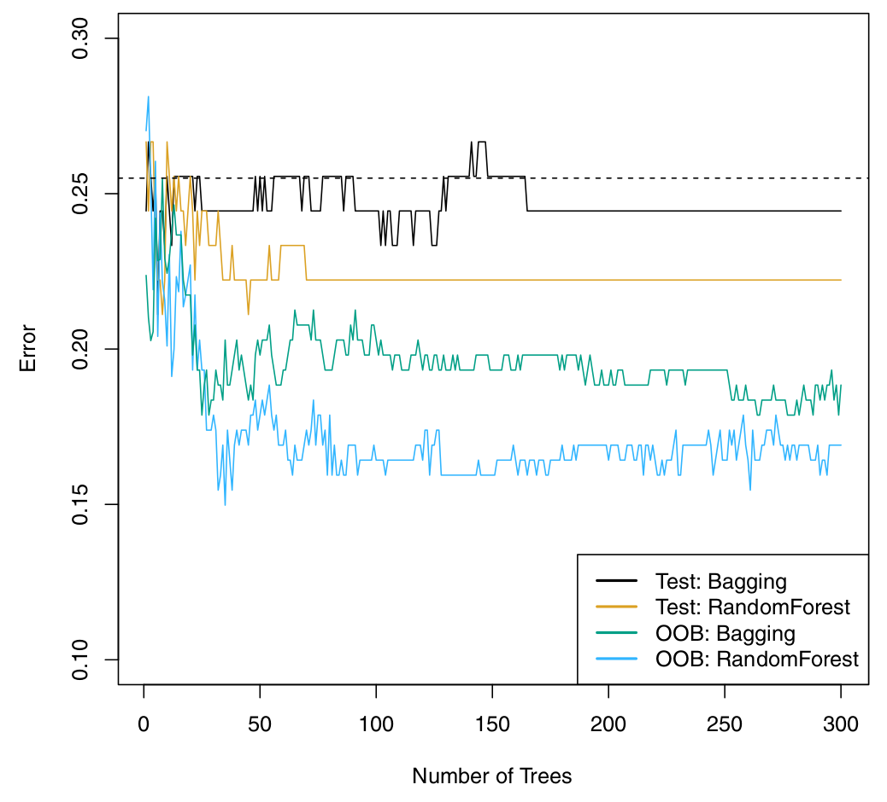{fig-alt="Line plot comparing test and out-of-bag error for bagging and random forest models as the number of trees increases." width="100%"}

:::::

::::: {.column width="48%"}

*Fill in during class.*

:::::

::::::

## Out-of-bag error estimation

:::::: {.columns}

::::: {.column width="48%"}

- On average, a bootstrap sample uses about 2/3 of the data.
- The remaining observations, not used to build that tree, are called *out-of-bag* (OOB) observations.
- For each observation, run it through all the trees where it was not used for building.
- Return the average (or majority vote) of those predictions as its test prediction.
- This is a bootstrapped version of LOOCV.

:::::

::::: {.column width="48%"}

{fig-alt="Diagram showing several red data samples, each corresponding to an individual green decision tree, representing a bagging ensemble process." width="100%"}

:::::

::::::

## Error using OOB

:::::: {.columns}

::::: {.column width="48%"}

{fig-alt="Line plot comparing test and out-of-bag error for bagging and random forest models as the number of trees increases." width="100%"}

:::::

::::: {.column width="48%"}

*Fill in during class.*

:::::

::::::

# Random forests

## The idea

:::::: {.columns}

::::: {.column width="48%"}

**Goal:** decorrelate the bagged trees.

- If there is one strong predictor, the first split of most trees will be the same.
- Most or all trees will then be highly correlated.
- Averaging highly correlated quantities does not decrease the variance as much as averaging uncorrelated ones.

:::::

::::: {.column width="48%"}

**The random forest fix:**

- Each time a split is considered, only use a random subset of $m$ of the predictors.
- A fresh sample is taken every time.
- Typically $m \approx \sqrt p$.
- On average, a fraction $(p-m)/p$ of the splits won't consider the strong predictor.
- $m = p$ gives back bagging.

:::::

::::::

## Example on gene expression

:::::: {.columns}

::::: {.column width="48%"}

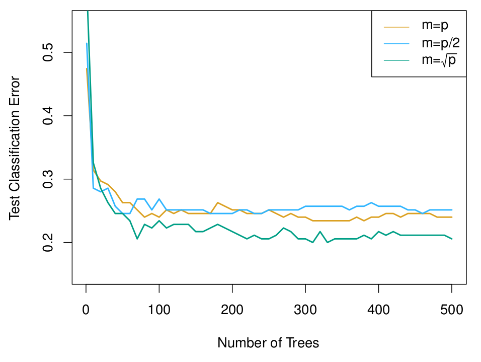{fig-alt="Plot of test classification error versus number of trees comparing m equal to p, m equal to p over 2, and m equal to the square root of p for random forests." width="100%"}

:::::

::::: {.column width="48%"}

*Fill in during class.*

:::::

::::::

## Coding time!

*Fill in during class.*

## TL;DR

- **Bagging:** trees are grown independently on random (bootstrap) samples. The trees tend to be similar to each other.
- **Random forest:** trees are grown independently on bootstrap samples, but each split uses only a random subset of the features.

## Next time

- Catch-up day and practice problems

See also the [course schedule](../../../Course_Info/Schedule.html).

## Source and reading

- Textbook reading: Ch. 8.2.1 and 8.2.2 of [*An Introduction to Statistical Learning with Applications in Python*](https://www.statlearning.com/).
- Figures and datasets are from the textbook (ISLP) unless noted.
