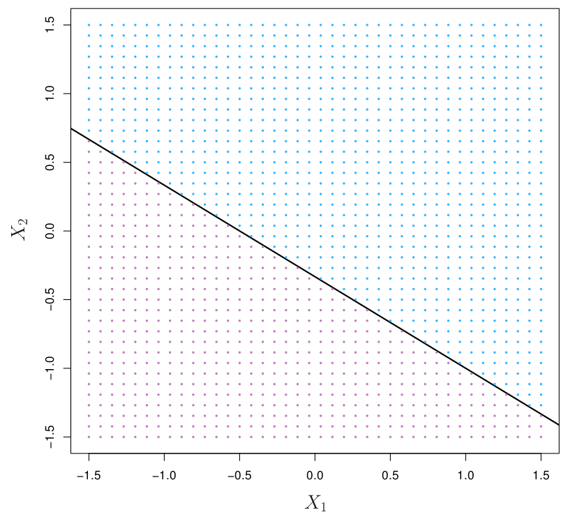
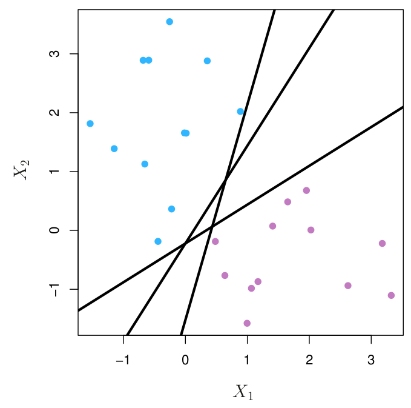
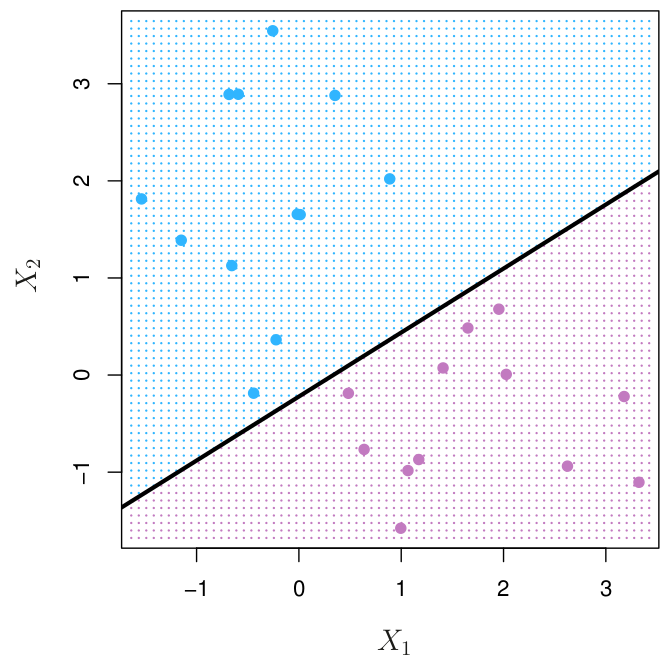
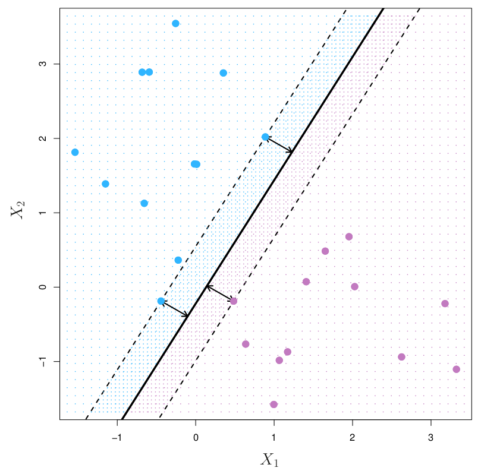
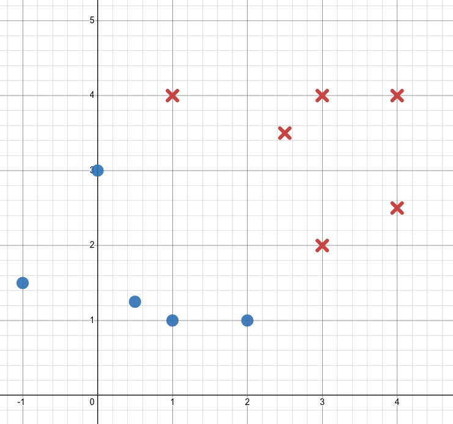
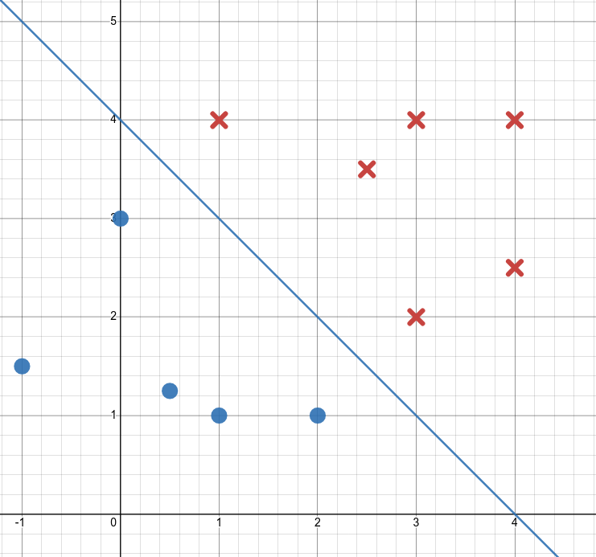
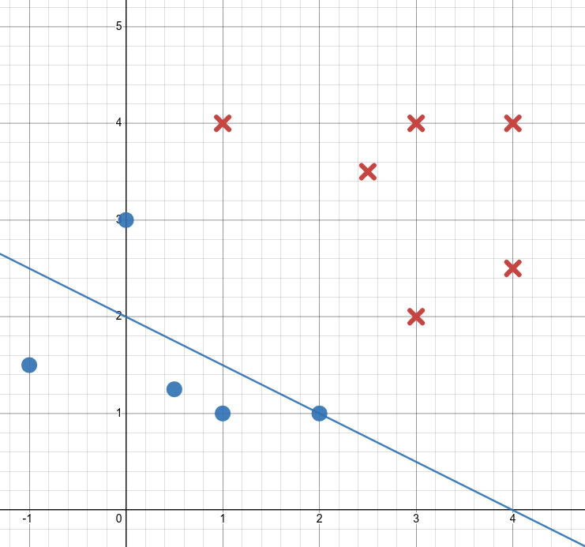
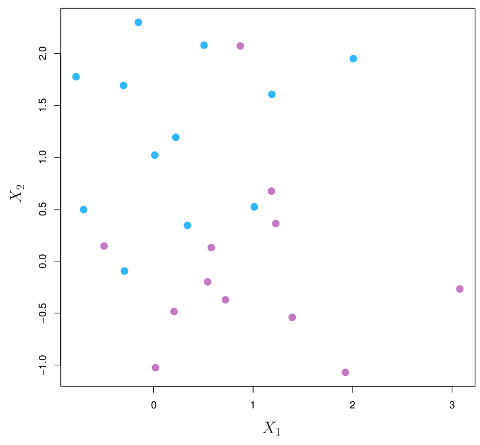
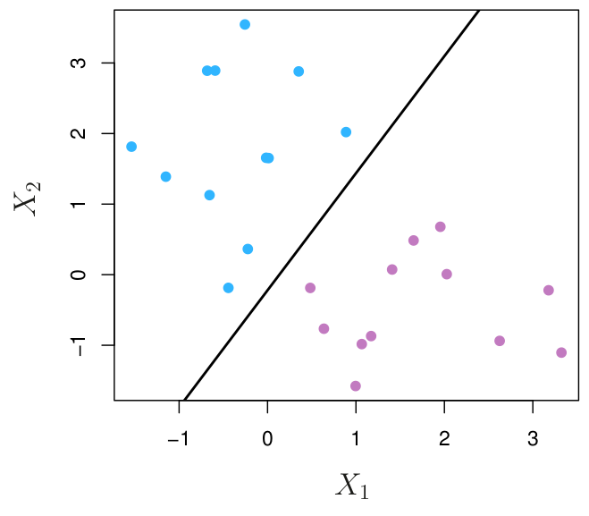
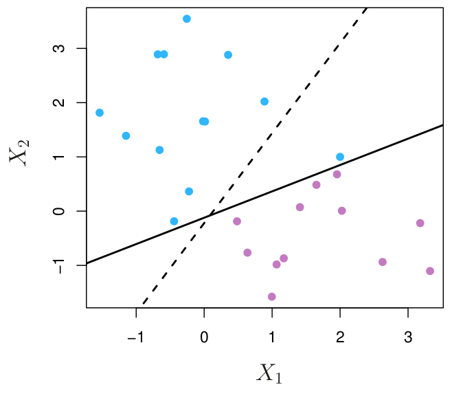

## Announcements

:::::: {.columns}

::::: {.column width="48%"}

**Last time:**

- Catch-up day and practice problems

**This lecture:**

- Maximal margin classifier
- There is no Jupyter notebook for this class.

:::::

::::: {.column width="48%"}

**Announcements:**

- Homework #6 is due Fri 11/20.

See the [course schedule](../../../Course_Info/Schedule.html).

:::::

::::::

## What will you learn today?

- What is a hyperplane?
    - How do you mathematically describe this hyperplane?
    - How do you mathematically describe the two sides of the hyperplane?
    - Given the equation of the hyperplane and the coordinates of a point, you should be able to tell which side of the plane the point is on.
- What qualifies a hyperplane as a separating hyperplane?
    - You should be able to describe this mathematically using an inequality.
    - You should also be able to determine whether a hyperplane is a separating hyperplane, given a graph, or given the equation of the plane and the coordinates and class of a few points.
- How do you use a separating hyperplane as a classifier?
- What makes a hyperplane a maximal margin hyperplane?
    - What are its margin and support vectors?
    - Given a graph, you should be able to label the margin and the support vectors, and to read off the size of the margin.
    - You should also be able to describe the optimization problem mathematically.
    - Given the equation of the maximal margin hyperplane and the coordinates of the support vectors, you should be able to calculate the size of the margin by hand.

# Maximal margin classifier

## The goal

:::::: {.columns}

::::: {.column width="48%"}

{fig-alt="Scatter plot of two classes of points, one class drawn in blue and the other in red, with a line between them that separates the two classes." width="100%"}

:::::

::::: {.column width="48%"}

*Fill in during class.*

:::::

::::::

## What is a hyperplane?

*Fill in during class.*

## Mathematical definition of a hyperplane

$$
\beta_0 + \beta_1X_1 + \beta_2X_2 + \cdots + \beta_p X_p = 0
$$

*Fill in during class.*

## Hyperplane for $p=2$

:::::: {.columns}

::::: {.column width="48%"}

{fig-alt="The line 1 + 2 X1 + 3 X2 = 0 in the X1-X2 plane. It divides the plane into two regions, one shaded blue and one shaded purple." width="100%"}

$1+2X_1 + 3X_2 = 0$

:::::

::::: {.column width="48%"}

*Fill in during class.*

:::::

::::::

## There are two sides to every hyperplane

:::::: {.columns}

::::: {.column width="48%"}

$$
\beta_0 + \beta_1X_1 + \beta_2X_2 + \cdots + \beta_p X_p < 0
$$

:::::

::::: {.column width="48%"}

$$
\beta_0 + \beta_1X_1 + \beta_2X_2 + \cdots + \beta_p X_p > 0
$$

:::::

::::::

{fig-alt="The line 1 + 2 X1 + 3 X2 = 0 in the X1-X2 plane. It divides the plane into two regions, one shaded blue and one shaded purple." width="40%" fig-align="center"}

## Classification setup

:::::: {.columns}

::::: {.column width="48%"}

Data matrix:
$$
X =
\begin{pmatrix}
- & x_1^T & -\\
- & x_2^T & -\\
 & \vdots & \\
- & x_n^T & -
\end{pmatrix}_{n \times p}
$$

$$
x_1 =
\begin{pmatrix}
x_{11} \\
\vdots \\
x_{1p}
\end{pmatrix}
,\cdots,
x_n =
\begin{pmatrix}
x_{n1} \\
\vdots \\
x_{np}
\end{pmatrix}
$$

:::::

::::: {.column width="48%"}

Observations are in one of two classes, $y_i \in \{-1,1\}$:
$$
Y =
\begin{pmatrix}
y_1 \\
y_2\\
\vdots \\
y_n
\end{pmatrix}
$$

:::::

::::::

Separate out a test observation:
$$
x^* = (x_1^* \; \cdots \; x^*_p)^T
$$

## Separating hyperplane

$$
\begin{aligned}
\beta_0 + \beta_1x_{i1} + \beta_2 x_{i2} + \cdots + \beta_px_{ip} &> 0 \text{ if } y_i = 1\\
\beta_0 + \beta_1x_{i1} + \beta_2 x_{i2} + \cdots + \beta_px_{ip} &< 0 \text{ if } y_i = -1
\end{aligned}
$$

:::::: {.columns}

::::: {.column width="40%"}

{fig-alt="Two classes of observations, blue and purple, with three different lines that each separate the blue points from the purple points." width="100%"}

:::::

::::: {.column width="55%"}

*Fill in during class.*

:::::

::::::

## Another way to say it

$$
\begin{aligned}
\beta_0 + \beta_1x_{i1} + \beta_2 x_{i2} + \cdots + \beta_px_{ip} &> 0 \text{ if } y_i = 1\\
\beta_0 + \beta_1x_{i1} + \beta_2 x_{i2} + \cdots + \beta_px_{ip} &< 0 \text{ if } y_i = -1
\end{aligned}
$$

For all $i$:
$$
y_i(\beta_0 + \beta_1x_{i1} + \beta_2 x_{i2} + \cdots + \beta_px_{ip}) > 0
$$

## A separating hyperplane becomes a classifier

:::::: {.columns}

::::: {.column width="48%"}

If you have a separating hyperplane:

- Check
$$
f(x^*) = \beta_0 + \beta_1x_{1}^* + \beta_2 x_{2}^* + \cdots + \beta_px_{p}^*
$$
- If positive, assign $\hat y = 1$.
- If negative, assign $\hat y = -1$.

:::::

::::: {.column width="48%"}

{fig-alt="Two classes of observations, blue and purple, with one separating line. The plane on each side of the line is shaded to match the class that a new point on that side is assigned to." width="100%"}

:::::

::::::

## How do we pick?

:::::: {.columns}

::::: {.column width="48%"}

{fig-alt="Two classes of observations, blue and purple, with three different lines that each separate the blue points from the purple points." width="100%"}

:::::

::::: {.column width="48%"}

*Fill in during class.*

:::::

::::::

## Distance from an observation to a hyperplane

:::::: {.columns}

::::: {.column width="48%"}

{fig-alt="The two-class scatter plot with one candidate separating line drawn through it." width="100%"}

:::::

::::: {.column width="48%"}

{fig-alt="The same two-class scatter plot with a different candidate separating line drawn through it." width="100%"}

:::::

::::::

## Maximal margin classifier

:::::: {.columns}

::::: {.column width="48%"}

{fig-alt="Blue and purple observations with the maximal margin hyperplane drawn as a solid line and the margin shown by two dashed lines on either side. Three observations, two blue and one purple, lie on the dashed lines and are the support vectors." width="100%"}

:::::

::::: {.column width="48%"}

*Fill in during class.*

:::::

::::::

## Example

:::::: {.columns}

::::: {.column width="48%"}

{fig-alt="Scatter plot in the X1-X2 plane with red X marks for the class y = 1 and blue circles for the class y = -1." width="100%"}

:::::

::::: {.column width="48%"}

- Sketch the maximal margin hyperplane.
- What is the equation of this line in the form $\beta_0 + \beta_1X_1 + \beta_2 X_2 = 0$?
- Circle the support vectors. What is their distance from the line?

:::::

::::::

Desmos: [Desmos graph of the example](https://www.desmos.com/calculator/tklbommiwz)

## Extra work space

:::::: {.columns}

::::: {.column width="48%"}

{fig-alt="Scatter plot in the X1-X2 plane with red X marks for the class y = 1 and blue circles for the class y = -1." width="100%"}

:::::

::::: {.column width="48%"}

Respond to the [PollEv question](https://PollEv.com/multiple_choice_polls/2q6UsD3rYTqB3c0z2IiNF/respond).

*Fill in during class.*

:::::

::::::

Desmos: [Desmos graph of the example](https://www.desmos.com/calculator/tklbommiwz)

## Mathematical formulation

$$
\begin{aligned}
&\underset{\beta_0, \beta_1, \dots, \beta_p,\, M}{\text{maximize}} \quad M\\
&\text{subject to} \quad \sum_{j=1}^p \beta_j^2 = 1,\\
&\qquad\qquad\;\; y_i(\beta_0 + \beta_1x_{i1} + \beta_2 x_{i2} + \cdots + \beta_px_{ip}) \geq M \quad \text{for all } i = 1, \dots, n.
\end{aligned}
$$

*Fill in during class.*

## First constraint

:::::: {.columns}

::::: {.column width="35%"}

{fig-alt="The red X and blue circle scatter plot with the maximal margin line drawn between the two classes." width="100%"}

:::::

::::: {.column width="60%"}

*Fill in during class: we had the equation $-4 + X_1 + X_2 = 0$. Rescale it so that $\sum_{j=1}^p \beta_j^2 = 1$, then plug in a support vector.*

:::::

::::::

## Second constraint

:::::: {.columns}

::::: {.column width="35%"}

{fig-alt="The red X and blue circle scatter plot with the maximal margin line drawn between the two classes." width="100%"}

- Blue circles: $y_i = -1$
- Red Xs: $y_i = 1$
- $-2 \sqrt 2 + \frac{\sqrt 2}{2} X_1 + \frac{\sqrt 2}{2} X_2 = 0$

:::::

::::: {.column width="60%"}

$$
y_i(\beta_0 + \beta_1 x_{i1} + \beta_2 x_{i2}) \geq M
$$

*Fill in during class.*

:::::

::::::

## An example with a bad choice of hyperplane

:::::: {.columns}

::::: {.column width="35%"}

{fig-alt="The red X and blue circle scatter plot with a different line drawn through it that does not separate the two classes well." width="100%"}

- Blue circles: $y_i = -1$
- Red Xs: $y_i = 1$
- $-\frac{4}{\sqrt{5}} + \frac{1}{\sqrt 5} X_1 + \frac{2}{\sqrt 5} X_2 = 0$

:::::

::::: {.column width="60%"}

What is $y_i(\beta_0 + \beta_1 x_{i1} + \beta_2 x_{i2})$ for the point $x_i = (0,3)$?

*Fill in during class.*

:::::

::::::

## Second constraint: extra space

:::::: {.columns}

::::: {.column width="35%"}

{fig-alt="The red X and blue circle scatter plot with the maximal margin line drawn between the two classes." width="100%"}

- Blue circles: $y_i = -1$
- Red Xs: $y_i = 1$
- $-2 \sqrt 2 + \frac{\sqrt 2}{2} X_1 + \frac{\sqrt 2}{2} X_2 = 0$

:::::

::::: {.column width="48%"}

$$
y_i(\beta_0 + \beta_1 x_{i1} + \beta_2 x_{i2}) \geq M
$$

*Fill in during class.*

:::::

::::::

## Mathematical formulation

$$
\begin{aligned}
&\underset{\beta_0, \beta_1, \dots, \beta_p,\, M}{\text{maximize}} \quad M\\
&\text{subject to} \quad \sum_{j=1}^p \beta_j^2 = 1,\\
&\qquad\qquad\;\; y_i(\beta_0 + \beta_1x_{i1} + \beta_2 x_{i2} + \cdots + \beta_px_{ip}) \geq M \quad \text{for all } i = 1, \dots, n.
\end{aligned}
$$

*Fill in during class.*

# Issues with the maximal margin classifier

## But what if ...

:::::: {.columns}

::::: {.column width="48%"}

{fig-alt="Blue and purple observations that overlap, so that no straight line can separate the two classes." width="100%"}

:::::

::::: {.column width="48%"}

*Fill in during class.*

:::::

::::::

## Sensitivity to new points

:::::: {.columns}

::::: {.column width="48%"}

{fig-alt="Blue and purple observations with the maximal margin hyperplane and its margin drawn between them." width="100%"}

:::::

::::: {.column width="48%"}

{fig-alt="The same observations plus one additional blue observation, which makes the maximal margin hyperplane shift sharply and the margin become much narrower." width="100%"}

:::::

::::::

*Fill in during class.*

## Next time

- Support vector classifier (Ch. 9.2)

See also the [course schedule](../../../Course_Info/Schedule.html).

## Source and reading

- Textbook reading: Ch. 9.1 of [*An Introduction to Statistical Learning with Applications in Python*](https://www.statlearning.com/).
- Figures and datasets are from the textbook (ISLP) unless noted.
