## Announcements

:::::: {.columns}

::::: {.column width="48%"}

**Last time:**

- 9.1 Maximal margin classifier

**This lecture:**

- 9.2 Support vector classifier

:::::

::::: {.column width="48%"}

**Announcements:**

- Homework #6 is due Fri 11/20.

See the [course schedule](../../../Course_Info/Schedule.html).

:::::

::::::

# Last time

## Separating hyperplane

:::::: {.columns}

::::: {.column width="40%"}

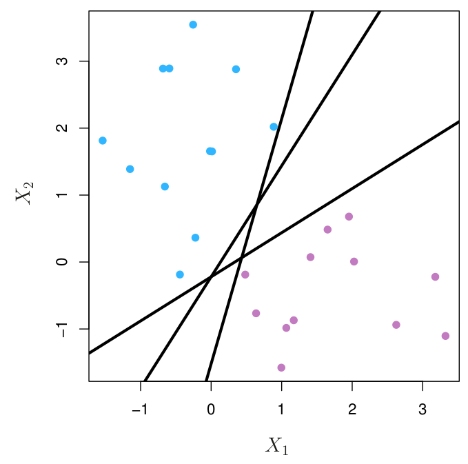{fig-alt="Two classes of observations, blue and purple, with three different lines that each separate the blue points from the purple points." width="100%"}

:::::

::::: {.column width="55%"}

Require that for every data point:
$$
\begin{aligned}
\beta_0 + \beta_1x_{i1} + \cdots + \beta_px_{ip} &> 0 \text{ if } y_i = 1\\
\beta_0 + \beta_1x_{i1} + \cdots + \beta_px_{ip} &< 0 \text{ if } y_i = -1
\end{aligned}
$$

*Equivalently*, require that for every data point:
$$
y_i(\beta_0 + \beta_1x_{i1} + \cdots + \beta_px_{ip}) > 0
$$

:::::

::::::

## A separating hyperplane becomes a classifier

:::::: {.columns}

::::: {.column width="48%"}

If you have a separating hyperplane:

- Check
$$
f(x^*) = \beta_0 + \beta_1x_{1}^* + \beta_2 x_{2}^* + \cdots + \beta_px_{p}^*
$$
- If positive, assign $\hat y = 1$.
- If negative, assign $\hat y = -1$.

:::::

::::: {.column width="48%"}

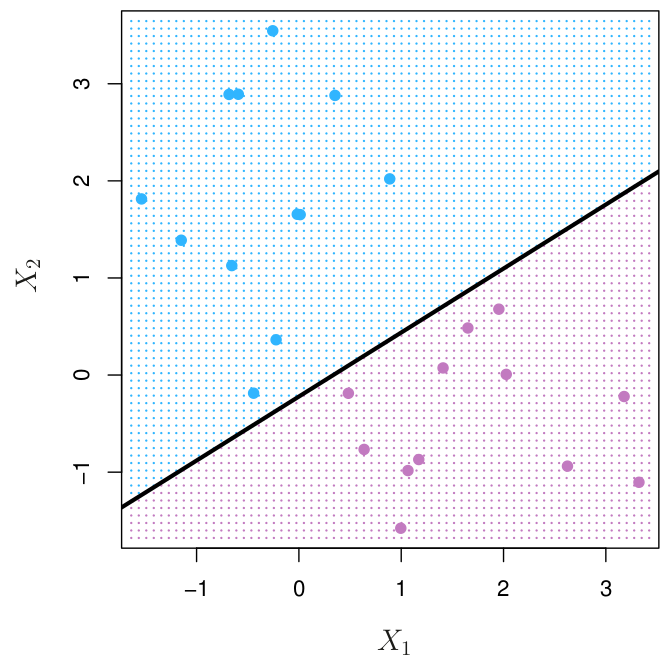{fig-alt="Two classes of observations, blue and purple, with one separating line. The plane on each side of the line is shaded to match the class assigned to a new point on that side." width="100%"}

:::::

::::::

## Maximal margin classifier

:::::: {.columns}

::::: {.column width="40%"}

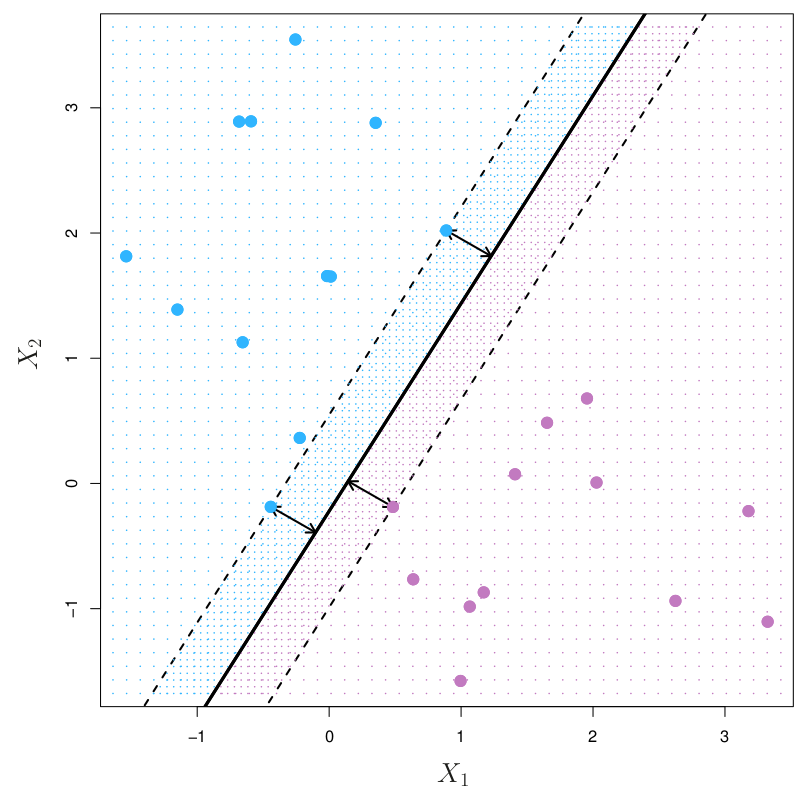{fig-alt="Blue and purple observations with the maximal margin hyperplane drawn as a solid line and the margin shown by two dashed lines on either side. Three observations, two blue and one purple, lie on the dashed lines and are the support vectors." width="100%"}

:::::

::::: {.column width="55%"}

- For a hyperplane, the *margin* is the smallest distance from any data point to the hyperplane.
- Observations that are closest are called *support vectors*.
- The *maximal margin hyperplane* is the hyperplane with the largest margin.
- The classifier built from this hyperplane is the *maximal margin classifier*.

Test your understanding: [PollEv](https://www.polleverywhere.com/activities)

:::::

::::::

## Mathematical formulation

$$
\begin{aligned}
&\underset{\beta_0, \beta_1, \dots, \beta_p,\, M}{\text{maximize}} \quad M\\
&\text{subject to} \quad \sum_{j=1}^p \beta_j^2 = 1,\\
&\qquad\qquad\;\; y_i(\beta_0 + \beta_1x_{i1} + \cdots + \beta_px_{ip}) \geq M \quad \text{for all } i = 1, \dots, n.
\end{aligned}
$$

*Fill in during class.*

## Problems

:::::: {.columns}

::::: {.column width="48%"}

**Might be no separating hyperplane**

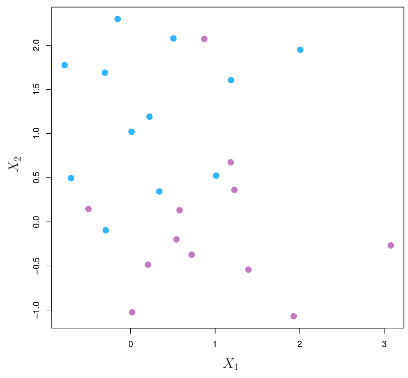{fig-alt="Blue and purple observations that overlap, so that no straight line can separate the two classes." width="60%"}

:::::

::::: {.column width="48%"}

**Sensitivity to new points**

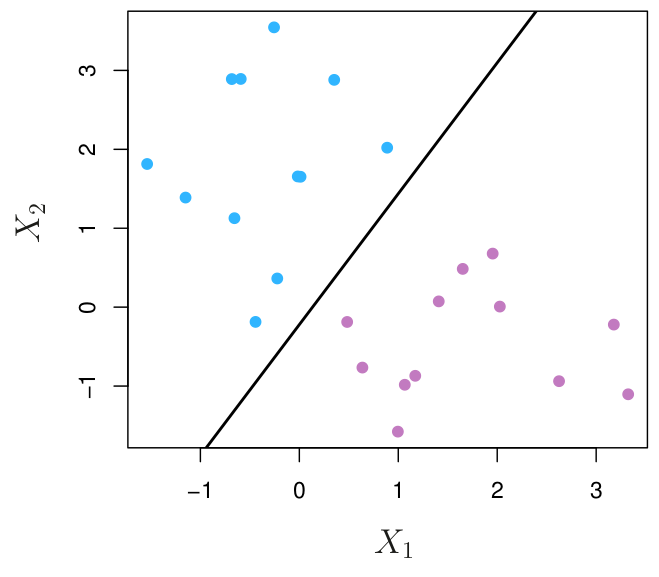{fig-alt="Blue and purple observations with the maximal margin hyperplane and its margin drawn between them." width="60%"}
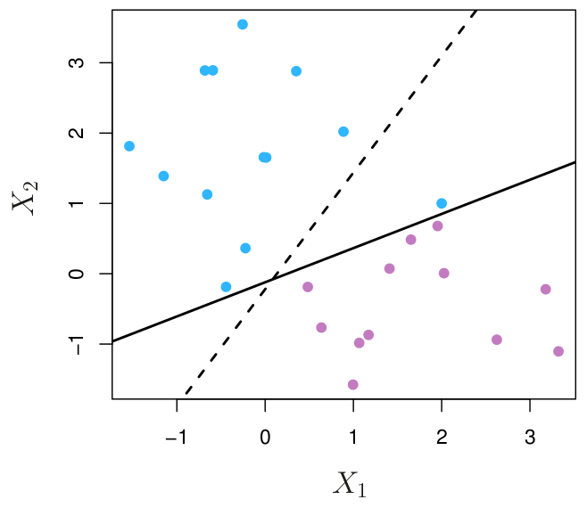{fig-alt="The same observations plus one additional blue observation, which makes the maximal margin hyperplane shift sharply and the margin become much narrower." width="60%"}

:::::

::::::

## What will you learn today?

- What is the difference between a support vector classifier and a maximal margin classifier?
    - What shortcomings of the maximal margin classifier does the support vector classifier overcome?
    - How?
    - You should be able to describe the difference verbally, graphically, and mathematically.
- How do you interpret each element of the mathematical formulation of the support vector classifier graphically?
    - Given a graph of a support vector classifier and some data points, you should be able to derive the values of the different parameters in the mathematical formulation (for example $M$ and $\epsilon_i$).
- What parameters control the flexibility (hence the bias-variance trade-off) of a support vector classifier?
- What are the support vectors of a support vector classifier?

# Support vector classifier

## Basic idea

*Fill in during class.*

## Soft margin

:::::: {.columns}

::::: {.column width="48%"}

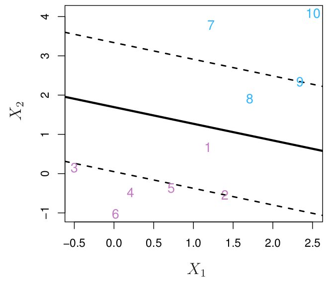{fig-alt="Blue and purple observations with a hyperplane and margin. Some observations lie on the wrong side of the margin but still on the correct side of the hyperplane." width="100%"}

:::::

::::: {.column width="48%"}

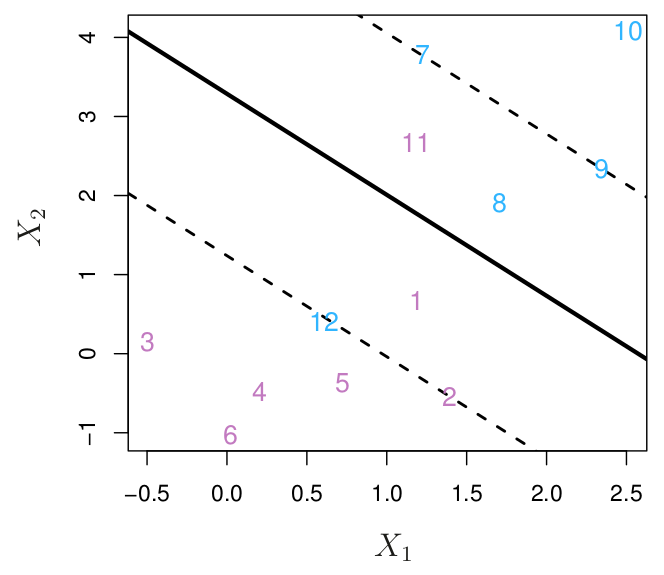{fig-alt="Blue and purple observations with a hyperplane and margin. Some observations lie on the wrong side of the hyperplane, so they are misclassified." width="100%"}

:::::

::::::

*Fill in during class.*

## Mathematical formulation of the support vector classifier

$$
\begin{aligned}
&\underset{\beta_0, \dots, \beta_p,\, \epsilon_1, \dots, \epsilon_n,\, M}{\text{maximize}} \quad M\\
&\text{subject to} \quad \sum_{j=1}^p \beta_j^2 = 1,\\
&\qquad\qquad\;\; y_i(\beta_0 + \beta_1x_{i1} + \cdots + \beta_px_{ip}) \geq M(1-\epsilon_i),\\
&\qquad\qquad\;\; \epsilon_i \geq 0, \quad \sum_{i=1}^n \epsilon_i \leq C.
\end{aligned}
$$

*Fill in during class.*

## Find positive $\epsilon_i$ that satisfy this inequality

$$
\text{Fix } M = \sqrt 2 \qquad y_i(\beta_0 + \beta_1x_{i1} + \cdots + \beta_px_{ip}) \geq M(1-\epsilon_i)
$$

:::::: {.columns}

::::: {.column width="48%"}

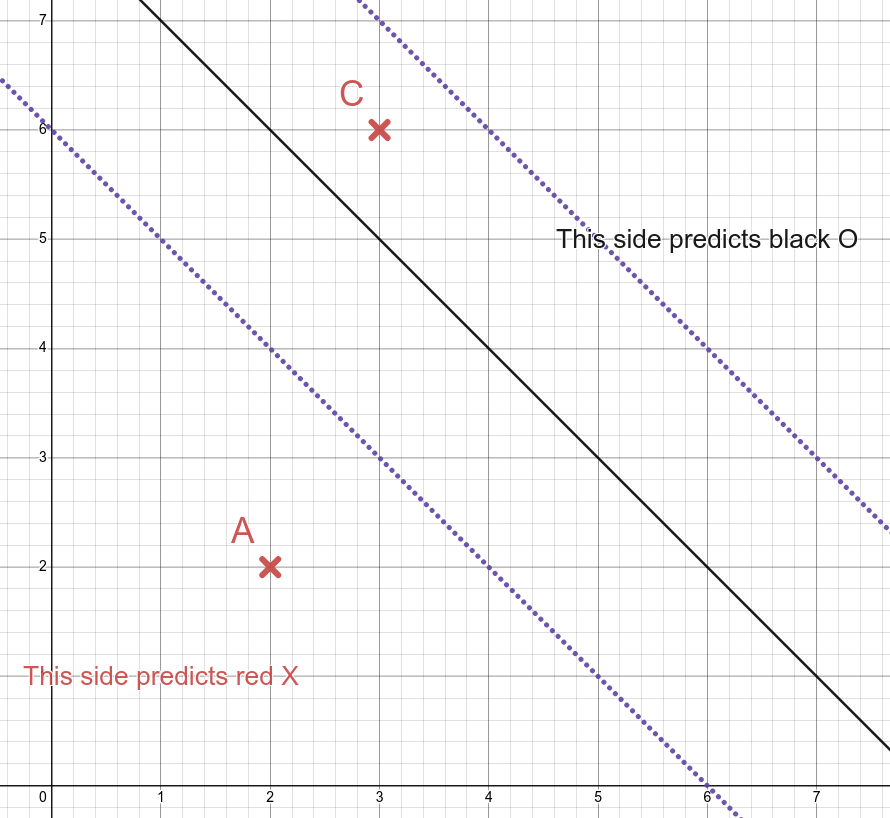{fig-alt="Scatter plot of two classes of points with a hyperplane and its margin. Point A is on the correct side of the hyperplane, beyond the margin. Point C is on the wrong side of the hyperplane for its class." width="100%"}

:::::

::::: {.column width="48%"}

*Fill in during class.*

:::::

::::::

## What is $\epsilon_i$? Practice

$$
\text{Fix } M = \sqrt 2 \qquad y_i(\beta_0 + \beta_1x_{i1} + \cdots + \beta_px_{ip}) \geq M(1-\epsilon_i)
$$

:::::: {.columns}

::::: {.column width="40%"}

Fill in the table so that the inequality is satisfied.

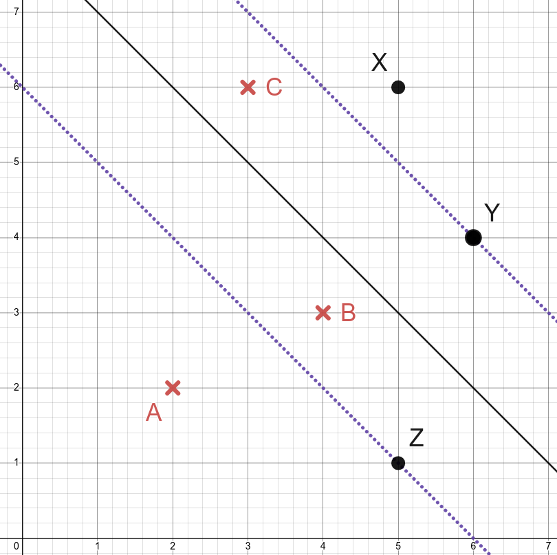{fig-alt="Scatter plot of two classes of points with a hyperplane and its margin. Six points labeled A, B, C, X, Y and Z are marked; the left side of the inequality for each point is given in the table." width="100%"}

:::::

::::: {.column width="58%"}

| Point | Left side | $\epsilon_i$ | $M(1-\epsilon_i)$ |
|:--:|:--:|:--:|:--:|
| A | $2\sqrt{2}$ | 0 | $\sqrt{2}$ |
| B | $\frac{\sqrt{2}}{2}$ | | |
| C | $-\frac{\sqrt{2}}{2}$ | 1.5 | $-\frac{\sqrt{2}}{2}$ |
| X | $\frac{3\sqrt{2}}{2}$ | | |
| Y | $\sqrt{2}$ | | |
| Z | $-\sqrt{2}$ | | |

:::::

::::::

## What is $\epsilon_i$?

:::::: {.columns}

::::: {.column width="48%"}

*Fill in during class.*

:::::

::::: {.column width="48%"}

{fig-alt="Blue and purple observations with a hyperplane and margin. Some observations lie on the wrong side of the hyperplane, so they are misclassified." width="100%"}

:::::

::::::

## What is $C$?

:::::: {.columns}

::::: {.column width="58%"}

$$
\epsilon_i \geq 0, \quad \sum_{i=1}^n \epsilon_i \leq C
$$

*Fill in during class.*

:::::

::::: {.column width="38%"}

{fig-alt="Blue and purple observations with a hyperplane and margin. Some observations lie on the wrong side of the hyperplane, so they are misclassified." width="100%"}

:::::

::::::

## Examples messing with $C$

Four support vector classifiers on the same data, from left to right with $C$ increasing: the margin gets wider and more observations are allowed to violate it.

:::::: {.columns}

::::: {.column width="25%"}

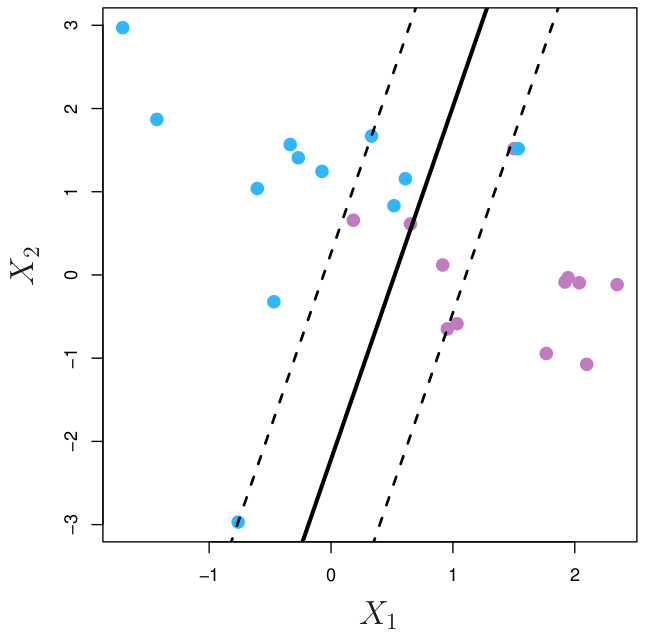{fig-alt="Support vector classifier with the smallest C of the four: a narrow margin with few observations on or inside it." width="100%"}

:::::

::::: {.column width="25%"}

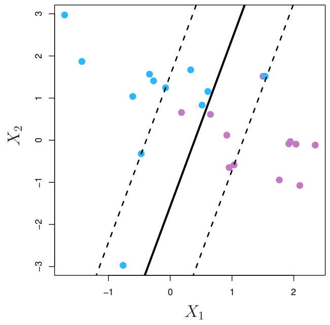{fig-alt="Support vector classifier with a larger C: a somewhat wider margin than the previous panel." width="100%"}

:::::

::::: {.column width="25%"}

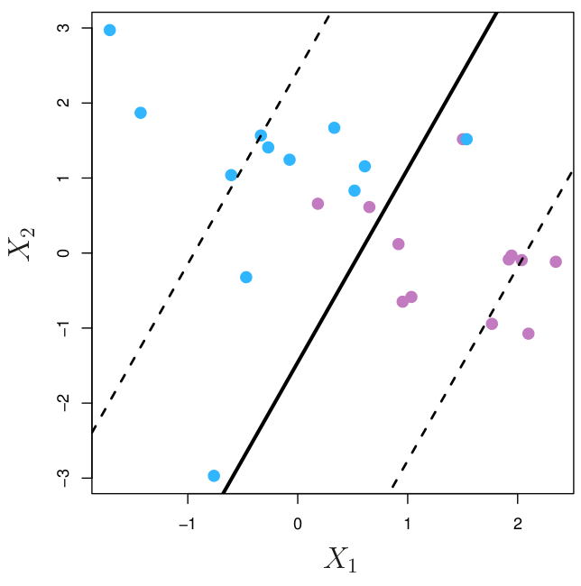{fig-alt="Support vector classifier with an even larger C: a wide margin with many observations on or inside it." width="100%"}

:::::

::::: {.column width="25%"}

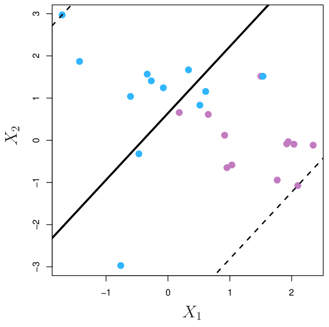{fig-alt="Support vector classifier with the largest C of the four: the widest margin, with the most observations on or inside it." width="100%"}

:::::

::::::

**Question:** How does $C$ control the bias-variance trade-off?

*Fill in during class.*

## What affects the hyperplane?

:::::: {.columns}

::::: {.column width="48%"}

{fig-alt="Support vector classifier with a narrow margin, with observations on or inside the margin marked as support vectors." width="100%"}

:::::

::::: {.column width="48%"}

*Fill in during class.*

:::::

::::::

## Coding

*Fill in during class.*

## TL;DR

:::::: {.columns}

::::: {.column width="48%"}

**Maximal margin classifier**

$$
\begin{aligned}
&\underset{\beta_0, \dots, \beta_p,\, M}{\text{maximize}} \; M\\
&\text{subject to} \; \sum_{j=1}^p \beta_j^2 = 1,\\
&\; y_i(\beta_0 + \cdots + \beta_px_{ip}) \geq M
\end{aligned}
$$

{fig-alt="Maximal margin hyperplane with its margin and three support vectors." width="50%"}

:::::

::::: {.column width="48%"}

**Support vector classifier**

$$
\begin{aligned}
&\underset{\beta_0, \dots, \beta_p,\, \epsilon_1, \dots, \epsilon_n,\, M}{\text{maximize}} \; M\\
&\text{subject to} \; \sum_{j=1}^p \beta_j^2 = 1,\\
&\; y_i(\beta_0 + \cdots + \beta_px_{ip}) \geq M(1-\epsilon_i),\\
&\; \epsilon_i \geq 0, \; \sum_{i=1}^n \epsilon_i \leq C
\end{aligned}
$$

{fig-alt="Support vector classifier with a margin that some observations lie on or inside." width="50%"}

:::::

::::::

## Next time

- Support vector machine (SVM)

See also the [course schedule](../../../Course_Info/Schedule.html).

## Source and reading

- Textbook reading: Ch. 9.2 of [*An Introduction to Statistical Learning with Applications in Python*](https://www.statlearning.com/).
- Figures are from the textbook (ISLP) unless noted.
