## Announcements

:::::: {.columns}

::::: {.column width="48%"}

**Last time:**

- 9.2 Support vector classifier

**This lecture:**

- 9.3 Support vector machine
- 9.4 SVMs with more than two classes

:::::

::::: {.column width="48%"}

**Announcements:**

- Homework #6 is due Fri 11/20.

See the [course schedule](../../../Course_Info/Schedule.html).

:::::

::::::

# Last time

## Classification setup

:::::: {.columns}

::::: {.column width="48%"}

Data matrix:
$$
X =
\begin{pmatrix}
- & x_1^T & -\\
- & x_2^T & -\\
 & \vdots & \\
- & x_n^T & -
\end{pmatrix}_{n \times p}
$$

$$
x_1 =
\begin{pmatrix}
x_{11} \\
\vdots \\
x_{1p}
\end{pmatrix}
,\cdots,
x_n =
\begin{pmatrix}
x_{n1} \\
\vdots \\
x_{np}
\end{pmatrix}
$$

:::::

::::: {.column width="48%"}

Observations are in one of two classes, $y_i \in \{-1,1\}$:
$$
Y =
\begin{pmatrix}
y_1 \\
y_2\\
\vdots \\
y_n
\end{pmatrix}
$$

:::::

::::::

Separate out a test observation:
$$
x^* = (x_1^* \; \cdots \; x^*_p)^T
$$

## Hyperplane becomes a classifier

:::::: {.columns}

::::: {.column width="48%"}

If you have a separating hyperplane:

- Check
$$
f(x^*) = \beta_0 + \beta_1x_{1}^* + \beta_2 x_{2}^* + \cdots + \beta_px_{p}^*
$$
- If positive, assign $\hat y = 1$.
- If negative, assign $\hat y = -1$.

:::::

::::: {.column width="48%"}

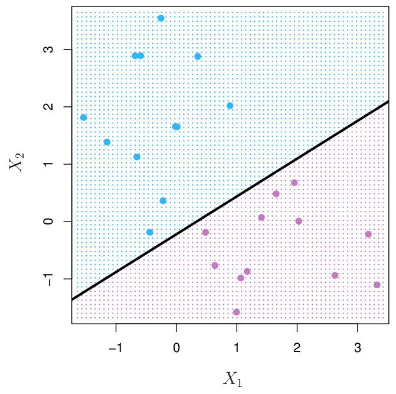{fig-alt="Two classes of observations, blue and purple, with one separating line. The plane on each side of the line is shaded to match the class assigned to a new point on that side." width="100%"}

:::::

::::::

## How do we pick? Old version: maximal margin classifier

:::::: {.columns}

::::: {.column width="40%"}

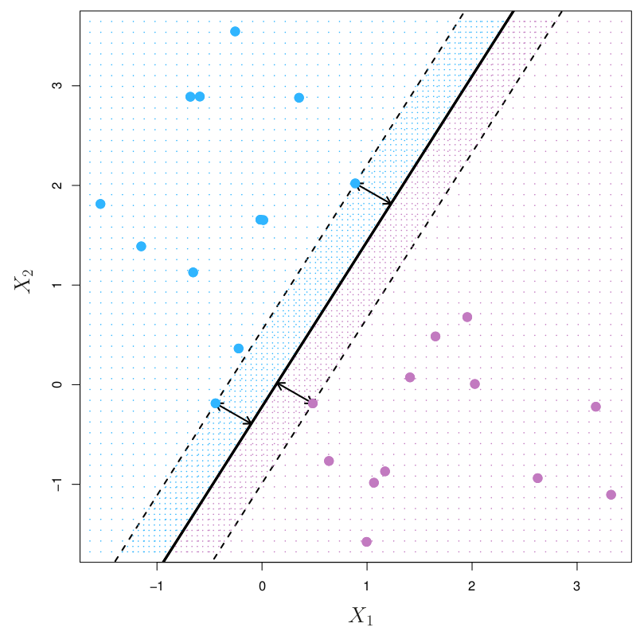{fig-alt="Blue and purple observations with the maximal margin hyperplane drawn as a solid line and the margin shown by two dashed lines on either side. Three observations, two blue and one purple, lie on the dashed lines and are the support vectors." width="100%"}

:::::

::::: {.column width="55%"}

- For a hyperplane, the *margin* is the smallest distance from any data point to the hyperplane.
- Observations that are closest are called *support vectors*.
- The *maximal margin hyperplane* is the hyperplane with the largest margin.
- The classifier built from this hyperplane is the *maximal margin classifier*.

:::::

::::::

## Issues

:::::: {.columns}

::::: {.column width="30%"}

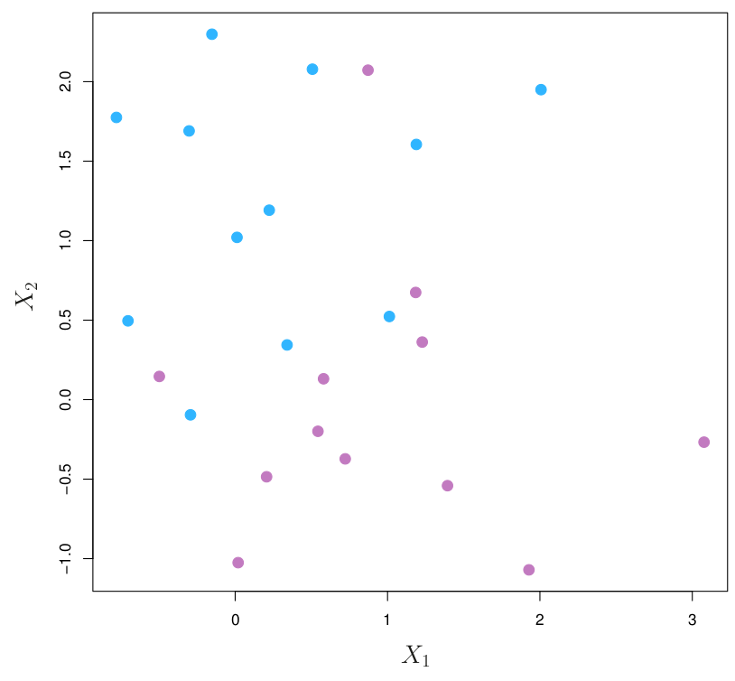{fig-alt="Blue and purple observations that overlap, so that no straight line can separate the two classes." width="100%"}

No separating hyperplane exists.

:::::

::::: {.column width="65%"}

:::::: {.columns}

::::: {.column width="48%"}

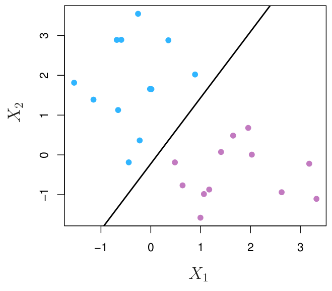{fig-alt="Blue and purple observations with the maximal margin hyperplane and its margin drawn between them." width="100%"}

:::::

::::: {.column width="48%"}

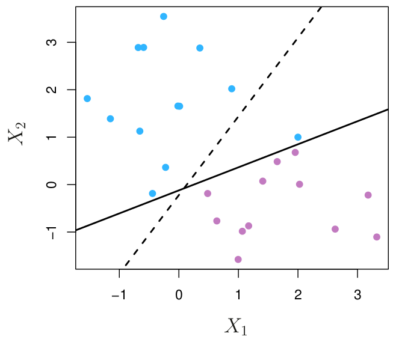{fig-alt="The same observations plus one additional blue observation, which makes the maximal margin hyperplane shift sharply and the margin become much narrower." width="100%"}

:::::

::::::

The choice of hyperplane is sensitive to new points.

:::::

::::::

## Support vector classifier

:::::: {.columns}

::::: {.column width="25%"}

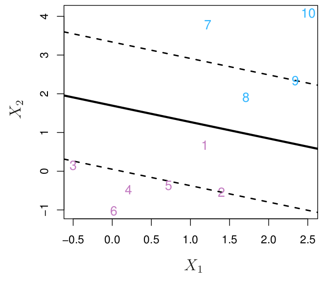{fig-alt="Blue and purple observations with a hyperplane and margin. Some observations lie on the wrong side of the margin but still on the correct side of the hyperplane." width="100%"}

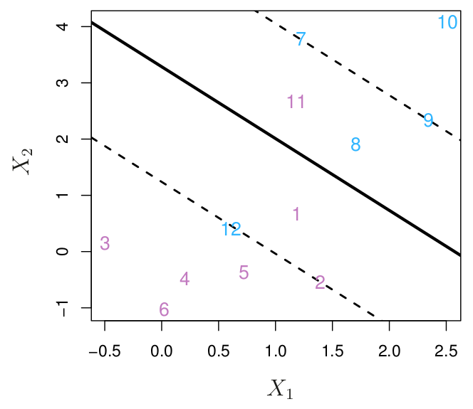{fig-alt="Blue and purple observations with a hyperplane and margin. Some observations lie on the wrong side of the hyperplane, so they are misclassified." width="100%"}

:::::

::::: {.column width="70%"}

$$
\begin{aligned}
&\underset{\beta_0, \dots, \beta_p,\, \epsilon_1, \dots, \epsilon_n,\, M}{\text{maximize}} \quad M\\
&\text{subject to} \quad \sum_{j=1}^p \beta_j^2 = 1,\\
&\qquad\qquad\;\; y_i(\beta_0 + \beta_1x_{i1} + \cdots + \beta_px_{ip}) \geq M(1-\epsilon_i),\\
&\qquad\qquad\;\; \epsilon_i \geq 0, \quad \sum_{i=1}^n \epsilon_i \leq C.
\end{aligned}
$$

*Fill in during class.*

:::::

::::::

## Two formulations side by side

:::::: {.columns}

::::: {.column width="48%"}

**Maximal margin classifier**

$$
\begin{aligned}
&\underset{\beta_0, \dots, \beta_p,\, M}{\text{maximize}} \; M\\
&\text{subject to} \; \sum_{j=1}^p \beta_j^2 = 1,\\
&\; y_i(\beta_0 + \cdots + \beta_px_{ip}) \geq M
\end{aligned}
$$

{fig-alt="Maximal margin hyperplane with its margin and three support vectors." width="50%"}

:::::

::::: {.column width="48%"}

**Support vector classifier**

$$
\begin{aligned}
&\underset{\beta_0, \dots, \beta_p,\, \epsilon_1, \dots, \epsilon_n,\, M}{\text{maximize}} \; M\\
&\text{subject to} \; \sum_{j=1}^p \beta_j^2 = 1,\\
&\; y_i(\beta_0 + \cdots + \beta_px_{ip}) \geq M(1-\epsilon_i),\\
&\; \epsilon_i \geq 0, \; \sum_{i=1}^n \epsilon_i \leq C
\end{aligned}
$$

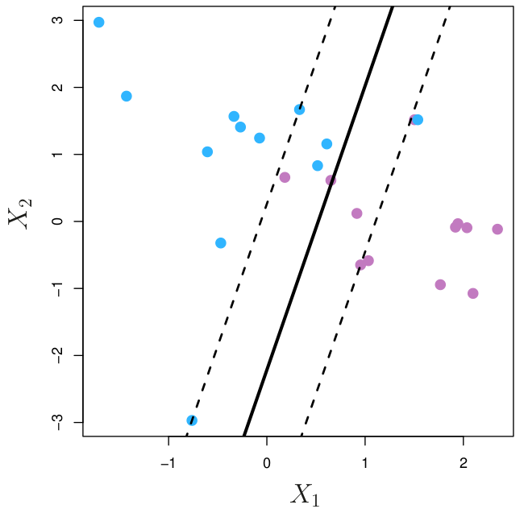{fig-alt="Support vector classifier with a margin that some observations lie on or inside." width="50%"}

:::::

::::::

## So many variables

:::::: {.columns}

::::: {.column width="48%"}

$$
\begin{aligned}
&\underset{\beta_0, \dots, \beta_p,\, \epsilon_1, \dots, \epsilon_n,\, M}{\text{maximize}} \; M\\
&\text{subject to} \; \sum_{j=1}^p \beta_j^2 = 1,\\
&\; y_i(\beta_0 + \cdots + \beta_px_{ip}) \geq M(1-\epsilon_i),\\
&\; \epsilon_i \geq 0, \; \sum_{i=1}^n \epsilon_i \leq C
\end{aligned}
$$

:::::

::::: {.column width="48%"}

- $C$ is a nonnegative tuning parameter.

    *Fill in during class.*

- $M$ is the width of the margin.
- $\epsilon_1, \dots, \epsilon_n$ are slack variables that allow observations to go to the other side.

    *Fill in during class.*

:::::

::::::

## Limiting factor of the SVC

:::::: {.columns}

::::: {.column width="48%"}

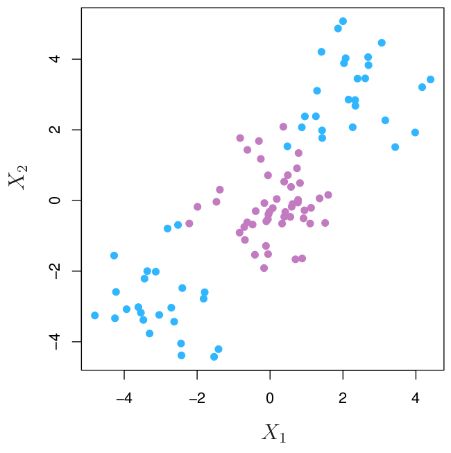{fig-alt="Two classes of observations, blue and purple, that cannot be separated by a straight line; the true boundary between them is curved." width="100%"}

:::::

::::: {.column width="48%"}

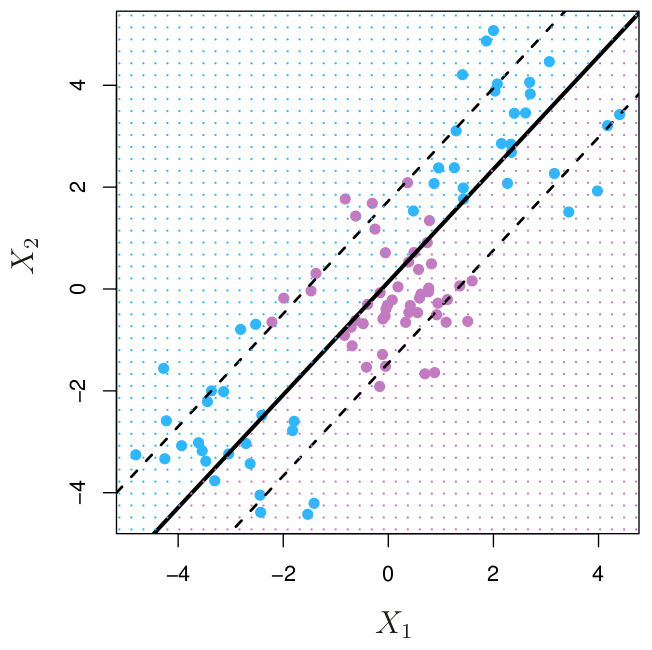{fig-alt="The same two classes with the straight-line boundary found by a support vector classifier, which misclassifies many observations." width="100%"}

:::::

::::::

*Fill in during class.*

## What will you learn today?

- How is nonlinearity introduced in a support vector machine?
    - You should be able to describe how kernels work conceptually and mathematically.
- What type of kernel makes a support vector machine equivalent to a support vector classifier?
- What other kernels are there?
- What type of kernel leads to more local behavior?
- How do you use a support vector machine in Python?
    - You should be able to fit a support vector machine using the different kernels covered in class.
    - You should be able to select the hyperparameters that optimize the bias-variance trade-off.

# Support vector machine

## How to bend the plane: polynomial features?

Want $2p$ features:
$$
X_1, X_1^2, X_2, X_2^2, \cdots, X_p, X_p^2
$$

Optimization becomes:
$$
\begin{aligned}
&\underset{\beta_0, \beta_{11}, \beta_{12}, \dots, \beta_{p1}, \beta_{p2},\, \epsilon_1, \dots, \epsilon_n,\, M}{\text{maximize}} \quad M\\
&\text{subject to} \quad \sum_{j=1}^p \sum_{k=1}^2 \beta_{jk}^2 = 1,\\
&\qquad\qquad\;\; y_i\left(\beta_0 + \sum_{j=1}^p \beta_{j1}x_{ij} + \sum_{j=1}^p \beta_{j2}x_{ij}^2\right) \geq M(1-\epsilon_i),\\
&\qquad\qquad\;\; \epsilon_i \geq 0, \quad \sum_{i=1}^n \epsilon_i \leq C.
\end{aligned}
$$

*Fill in during class.*

## Kernels: "There is no plane"

:::::: {.columns}

::::: {.column width="48%"}

$$
y_i f(x_i) \geq M(1-\epsilon_i)
$$

*Fill in during class.*

:::::

::::: {.column width="48%"}

$f(x_i)$ should give you some more general way of talking about how far the point $x_i$ is from the decision boundary.

*Fill in during class.*

:::::

::::::

## The kernel: replacing global coordinates with local similarity

:::::: {.columns}

::::: {.column width="48%"}

$$
K(x_i, x_{i'})
$$

*Fill in during class.*

:::::

::::: {.column width="48%"}

$$
y_i f(x_i) \geq M(1-\epsilon_i), \text{ where}
$$
$$
f(x) = \beta_0 + \sum_{i \in \mathcal{S}} \alpha_i K(x, x_i)
$$

*Fill in during class.*

:::::

::::::

## Inner products

$$
\langle a, b \rangle = \sum_{i=1}^r a_i b_i
$$

*Fill in during class.*

## Quick computations

What are the following?

- $\langle (1,1), (0,3) \rangle$
- $\langle (1,1), (3,2) \rangle$
- $\langle (2,3), (0,3) \rangle$
- $\langle (2,3), (3,2) \rangle$

*Fill in during class.*

## SVC via inner products

$$
f(x) = \beta_0 + \sum_{i=1}^n \alpha_i \langle x, x_i \rangle
$$

$$
f(x) = \beta_0 + \sum_{i\in\mathcal{S}} \alpha_i \langle x, x_i \rangle
$$

*Fill in during class.*

## Example

$$
-2\sqrt 2 + \frac{\sqrt{2}}{2} X_1 + \frac{\sqrt{2}}{2} X_2 = 0
$$

$$
-2\sqrt 2 + \frac{\sqrt2}{18}\langle (X_1,X_2), (0,3) \rangle + \frac{\sqrt2}{6}\langle (X_1,X_2), (3,2) \rangle = 0
$$

:::::: {.columns}

::::: {.column width="30%"}

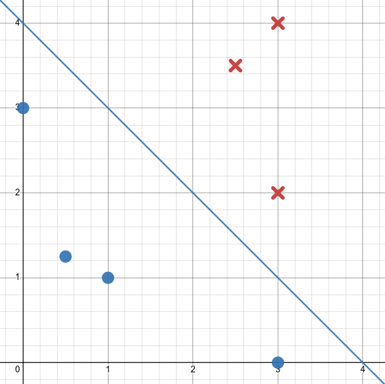{fig-alt="Scatter plot of two classes of points with the line X1 + X2 = 4 between them. The points (0,3) and (3,2), which are support vectors, are marked." width="100%"}

:::::

::::: {.column width="65%"}

*Fill in during class.*

:::::

::::::

## The kernel: more generally

:::::: {.columns}

::::: {.column width="48%"}

$$
K(x_i, x_{i'})
$$

*Fill in during class.*

:::::

::::: {.column width="48%"}

$$
f(x) = \beta_0 + \sum_{i \in \mathcal{S}} \alpha_i K(x, x_i)
$$

*Fill in during class.*

:::::

::::::

## A polynomial kernel

$$
K(x_i, x_{i'}) = \left(1 + \sum_{j=1}^p x_{ij}x_{i'j} \right)^d
$$

:::::: {.columns}

::::: {.column width="55%"}

*Fill in during class.*

:::::

::::: {.column width="35%"}

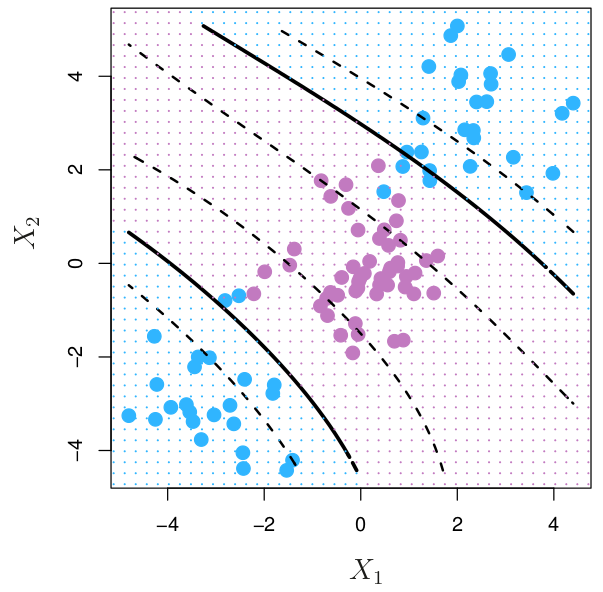{fig-alt="Two classes of observations with the curved decision boundary and margin of a support vector machine with a degree 3 polynomial kernel." width="100%"}

:::::

::::::

## A radial kernel

$$
K(x_i, x_{i'}) = \exp \left( -\gamma \sum_{j=1}^p (x_{ij} - x_{i'j})^2 \right)
$$

:::::: {.columns}

::::: {.column width="55%"}

*Fill in during class.*

:::::

::::: {.column width="35%"}

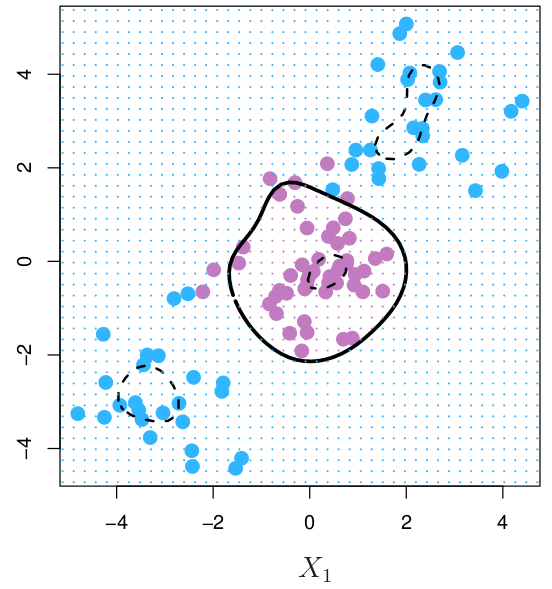{fig-alt="Two classes of observations with the curved decision boundary and margin of a support vector machine with a radial kernel." width="100%"}

:::::

::::::

## Support vector machine

$$
f(x) = \beta_0 + \sum_{i \in \mathcal{S}} \alpha_i K(x, x_i)
$$

*Fill in during class.*

## Coding

Open the **Day 32 Jupyter notebook** on the course site and work through it in class.

# SVMs with more than two classes

## One-versus-one classification

Also called all-pairs.

*Fill in during class.*

## One-versus-all classification

*Fill in during class.*

## TL;DR

:::::: {.columns}

::::: {.column width="48%"}

$$
f(x) = \beta_0 + \sum_{i \in \mathcal{S}} \alpha_i K(x, x_i)
$$

:::::

::::: {.column width="48%"}

**Kernels**

- Linear:
$$
K(x_i, x_{i'}) = \sum_{j=1}^p x_{ij}x_{i'j}
$$
- Polynomial:
$$
K(x_i, x_{i'}) = \left(1 + \sum_{j=1}^p x_{ij}x_{i'j} \right)^d
$$
- Radial:
$$
K(x_i, x_{i'}) = \exp \left( -\gamma \sum_{j=1}^p (x_{ij} - x_{i'j})^2 \right)
$$

:::::

::::::

## Next time

- Single layer neural network (Ch. 10.1)

See also the [course schedule](../../../Course_Info/Schedule.html).

## Source and reading

- Textbook reading: Ch. 9.3 and 9.4 of [*An Introduction to Statistical Learning with Applications in Python*](https://www.statlearning.com/).
- Figures are from the textbook (ISLP) unless noted.
