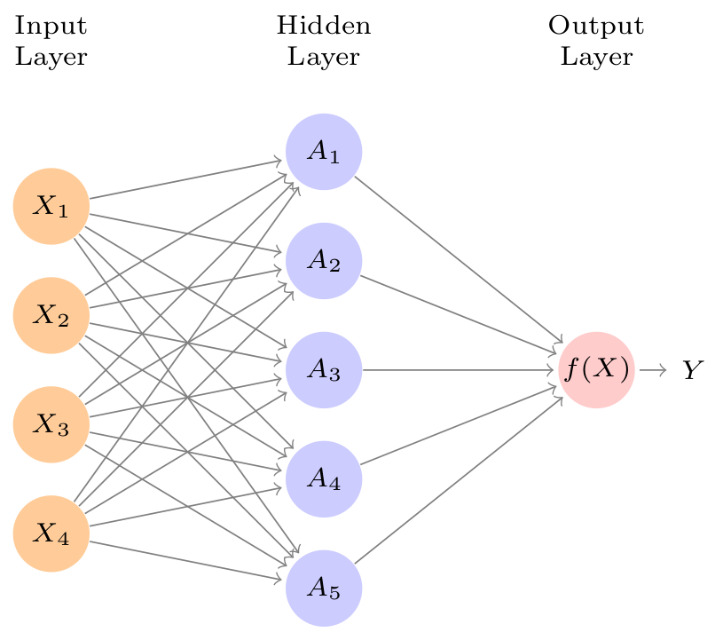
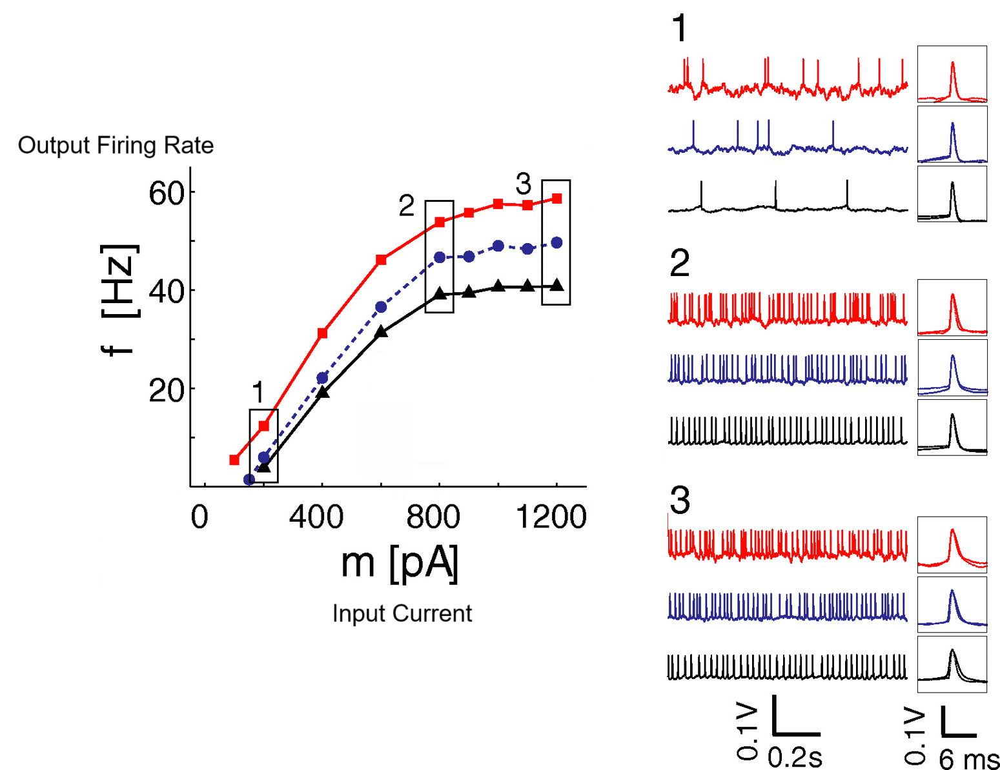
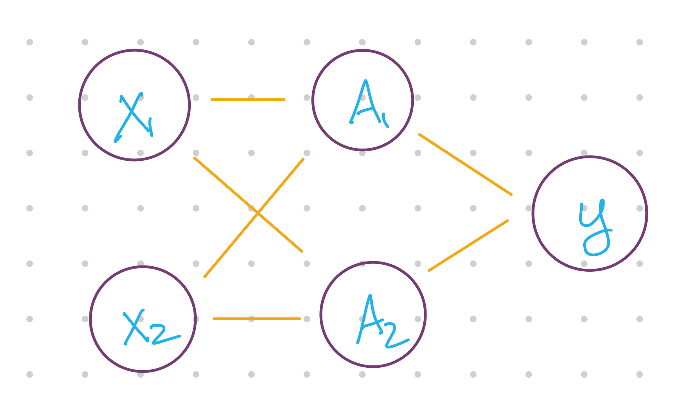
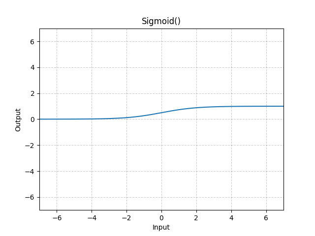
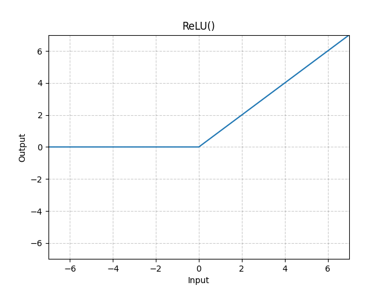

## Announcements

:::::: {.columns}

::::: {.column width="48%"}

**Last time:**

- Support vector machines

**This lecture:**

- Feed-forward neural networks

:::::

::::: {.column width="48%"}

**Announcements:**

- Homework #6 is due Fri 11/20.

See the [course schedule](../../../Course_Info/Schedule.html).

:::::

::::::

## What will you learn today?

- What is the architecture of a simple feed-forward neural network?
    - You should be able to describe what happens at each layer (input layer, hidden layer, output layer) conceptually and mathematically.
- What is an activation? What types of activation functions are there?
    - You should be able to explain it mathematically.
    - Given example inputs and the weights from the previous layer, you should be able to calculate the activation $A$ by hand (with the help of a calculator).
- How does a simple feed-forward neural network produce an output?
    - Given a $\beta$ matrix and the activations from the previous layer, you should be able to calculate the output by hand.
- What do the fitted parameters minimize in a simple feed-forward neural network?

# Neural nets

## The idea

*Fill in during class.*

## Feed-forward neural network: the cartoon

:::::: {.columns}

::::: {.column width="48%"}

{fig-alt="Diagram of a feed-forward neural network with one hidden layer. Four input units X1 to X4 on the left each have an arrow to every one of five hidden units A1 to A5 in the middle, and each hidden unit has an arrow to the single output unit Y on the right." width="100%"}

:::::

::::: {.column width="48%"}

*Fill in during class.*

:::::

::::::

## What is an activation? Neuroscience 101

{fig-alt="Figure from a neuroscience paper showing a neuron's transfer function: how the neuron's output responds as its input increases." width="55%" fig-align="center"}

Figure adapted from Fig. 1 of Arsiero et al. 2007 (*Journal of Neuroscience*).

## A very simple example: computing $A_k$ for $(1,0)$

:::::: {.columns}

::::: {.column width="48%"}

$$
A_k = h_k(X) = g\left(w_{k0} + \sum_{j=1}^p w_{kj}X_j\right)
$$

{fig-alt="Diagram of a small neural network with two input units X1 and X2, a hidden layer, and one output Y. The weights on the arrows are written next to them." width="100%"}

:::::

::::: {.column width="48%"}

*Fill in during class.*

:::::

::::::

## A very simple example: computing $Y$ for $(1,0)$

:::::: {.columns}

::::: {.column width="48%"}

$$
f(X) = \beta_0 + \sum_{k=1}^K \beta_k A_k
$$

{fig-alt="Diagram of a small neural network with two input units X1 and X2, a hidden layer, and one output Y. The weights on the arrows are written next to them." width="100%"}

:::::

::::: {.column width="48%"}

*Fill in during class.*

:::::

::::::

## A very simple example: computing $Y$ for $(0,1)$

$$
A_k = g\left(w_{k0} + \sum_{j=1}^p w_{kj}X_j\right)
\qquad
f(X) = \beta_0 + \sum_{k=1}^K \beta_k A_k
$$

:::::: {.columns}

::::: {.column width="48%"}

{fig-alt="Diagram of a small neural network with two input units X1 and X2, a hidden layer, and one output Y. The weights on the arrows are written next to them." width="100%"}

:::::

::::: {.column width="48%"}

*Fill in during class.*

:::::

::::::

## A different example

- Draw the diagram for a neural net with $p=3$ inputs (that is, $(X_1,X_2,X_3)$) and two units in the hidden layer.
- Using the $\omega$ and $\beta$ matrices, what is the predicted output $Y$ for the point $(2,0,1)$?

$$
\omega =
\begin{pmatrix}
1 & 0 & -2 & 2\\
-3 & 1 & 0 & -1
\end{pmatrix}
\qquad
\beta =
\begin{pmatrix}
-1 \\
-2 \\
1
\end{pmatrix}
$$

- Use the activation function
$$
g(z) = (z)_+ =
\begin{cases}
0 & \text{if } z<0 \\
z & \text{otherwise.}
\end{cases}
$$

## Extra space

*Fill in during class.*

## What if there is no activation function?

:::::: {.columns}

::::: {.column width="48%"}

{fig-alt="Diagram of a small neural network with two input units, two hidden units and one output unit, with an arrow from every unit in one layer to every unit in the next." width="100%"}

$$
\omega =
\begin{pmatrix}
1 & 2 & 3 \\
4 & 5 & 6
\end{pmatrix}
\qquad
\beta =
\begin{pmatrix}
-1 \\
-2 \\
1
\end{pmatrix}
$$

:::::

::::: {.column width="48%"}

*Fill in during class.*

:::::

::::::

## Choices for the activation function

:::::: {.columns}

::::: {.column width="48%"}

**Sigmoid:**
$$
g(z) = \frac{e^z}{1+e^z} = \frac{1}{1+e^{-z}}
$$

{fig-alt="Graph of the sigmoid function: an S-shaped curve that rises from 0 on the far left, passes through 0.5 at z = 0, and levels off at 1 on the right." width="100%"}

:::::

::::: {.column width="48%"}

**ReLU** (rectified linear unit):
$$
g(z) = (z)_+ =
\begin{cases}
0 & \text{if } z<0 \\
z & \text{otherwise.}
\end{cases}
$$

{fig-alt="Graph of the ReLU function: a flat line at 0 for negative z, then a straight line with slope 1 for positive z." width="100%"}

:::::

::::::

## Matrix version: first layer

:::::: {.columns}

::::: {.column width="30%"}

{fig-alt="Diagram of a small neural network with two input units X1 and X2, a hidden layer, and one output Y. The weights on the arrows are written next to them." width="100%"}

:::::

::::: {.column width="65%"}

$$
A_k = g\left(w_{k0} + \sum_{j=1}^p w_{kj}X_j\right)
$$

$$
A = g(\mathbf{W}\cdot \mathbf{X})
\qquad
\mathbf{X}^T = (1 \; X_1 \; X_2 \; \cdots \; X_p)
$$

*Fill in during class.*

:::::

::::::

## Matrix version: output

:::::: {.columns}

::::: {.column width="30%"}

{fig-alt="Diagram of a small neural network with two input units X1 and X2, a hidden layer, and one output Y. The weights on the arrows are written next to them." width="100%"}

:::::

::::: {.column width="65%"}

$$
f(X) = \beta_0 + \sum_{k=1}^K \beta_k A_k
$$

$$
Y = \beta \cdot \mathbf{A}
\qquad
\mathbf{A}^T = (1 \; A_1 \; A_2 \; \cdots \; A_K)
$$

:::::

::::::

## Now what?

Choose the parameters by minimizing the RSS, $\displaystyle\sum_{i=1}^n (y_i - f(x_i))^2$.

:::::: {.columns}

::::: {.column width="48%"}

**Chosen in advance:**

*Fill in during class.*

:::::

::::: {.column width="48%"}

**Tuned by the model:**

*Fill in during class.*

:::::

::::::

## Coding

Open the **Day 33 Jupyter notebook** on the course site and work through it in class.

## Next time

- Multi-layer neural networks (Ch. 10.2)

See also the [course schedule](../../../Course_Info/Schedule.html).

## Source and reading

- Textbook reading: Ch. 10.1 of [*An Introduction to Statistical Learning with Applications in Python*](https://www.statlearning.com/).
- Figures are from the textbook (ISLP) unless noted.
