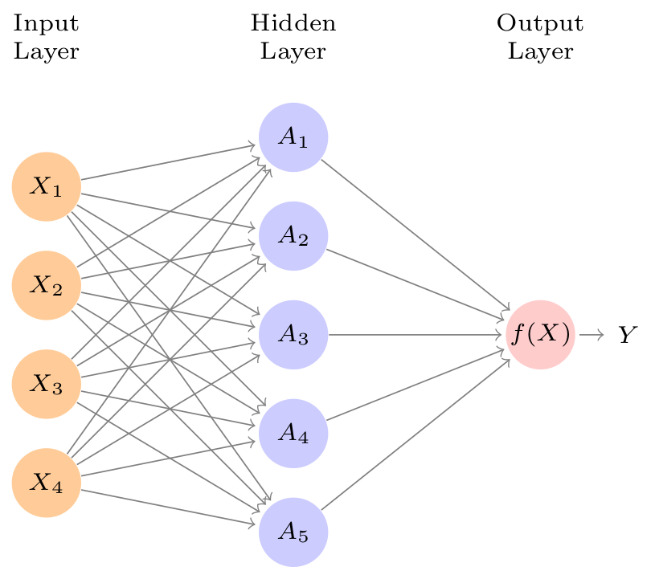
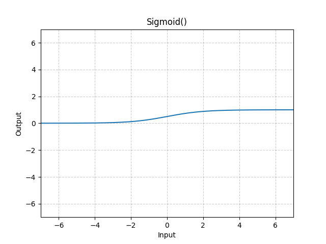
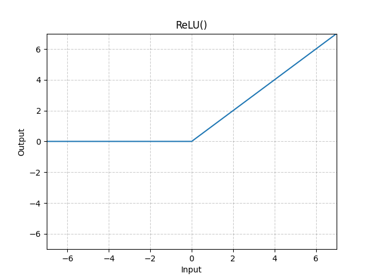
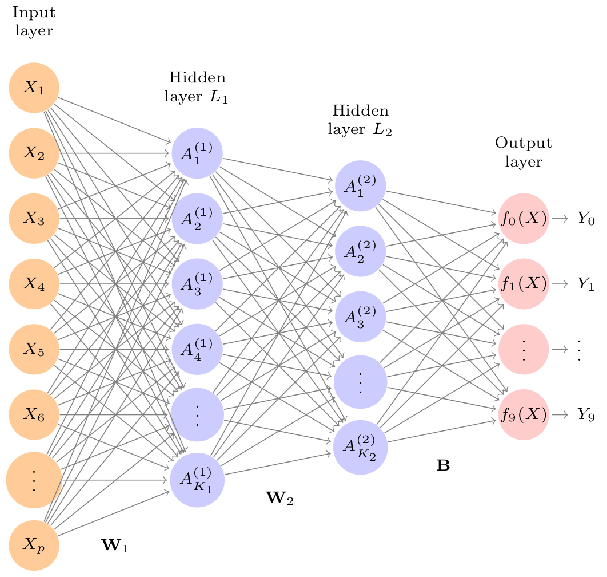
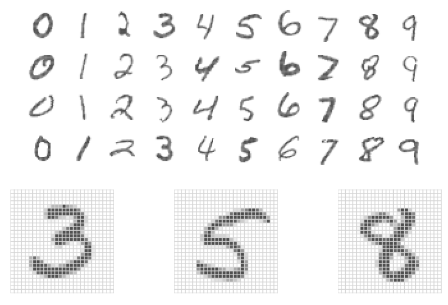

## Announcements

:::::: {.columns}

::::: {.column width="48%"}

**Last time:**

- Single-layer neural nets

**This lecture:**

- Multi-layer neural nets
- Application to MNIST

:::::

::::: {.column width="48%"}

**Announcements:**

- Homework #6 is due today.
- Midterm 3 is on Wed 12/9.
- The project is due Tue 12/15.

**The end is near!** See the [course schedule](../../../Course_Info/Schedule.html).

:::::

::::::

# Previously...

## Feed-forward neural network: the cartoon

:::::: {.columns}

::::: {.column width="48%"}

{fig-alt="Diagram of a feed-forward neural network with one hidden layer. Four input units X1 to X4 on the left each have an arrow to every one of five hidden units A1 to A5 in the middle, and each hidden unit has an arrow to the single output unit Y on the right." width="100%"}

:::::

::::: {.column width="48%"}

$$
A_k = g\left(w_{k0} + \sum_{j=1}^p w_{kj}X_j\right)
$$

$$
f(X) = \beta_0 + \sum_{k=1}^K \beta_k A_k
$$

*Fill in during class.*

:::::

::::::

## Choices for the activation function

:::::: {.columns}

::::: {.column width="48%"}

**Sigmoid:**
$$
g(z) = \frac{e^z}{1+e^z} = \frac{1}{1+e^{-z}}
$$

{fig-alt="Graph of the sigmoid function: an S-shaped curve that rises from 0 on the far left, passes through 0.5 at z = 0, and levels off at 1 on the right." width="100%"}

:::::

::::: {.column width="48%"}

**ReLU** (rectified linear unit):
$$
g(z) = (z)_+ =
\begin{cases}
0 & \text{if } z<0 \\
z & \text{otherwise.}
\end{cases}
$$

{fig-alt="Graph of the ReLU function: a flat line at 0 for negative z, then a straight line with slope 1 for positive z." width="100%"}

:::::

::::::

## Matrix version

:::::: {.columns}

::::: {.column width="30%"}

{fig-alt="Diagram of a small neural network with two input units X1 and X2, a hidden layer, and one output Y. The weights on the arrows are written next to them." width="100%"}

:::::

::::: {.column width="65%"}

$$
A_k = g\left(w_{k0} + \sum_{j=1}^p w_{kj}X_j\right)
$$

$$
A = g(\mathbf{W}\cdot \mathbf{X})
\qquad
\mathbf{X}^T = (1 \; X_1 \; X_2 \; \cdots \; X_p)
$$

Then the output:

$$
f(X) = \beta_0 + \sum_{k=1}^K \beta_k A_k
$$

$$
Y = \beta \cdot \mathbf{A}
\qquad
\mathbf{A}^T = (1 \; A_1 \; A_2 \; \cdots \; A_K)
$$

:::::

::::::

## Training the model

Choose the parameters by minimizing the RSS, $\displaystyle\sum_{i=1}^n (y_i - f(x_i))^2$ (or another loss function).

:::::: {.columns}

::::: {.column width="48%"}

**Chosen in advance:**

*Fill in during class.*

:::::

::::: {.column width="48%"}

**Tuned by the model:**

*Fill in during class.*

:::::

::::::

## What will you learn today?

- What is the architecture of a multi-layer neural network?
    - You should be able to describe what happens at each layer mathematically for a typical classification problem.
    - You should be able to calculate class probabilities for the output layer using softmax.
- How do you classify images using multi-layer neural networks in Python?

# Multi-layer neural networks

## Multiple layers

:::::: {.columns}

::::: {.column width="48%"}

{fig-alt="Diagram of a neural network with two hidden layers. A column of input units is on the left, then a first hidden layer with 256 units, then a second hidden layer with 128 units, then an output layer of 10 units on the right. Every unit has an arrow to every unit in the next layer." width="100%"}

:::::

::::: {.column width="48%"}

*Fill in during class.*

:::::

::::::

## More typical for image classification

:::::: {.columns}

::::: {.column width="48%"}

Example: MNIST

{fig-alt="A grid of example handwritten digits from the MNIST data set. Each is a small grayscale image of one digit from 0 to 9." width="100%"}

:::::

::::: {.column width="48%"}

*Fill in during class.*

:::::

::::::

## Hidden layers

:::::: {.columns}

::::: {.column width="35%"}

{fig-alt="Diagram of a neural network with two hidden layers of 256 and 128 units and an output layer of 10 units." width="100%"}

:::::

::::: {.column width="60%"}

First hidden layer:
$$
A^{(1)}_k = g\left(w^{(1)}_{k0} + \sum_{j=1}^p w^{(1)}_{kj}X_j\right), \quad k = 1, \dots, K_1
$$

Second hidden layer:
$$
A^{(2)}_l = g\left(w^{(2)}_{l0} + \sum_{k=1}^{K_1} w^{(2)}_{lk}A^{(1)}_k\right), \quad l = 1, \dots, K_2
$$

*Fill in during class.*

:::::

::::::

## More on that architecture

:::::: {.columns}

::::: {.column width="30%"}

{fig-alt="Diagram of a neural network with two hidden layers of 256 and 128 units and an output layer of 10 units." width="100%"}

:::::

::::: {.column width="65%"}

$$
A^{(1)}_k = g\left(w^{(1)}_{k0} + \sum_{j=1}^p w^{(1)}_{kj}X_j\right)
$$

$$
A^{(2)}_l = g\left(w^{(2)}_{l0} + \sum_{k=1}^{K_1} w^{(2)}_{lk}A^{(1)}_k\right)
$$

*Fill in during class.*

:::::

::::::

## Matrix version: first layer

:::::: {.columns}

::::: {.column width="30%"}

{fig-alt="Diagram of a neural network with two hidden layers of 256 and 128 units and an output layer of 10 units." width="100%"}

:::::

::::: {.column width="65%"}

$$
A^{(1)}_k = g\left(w^{(1)}_{k0} + \sum_{j=1}^p w^{(1)}_{kj}X_j\right)
$$

$$
A^{(1)} = g\left(\mathbf{W}^{(1)}\cdot \mathbf{X}\right)
\qquad
\mathbf{X}^T = (1 \; X_1 \; X_2 \; \cdots \; X_p)
$$

:::::

::::::

## Matrix version: second layer

:::::: {.columns}

::::: {.column width="30%"}

{fig-alt="Diagram of a neural network with two hidden layers of 256 and 128 units and an output layer of 10 units." width="100%"}

:::::

::::: {.column width="65%"}

$$
A^{(2)}_l = g\left(w^{(2)}_{l0} + \sum_{k=1}^{K_1} w^{(2)}_{lk}A^{(1)}_k\right)
$$

$$
A^{(2)} = g\left(\mathbf{W}^{(2)}\cdot \mathbf{A}^{(1)}\right)
\qquad
(\mathbf{A}^{(1)})^T = (1 \; A^{(1)}_1 \; A^{(1)}_2 \; \cdots \; A^{(1)}_{K_1})
$$

:::::

::::::

## Matrix version: last layer, first step

:::::: {.columns}

::::: {.column width="30%"}

{fig-alt="Diagram of a neural network with two hidden layers of 256 and 128 units and an output layer of 10 units." width="100%"}

:::::

::::: {.column width="65%"}

$$
Z_m = \beta_{m0} + \sum_{l=1}^{K_2} \beta_{ml}A^{(2)}_l, \quad m = 0, 1, \dots, 9
$$

$$
\mathbf{Z} = \beta \cdot \mathbf{A}^{(2)}
$$

$$
\beta \text{ is an } M \times (K_2+1) \text{ matrix}
\qquad
(\mathbf{A}^{(2)})^T = (1 \; A^{(2)}_1 \; A^{(2)}_2 \; \cdots \; A^{(2)}_{K_2})
$$

*Fill in during class.*

:::::

::::::

## The last layer for classification: softmax

:::::: {.columns}

::::: {.column width="30%"}

{fig-alt="Diagram of a neural network with two hidden layers of 256 and 128 units and an output layer of 10 units." width="100%"}

:::::

::::: {.column width="65%"}

$$
f_m(X) = \Pr(Y = m \mid X) = \frac{e^{Z_m}}{\sum_{\ell=0}^{9} e^{Z_\ell}}, \quad m = 0, 1, \dots, 9
$$

*Fill in during class.*

:::::

::::::

## An example

:::::: {.columns}

::::: {.column width="48%"}

$$
f_m(X) = \frac{e^{Z_m}}{\sum_{\ell} e^{Z_\ell}}
$$

(Here there are 5 classes, so the sum runs over the 5 entries of $Z$.)

$$
Z = \begin{pmatrix} 1 & 3 & -1 & 2 & 5 \end{pmatrix}
$$

:::::

::::: {.column width="48%"}

*Fill in during class.*

:::::

::::::

## MNIST

:::::: {.columns}

::::: {.column width="48%"}

{fig-alt="A grid of example handwritten digits from the MNIST data set. Each is a small grayscale image of one digit from 0 to 9." width="100%"}

:::::

::::: {.column width="48%"}

*Fill in during class.*

:::::

::::::

## Coding

Open the **Day 34 Jupyter notebook** on the course site and work through it in class.

## TL;DR

:::::: {.columns}

::::: {.column width="48%"}

**Feed-forward neural net**

{fig-alt="Diagram of a neural network with two hidden layers of 256 and 128 units and an output layer of 10 units." width="50%"}

$$
A_k = g\left(w_{k0} + \sum_{j=1}^p w_{kj}X_j\right)
$$

- Combines the input data using learned weights.
- Takes a linear combination of those to get the output.
- Sometimes uses softmax to get the probability of each class.

:::::

::::::

## Next time

- Convolutional neural networks (CNN, Ch. 10.3)

See also the [course schedule](../../../Course_Info/Schedule.html).

## Source and reading

- Textbook reading: Ch. 10.2 of [*An Introduction to Statistical Learning with Applications in Python*](https://www.statlearning.com/).
- Figures are from the textbook (ISLP) unless noted.
